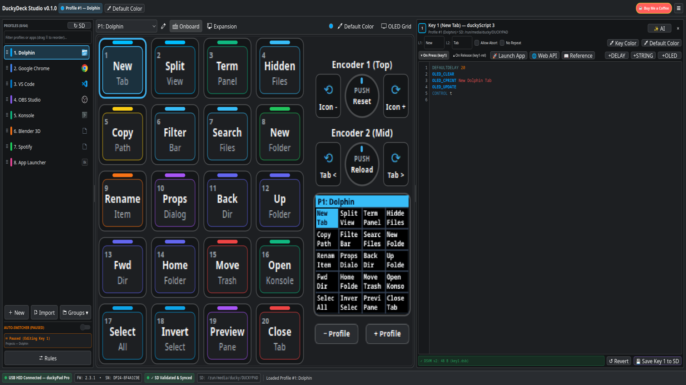
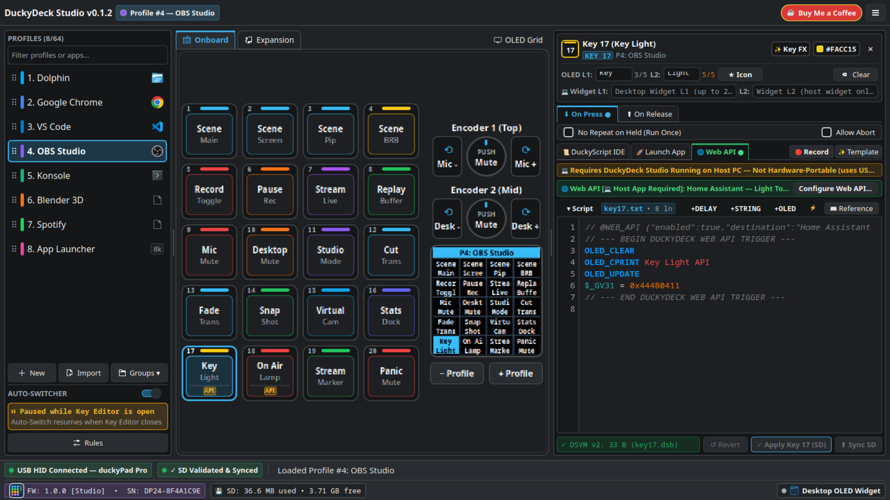
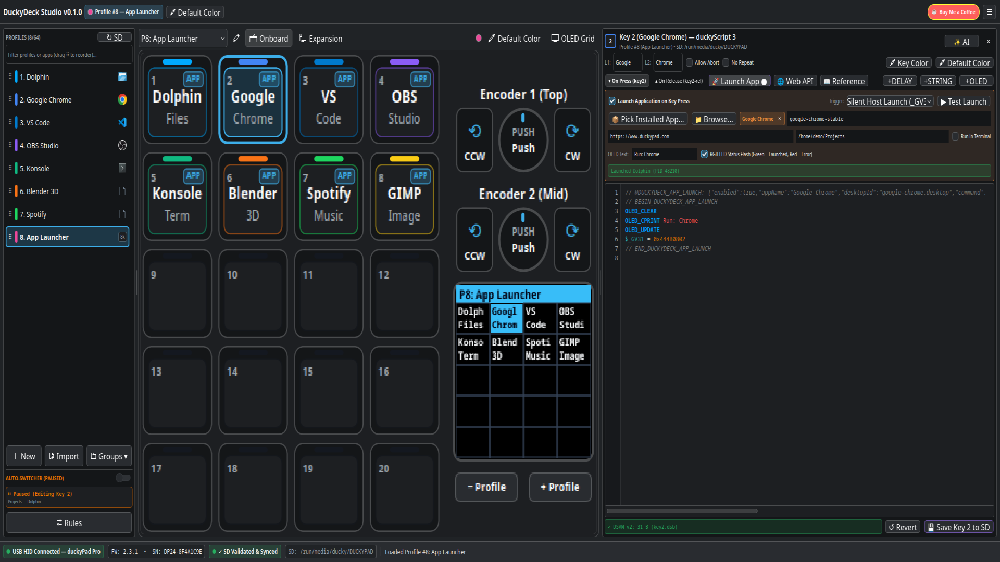
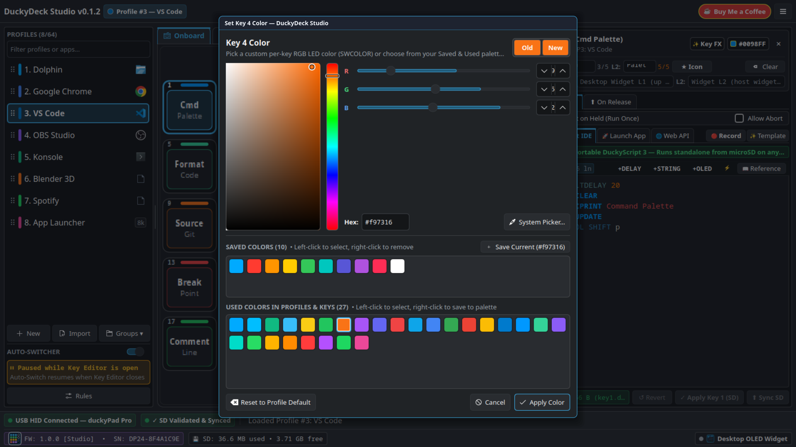
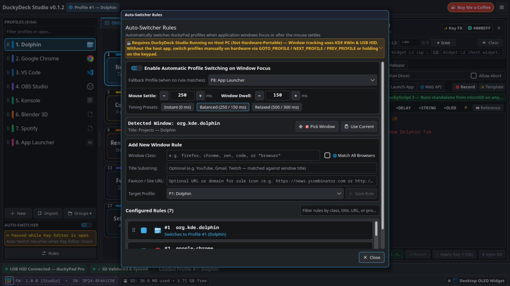
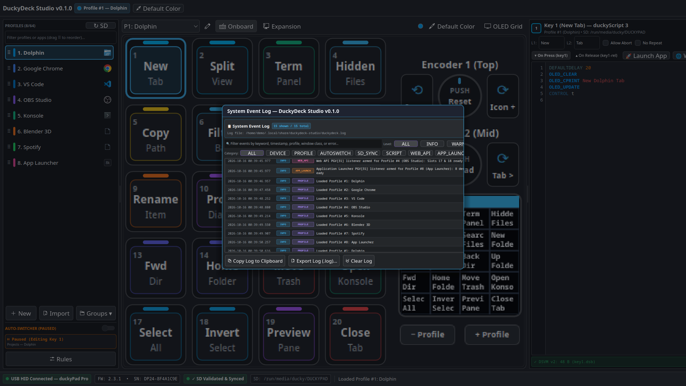

#  DuckyDeck Studio

[](https://duckydeckstudio.com/releases/duckydeck-studio-v0.1.3-linux-x86_64.tar.gz)
[](https://duckydeckstudio.com/releases/duckydeck-studio-v0.1.3-x86_64.flatpak)
[](https://github.com/russellmilliner/duckydeck-studio/releases/tag/fw-v1.0.0)
[](https://duckydeckstudio.com)
[](https://duckydeckstudio.com/architecture.html)
[](https://github.com/russellmilliner/duckydeck-studio)
[](https://ko-fi.com/russellmilliner)
[](https://www.duckypad.com)
[](https://www.tindie.com/stores/dekunukem/)
[](https://www.gnu.org/licenses/gpl-3.0)
[](https://kde.org/)

**DuckyDeck Studio (`v0.1.3`)** is a native Linux desktop configurator, **DSVM v2 bytecode compiler**, **KDE Plasma 6 Wayland Auto-Switcher**, and **Macro Template Generator (experimental)** for the **duckyPad Pro (`0x0483:0xd11d`)** and **duckyPad 2020 (`0x0483:0xd11c`)**, built with **Rust**, **CXX-Qt 0.7**, and **KDE Frameworks 6 (Kirigami + KSyntaxHighlighting)**.

> 🏷️ **Current Version:** **DuckyDeck Studio `v0.1.3`** · **Custom Firmware `v1.0.0`** · **KDE Plasma 6 Applet `v1.0.2`**
>
> 🌐 **Official Website & Online Documentation:** **[https://duckydeckstudio.com](https://duckydeckstudio.com)** · **[Architecture Reference (`architecture.html`)](https://duckydeckstudio.com/architecture.html)**
>
> 💻 **GitHub Repository & Releases:** **[https://github.com/russellmilliner/duckydeck-studio](https://github.com/russellmilliner/duckydeck-studio)** · **[Flatpak Bundle (`v0.1.3`)](https://duckydeckstudio.com/releases/duckydeck-studio-v0.1.3-x86_64.flatpak)** · **[Linux x86_64 Tarball (`v0.1.3`)](https://duckydeckstudio.com/releases/duckydeck-studio-v0.1.3-linux-x86_64.tar.gz)**
>
> ☕ **Enjoying DuckyDeck Studio?** Support development by buying Russell Milliner a coffee on Ko-fi: **[https://ko-fi.com/russellmilliner](https://ko-fi.com/russellmilliner)**
>
> 🙏 **Special Thanks to [dekuNukem](https://github.com/dekuNukem)** for creating the **[duckyPad & duckyPad Pro](https://www.duckypad.com)**! Get official hardware and accessories at **[dekuNukem's Official Tindie Store](https://www.tindie.com/stores/dekunukem/)**.

---

## 🎬 Video Demo & Screenshots

- 🎥 **[Watch the Full 1080p Application Demo Video (`docs/duckydeck-studio-demo.mp4`)](docs/duckydeck-studio-demo.mp4)**

| Dolphin File Manager & DSVM v2 IDE | OBS Studio & Web API Webhook Builder |
| :---: | :---: |
|  |  |
| **Desktop Application Launcher** | **Custom Key Color Picker & Palettes** |
|  |  |
| **KWin Wayland Auto-Switcher Rules** | **Live System Event Log** |
|  |  |

---

## ✨ Key Features

- **🎹 Interactive Hardware Canvas & 128×128 OLED Simulator:**
  - Full visual editor for the **20-key RGB matrix (4×5)**, **Dual Rotary Encoders (Slots 21–26)**, and **32-channel Expansion Modules (Slots 27–58)**.
  - **Header-Footer Split Keycap Layout:** Each keycap features a dedicated top header with its compact key number (`1..20`) next to a pill-shaped RGB LED color bar, a centered 2-line OLED label preview with automatic icon scaling, and a bottom footer strip displaying `APP`/`API` host badges and `↻`/`⏹` execution indicators with zero text overlap up to `115%+` UI zoom.
  - Drag-and-drop keys to **swap** slots, or hold <kbd>Shift</kbd> while dragging to **insert & shift** keys.
  - Live 128×128 monochrome OLED display simulator supporting both the 4×5 key label grid and custom `OLED_LINE` / `OLED_RECT` / `OLED_CIRCLE` / `OLED_PRINT` drawing scripts.
  - Right-click any keycap to **Copy**, **Paste** (across keys and profiles), **Set Key X Color**, or **Clear / Reset**.
- **🎨 Custom Color Picker with Saved & Used Palettes:**
  - Interactive 2D Saturation/Value color square, vertical Hue slider, R/G/B (`0–255`) sliders & spinboxes, `#RRGGBB` hex input, and native OS eyedropper integration.
  - **Saved Colors Palette:** Pin your favorite RGB colors to a persistent palette (`~/.config/duckydeck-studio/kwin_rules.json`).
  - **Used Colors Palette:** Automatically scans and displays every unique color currently used in any profile (`BG_COLOR`) or key (`SWCOLOR`) for 1-click reuse.
- **📜 Built-In duckyScript 3 IDE & DSVM v2 Bytecode Compiler:**
  - Pure-Rust two-pass compiler that compiles `duckyScript 3` (`keyN.txt` & `keyN-release.txt`) directly into **DSVM v2 (`.dsb`)** bytecode binaries.
  - Live syntax verification with byte count & exact error line reporting, KDE `KSyntaxHighlighting`, and a searchable **Command Reference Drawer**.
- **🚀 Launch Application Builder (No-Code Desktop App Launcher):**
  - Search installed Linux desktop applications (`.desktop` entries from system, user, and Flatpak directories with icons and categories) or configure custom CLI commands, arguments, working directories, and terminal execution.
  - Triggers instantaneously over USB HID via Persistent Global Variable `_GV31` (`encode_pgv31_trigger`, no keyboard shortcut conflicts!) or via `F13–F24` global hotkeys (`evdev`).
- **🌐 Web API / Webhook Builder & 🏠 Home Assistant Entity Search:**
  - Trigger HTTP `GET`, `POST`, `PUT`, `PATCH`, and `DELETE` requests (Home Assistant, Miniflux, OBS, custom webhooks) with custom headers and JSON bodies directly from any duckyPad key via USB HID (`_GV31`) or `F13–F24`.
  - **Built-in Home Assistant Web API Browser:** Connect to your Home Assistant instance (`base_url` + Long-Lived Access Token) to search devices and entities across domains (`light`, `switch`, `scene`, `script`, `automation`, `button`, `input_boolean`, `media_player`, `cover`, `fan`, `climate`, `lock`) and bind `toggle` / `turn_on` / `turn_off` / `trigger` service calls to any key in one click.
  - **🔔 Profile Change Webhooks:** Automatically fire a per-profile HTTP webhook (configured in **Profile Properties**) and/or a global profile-change webhook (configured in **Settings**) whenever the active profile changes via UI, hardware buttons, Window Auto-Switcher, or the REST API, with template placeholders (`{{profile_number}}`, `{{profile_name}}`, `{{previous_profile_number}}`, `{{previous_profile_name}}`, `{{source}}`, `{{device_serial}}`, `{{timestamp}}`).
- **🔌 Built-In HTTP REST API Server (`/api/v1/*`) for Remote Control & Programming:**
  - Optional embedded HTTP/1.1 REST API server configurable in **Settings → HTTP REST API Server** (defaults to `127.0.0.1:28491`, disabled by default, with 160-bit `ddk_...` Bearer token authentication) for controlling and programming every function of the duckyPad remotely (switching/creating/editing/deleting profiles, programming key labels/colors/icons/scripts, reading/writing `_GV0.._GV31`, setting LEDs/OLED, triggering slots, and syncing to microSD).
- **🪟 KDE Plasma 6 Wayland Auto-Switcher & Protected Fallback Profile:**
  - Pure-Rust `zbus` D-Bus listener integrated with KWin Wayland to automatically switch duckyPad hardware profiles when you focus different applications or browser tabs.
  - **Automatic Rule & Fallback Synchronization:** New profile groups always create a Default Fallback Profile (`★ FALLBACK`) that is protected from deletion. Reordering profiles automatically updates all Auto-Switcher rule bindings, and deleting a profile automatically reassigns any rules referencing it to the Fallback Profile.
  - Includes a **🎯 Crosshair Window Picker** to bind any open window or web app tab in one click, inline `✕` filter clear buttons, hover tooltips for drag-and-drop reordering, and automatic pausing while the Key Editor is open.
- **💾 Offline Profile Cache, Diff Summary & Validated microSD Sync:**
  - Edits are saved immediately to a local per-device cache (`~/.local/share/duckydeck-studio/profiles_cache/`).
  - Inspect a detailed **Unsynced Changes Summary** before syncing, then write, flush, and verify `.dsb` bytecode and `config.txt` files on the duckyPad microSD card.
  - **Portable `duckydeck_rules.json` microSD Persistence:** Syncs your KWin Wayland auto-switcher rules directly onto the microSD card root alongside hardware profiles so your window bindings travel with your duckyPad across computers.
  - Export and import individual profiles (`.duckyprofile.json` or folder) or complete **Profile Groups (`.duckygroup.json`)**.
- **🧙‍♂️ First-Run Deck Setup & Legacy dekuNukem Migration:**
  - Automatically detects unconfigured or fresh decks and discovers legacy profiles and auto-switcher rules from existing dekuNukem installations (`~/.local/share/duckypad_config/profile_backups/` and `~/.local/share/duckypad_autoswitcher/`).
  - Detects running legacy background daemons (`duckypad_autoprofile.py`, `duckypad_autoswitcher`, `duckypad_configurator`) and provides 1-click graceful termination to prevent USB HID bus contention.
- **🔢 Live PGV Inspector (`_GV0`..`_GV31`) & ✨ Macro Template Generator (experimental):**
  - Read and write all 32 non-volatile 32-bit Persistent Global Variables (`_GV0.._GV31`) over USB HID (`0x18`/`0x19`) in Signed, Unsigned, or Hex format.
  - Generate duckyScript 3 macro templates from your local KDE shortcuts (`~/.config/kglobalshortcutsrc`), converting KDE key sequences directly into duckyScript 3 key combos.
- **📋 System Event Log, Global UI Zoom (`Ctrl++`/`Ctrl+-`), High-Contrast Controls & System Tray:**
  - Built-in **System Event Log** (`DEVICE`, `PROFILE`, `AUTOSWITCH`, `SD_SYNC`, `SCRIPT`, `WEB_API`, `APP_LAUNCH`, `SYSTEM`) with search, category/severity filters, and file export.
  - Global UI text zoom (`75%–160%`, minimum `10pt` base font) with standard <kbd>Ctrl</kbd>+<kbd>+</kbd>, <kbd>Ctrl</kbd>+<kbd>=</kbd>, <kbd>Ctrl</kbd>+<kbd>-</kbd>, and <kbd>Ctrl</kbd>+<kbd>0</kbd> shortcuts persisted across restarts, high-contrast checkboxes and scrollbars in Dark and Light modes, and a dynamic KDE `StatusNotifierItem` System Tray icon with quick access to **Show / Hide**, **Toggle Desktop OLED Widget**, **Auto-Switcher**, **Autostart**, and **About DuckyDeck Studio**.
- **🗂️ Reusable Profile Templates:**
  - Create new profiles from built-in templates (*Blank*, *Media & Streaming*, *IDE & Developer*, *Desktop App & Web API Launcher*) or copy any existing profile into a reusable custom template (`~/.config/duckydeck-studio/profile_templates.json`).
- **🖥️ Desktop OLED Companion Widget & Instant 4-Way Rotated Key Labels (`0° / 90° / 180° / 270°`):**
  - Floating, multi-monitor-aware desktop replica of the duckyPad OLED screen (plus a companion KDE Plasma 6 Applet in `plasmoid/io.github.duckydeck.oled`) with persistent screen/position/transparency settings, optional 24-character extended labels (`wzN`/`wxN`), and independent **Desktop Widget Orientation** (`Follow OLED`, `0°`, `90°`, `180°`, `270°`) configurable per profile in **Profile Properties** that rotates both the key grid positions and the text inside each key immediately without requiring a microSD card sync.
- **🔧 DuckyDeck Studio Firmware `v1.0.0` & Official Firmware Catalog Downloader:**
  - Custom firmware build (`v1.0.0`, badged with the DuckyDeck Studio icon in the status bar) supporting `0°`, `90°`, `180°`, and `270°` hardware OLED orientations and crisp 1-bit monochrome key icons.
  - **Official Firmware Catalog Downloader:** Fetch the list of official dekuNukem firmwares directly inside the **Firmware Manager** window, download `.bin` images with IEEE CRC32 verification, and install them in one click.

---

## ⚠️ Hardware Portability vs. Host-Dependent Capabilities

DuckyDeck Studio clearly badges capabilities in the UI as either **✅ Hardware-Portable** (compiled to the microSD card and executed autonomously by the duckyPad on any computer) or **💻 Requires DuckyDeck Studio Running on Host PC (Not Hardware-Portable)**:

| Capability / Feature | Portability | How It Works & What Happens Without DuckyDeck Studio |
| :--- | :--- | :--- |
| **Standard DuckyScript 3 Macros** (`STRING`, `KEYDOWN`, `DELAY`, `MOUSE_MOVE`, `LMOUSE`, loops, `IF`/`WHILE`) | ✅ **Hardware-Portable** | Compiles to `.dsb` bytecode on the microSD card. Works on **any PC/OS** with zero host software installed. |
| **Static Profile & Key RGB Colors** (`BG_COLOR`, `SWCOLOR`, `KEYDOWN_COLOR`, `DIM_UNUSED_KEYS`) | ✅ **Hardware-Portable** | Stored in `config.txt` on the microSD card and rendered directly by duckyPad hardware. |
| **Embedded Key Script RGB Animations** (`SWC_SET`, `SWC_FILL`, `SWC_RESET`) | ✅ **Hardware-Portable** | Compiled directly into `keyN.dsb` bytecode on the microSD card; runs standalone on hardware. |
| **5-Char Physical OLED Key Labels (`zN` / `xN`) & `OLED_*` Script Graphics** | ✅ **Hardware-Portable** | Stored on microSD and rendered by the physical 128×128 OLED display. |
| **Physical OLED Orientation (`0° / 90° / 180° / 270°`) & Monochrome Icons** | ✅ **Hardware-Portable** *(180°/270° & icons require DuckyDeck Studio Firmware v1.0.0)* | Stored in `config.txt` (`IS_LANDSCAPE` / `OLED_ROTATION`) and rendered on the hardware OLED screen. |
| **Manual Profile Switching** (`GOTO_PROFILE`, `NEXT_PROFILE`, `PREV_PROFILE`, `+`/`-` button hold) | ✅ **Hardware-Portable** | Handled natively on the duckyPad hardware. |
| **🚀 Launch Desktop Application (`APP` badge)** | 💻 **Requires DuckyDeck Studio Running** | Triggered over USB HID (`_GV31`) or `evdev` (`F13–F24`) by the DuckyDeck Studio host process. **Will not launch apps if DuckyDeck Studio is closed or on another PC.** |
| **🌐 Web API / HTTP Webhooks & Home Assistant Triggers (`API` badge)** | 💻 **Requires DuckyDeck Studio Running** | Outbound HTTP requests are dispatched by DuckyDeck Studio on the host PC. **The duckyPad hardware has no network stack and cannot fire webhooks standalone.** |
| **🔔 Profile Change Webhooks (Per-Profile & Global)** | 💻 **Requires DuckyDeck Studio Running** | Fired by DuckyDeck Studio when a profile switch is initiated or detected on the host PC. Does not require a microSD card sync. |
| **🔌 HTTP REST API Server (`/api/v1/*`)** | 💻 **Requires DuckyDeck Studio Running** | Hosted by the DuckyDeck Studio process (`127.0.0.1:28491` by default). |
| **🪟 KWin Wayland Active-Window Auto-Switcher** | 💻 **Requires DuckyDeck Studio Running** | Uses KDE Plasma 6 KWin D-Bus tracking on the host PC to send USB HID profile-switch commands. Without the host app, switch profiles manually on the keypad. |
| **🖥️ Desktop OLED Widget, 24-Char Extended Widget Labels (`wzN`/`wxN`) & Widget Orientation (`DW_ROTATION`)** | 💻 **Requires DuckyDeck Studio Running** | Displayed on your computer monitor by DuckyDeck Studio; orientation changes apply immediately without requiring a microSD card sync. |
| **✨ Live USB HID RGB Animation Streaming** | 💻 **Requires DuckyDeck Studio Running** | Streams RGB frames over USB HID (`0x14`) from DuckyDeck Studio. Use the *"Embed standalone DuckyScript 3 SWC_SET"* option if you want portable on-device key lighting. |

---

## 🔧 DuckyDeck Studio Firmware (`v1.0.0`) vs. Standard Firmware (`3.3.5`)

**DuckyDeck Studio Firmware `v1.0.0` (`DPP_FW_1.0.0_ad2acc81.bin`)** is an optional, 100% backwards-compatible custom firmware build for **duckyPad Pro (2024)**. All existing `.dsb` bytecode scripts, profiles, and official features work identically to upstream firmware `3.3.5`, while unlocking the following hardware enhancements:

- **📦 Download from GitHub Releases:** [`DPP_FW_1.0.0_ad2acc81.bin` (`v1.0.0`)](https://github.com/russellmilliner/duckydeck-studio/releases/tag/fw-v1.0.0) *(place in `firmware/releases/` locally or download directly inside the app's Firmware Manager)*
- **🌐 Direct Website Download:** [`https://duckydeckstudio.com/firmware/DPP_FW_1.0.0_ad2acc81.bin`](https://duckydeckstudio.com/firmware/DPP_FW_1.0.0_ad2acc81.bin)
- **🔢 Checksums:** IEEE CRC32 `ad2acc81` · SHA-256 `d558e6b20d6add543822837acec73e2900a1823f7522b13c03ee44c9de7647dd`

| Feature / Capability | Standard Firmware (`3.3.5`) | DuckyDeck Studio Firmware (`1.0.0`) |
| :--- | :--- | :--- |
| **1-Bit Monochrome OLED Key Icons** (`oled_icons.c` / `ui_task.c`) | ❌ ASCII text only (`0x20..0x7E`); Unicode/emoji symbols are stripped or ignored on hardware. | ✅ **3-Tier Crisp Pixel-Art Icon Rendering** (`35+` built-in icons across Media, Dev, Arrows, System, Browser & Editing):<br>• **Full-Cell `16×16` Icon**: Centered in the key box when Line 1 is a single icon and Line 2 is empty.<br>• **Top-Line `10×10` Icon + Caption**: Centered `10×10` icon on Line 1 above a `7×10` or `6×8` text label on Line 2.<br>• **Inline `7×10` / `6×8` Glyphs**: Mixed inline with ASCII text labels. |
| **UTF-8 Key Label Decoding & Buffer Size** (`profiles.h` / `profiles.c`) | ❌ `KEYNAME_SIZE = 8` bytes with raw byte truncation (`str[5] = 0`), which slices multi-byte UTF-8 characters. | ✅ **Expanded `KEYNAME_SIZE = 24` bytes** with glyph-aware UTF-8 truncation (`oled_utf8_truncate_glyphs` — 5 glyphs in `0°/180°`, 4 glyphs in `90°/270°`). Reads `ui_z<N>` / `ui_x<N>` directives for icons while keeping `z<N>` / `x<N>` ASCII fallbacks for backwards compatibility. |
| **Physical OLED Screen Orientations** (`ssd1306.c` / `ui_task.c`) | ⚠️ **2 Orientations Only**: `0°` Standard Portrait (`IS_LANDSCAPE 0`) and `90°` Clockwise (`IS_LANDSCAPE 1`). | ✅ **Full 4-Way Hardware Rotation (`0°`, `90°`, `180°`, `270°`)**:<br>• Adds **`180°` Inverted Portrait** (`IS_LANDSCAPE 2` / `OLED_ROTATION 180` via `SSD1306_ROTATE_180`).<br>• Adds **`270°` Counter-Clockwise Landscape** (`IS_LANDSCAPE 3` / `OLED_ROTATION 270` via `SSD1306_ROTATE_CCW90` & `draw_profile_rotated_ccw` with `sw_idx = (4 - col) * 4 + row` key grid remapping). |
| **USB HID Capability Signature** (`hid_task.c`) | Standard `GET_INFO` (`0x00`) response (`fw 3.3.5`). | ✅ Reports `fw 1.0.0` (`dsvm 2`) + **`'D','D','S'` capability signature** at HID bytes `19..21` so DuckyDeck Studio automatically badges the status bar and enables `180°/270°` & hardware icon sync. |

---

## 🔌 HTTP REST API Server & Security Implications

DuckyDeck Studio includes a full-featured **HTTP REST API Server** (configurable in **Settings → HTTP REST API Server**) for remotely controlling and programming all functions of the duckyPad from scripts, Home Assistant, Node-RED, Stream Deck bridges, or custom tools.

- **Default Listen Address & Port:** `127.0.0.1:28491` (Disabled by default; Bearer Token Authentication enabled by default).
- **Authentication Header:** Pass your generated 160-bit token (`ddk_<40 hex chars>`) via `Authorization: Bearer <token>` or `X-API-Token: <token>`.

### ⚠️ Security Implications & Best Practices
1. **Full Hardware & Host Control:** An authenticated REST API client has complete administrative control over the connected duckyPad and host integrations. It can switch/create/modify/delete profiles and key scripts, sync changes to the microSD card, compile and execute DuckyScript keystroke/mouse macros, manipulate LEDs/OLED/PGVs, and invoke host actions (`APP_LAUNCH`, `WEB_API`, `SYS_ACTION`) configured on slots.
2. **Loopback (`127.0.0.1`) vs. Network Binding (`0.0.0.0`):**
   - Keeping the listen address set to **`127.0.0.1` (default)** ensures that only local processes running on your computer can connect to the API.
   - Binding to **`0.0.0.0`** or a LAN IP address exposes the server over **unencrypted HTTP** to every device on your local network.
3. **Token Protection & Transport Security:**
   - Always keep **Require Bearer Token Authentication** enabled, especially when binding to a non-loopback address.
   - Treat your API token (`ddk_...`) as a sensitive secret and rotate it immediately using **Generate Token** in Settings if you suspect it was exposed.
   - Never expose the plain-HTTP port directly to the public internet or untrusted networks; place it behind a TLS/HTTPS reverse proxy (Caddy, Nginx) or use an encrypted tunnel (SSH port forwarding, WireGuard, Tailscale).

### REST API Endpoint Summary (`/api/v1/*`)
Full documentation and request/response schemas are available at **[https://duckydeckstudio.com](https://duckydeckstudio.com)** as well as in **[`docs/REST_API.md`](docs/REST_API.md)**, **[`docs/openapi.yaml`](docs/openapi.yaml)**, and **[`docs/swagger.json`](docs/swagger.json)**.

| Method & Path | Description |
| :--- | :--- |
| `GET /api/v1/health` | Unauthenticated liveness probe (`{"ok":true,"service":"duckydeck-studio","version":"0.1.3","authRequired":true}`). |
| `GET /api/v1/openapi.json` \| `/swagger.json` \| `/openapi.yaml` | Unauthenticated OpenAPI 3.0.3 / Swagger specification in JSON or YAML format. |
| `GET /api/v1/status` *(or `/api/v1`)* | Full device connection, firmware, active profile, SD sync, and auto-switcher state. |
| `GET /api/v1/profiles` | List all profiles and their properties. |
| `POST /api/v1/profiles` | Create a new profile (`{"name":"Streaming"}`) or duplicate an existing profile (`{"name":"Copy","duplicateFrom":1}`). |
| `POST /api/v1/profiles/select` | Select active profile and optionally switch hardware (`{"profile":2,"switchHardware":true}`). |
| `POST /api/v1/profiles/reorder` | Move profile (`{"fromProfile":3,"toProfile":1}`) and automatically sync Auto-Switcher rule bindings. |
| `GET /api/v1/profiles/{num}` | Get full profile details, webhook config, and all 26 slots. |
| `PUT` \| `PATCH /api/v1/profiles/{num}` | Update profile properties (`name`, `bgColor`, `oledRotation`, `widgetRotation`, `webhook`, etc.). |
| `DELETE /api/v1/profiles/{num}` | Delete profile `{num}` (Fallback Profile is protected; deleted profile rules reassign to Fallback). |
| `GET /api/v1/profiles/{num}/slots` | List all 26 slots (`1..20` keys, `21..26` rotary encoders) in profile `{num}`. |
| `GET /api/v1/profiles/{num}/slots/{slot}` | Get configuration and scripts for a specific slot (`1..26`). |
| `PUT` \| `POST` \| `PATCH /api/v1/profiles/{num}/slots/{slot}` | Program a slot (`labelLine1`, `labelLine2`, `widgetLabelLine1`, `widgetLabelLine2`, `colorHex`, `scriptContent`, `allowAbort`, `dontRepeat`, `hostApp`, `applyTemplateId`). |
| `DELETE /api/v1/profiles/{num}/slots/{slot}` | Clear/reset slot `{slot}` in profile `{num}`. |
| `POST /api/v1/profiles/{num}/slots/{slot}/trigger` | Remotely execute the slot's configured host action (`@HOST_APP`, `@HA_ACTION`, `@WEBHOOK`). |
| `POST /api/v1/dsvm/compile` | Validate/compile duckyScript 3 source (`{"script":"STRINGLN Hello"}`) into `.dsb` bytecode + CRC32. |
| `GET /api/v1/templates` | List all built-in and user-saved key templates. |
| `GET /api/v1/pgv` \| `PUT` \| `POST /api/v1/pgv` | Read or write all 32 Persistent Global Variables (`_GV0.._GV31`). |
| `POST /api/v1/leds` | Live-override per-key RGB LEDs (`{"colorHex":"#38bdf8"}` or `{"leds":[{"slot":1,"colorHex":"#ff0055"}]}`) or restore profile LEDs (`{"restore":true}`). |
| `POST /api/v1/sd/sync` \| `/reload` \| `/mount` \| `/unmount` | Sync `.dsb` bytecode & profiles to microSD, reload from SD/cache, mount SD mode, or unmount SD. |
| `GET /api/v1/jobs/{id}` | Poll background job status (`running`, `done`, `error`) for async SD/reboot operations. |
| `POST /api/v1/device/sleep` \| `/wake` \| `/reboot` \| `/sync-rtc` | Put duckyPad to sleep, wake it up, soft-reboot, or synchronize hardware RTC with host clock. |
| `GET /api/v1/logs` | Retrieve recent system, HID, script, and automation event logs. |

---

## 📚 Documentation & Links

- **🌐 [Official Website & User Documentation (`https://duckydeckstudio.com`)](https://duckydeckstudio.com)** — Official online documentation, user manual, release downloads, and firmware downloads (accessible directly inside the app via **☰ → User Documentation** or **About → User Guide**; offline copy at [`docs/user-guide.html`](docs/user-guide.html)).
- **🏗️ [Architecture & Design Developer Documentation (`https://duckydeckstudio.com/architecture.html`)](https://duckydeckstudio.com/architecture.html)** — Interactive HTML architecture reference ([`docs/architecture.html`](docs/architecture.html)) and Markdown documentation ([`docs/ARCHITECTURE.md`](docs/ARCHITECTURE.md)) detailing the CXX-Qt bridge, USB HID/MSC protocol, DSVM v2 bytecode compiler, HTTP REST API server, Flatpak sandbox, and KWin Wayland Auto-Switcher.
- **💻 [GitHub Repository & Issue Tracker (`https://github.com/russellmilliner/duckydeck-studio`)](https://github.com/russellmilliner/duckydeck-studio)** — Source code, issue tracker, and **[GitHub Releases](https://github.com/russellmilliner/duckydeck-studio/releases)**.
- **🔌 [HTTP REST API Reference (`https://duckydeckstudio.com/REST_API.md` / `docs/REST_API.md`)](https://duckydeckstudio.com/REST_API.md)** — Complete endpoint documentation, authentication guide, and `curl` examples, accompanied by **[`docs/REST_API.md`](docs/REST_API.md)**, **[`docs/openapi.yaml`](docs/openapi.yaml)**, and **[`docs/swagger.json`](docs/swagger.json)**.

---

## 📂 Project Layout

```text
duckydeck-studio/
├── Cargo.toml                             # Rust dependencies (cxx-qt, hidapi, zbus, tokio, reqwest, keyring)
├── build.rs                               # CXX-Qt QML module & QObject bridge compiler
├── io.github.duckydeck.Studio.yml         # Flatpak manifest (org.kde.Platform 6.8 + Rust SDK)
├── scripts/
│   ├── check.sh                           # Quality gate (rustfmt, clippy, unit tests, architecture checks)
│   ├── build-flatpak.sh                   # Builds & bundles target/release/duckydeck-studio-v0.1.3-x86_64.flatpak
│   └── test-flatpak-ui.sh                 # Runs the automated QML UI test suite inside the Flatpak sandbox
├── docs/
│   ├── user-guide.html                    # Interactive Web User Documentation & Manual
│   ├── architecture.html                  # Interactive Web Architecture & Developer Reference
│   ├── REST_API.md                        # HTTP REST API Reference & curl examples
│   ├── openapi.yaml                       # OpenAPI 3.0.3 YAML specification
│   ├── swagger.json                       # OpenAPI 3.0.3 / Swagger JSON specification
│   └── ARCHITECTURE.md                    # Developer Architecture & Design Documentation (Markdown)
├── data/
│   ├── io.github.duckydeck.Studio.desktop      # XDG Desktop entry
│   ├── io.github.duckydeck.Studio.metainfo.xml # AppStream metadata with USB modalias
│   ├── icons/io.github.duckydeck.Studio.svg    # Scalable application icon
│   ├── syntax/duckyscript3.xml                 # KDE KSyntaxHighlighting grammar for duckyScript 3
│   └── udev/
│       ├── 70-duckypad.rules                   # uaccess udev rules for 0x0483:0xd11d & 0xd11c
│       └── install-udev-rules.sh               # Helper script to install & reload udev rules
└── src/
    ├── main.rs                            # Qt 6 / Breeze entrypoint, D-Bus IPC & syntax registration
    ├── api_server.rs                      # Embedded HTTP/1.1 REST API Server (/api/v1/*) with Bearer auth
    ├── actions/                           # Host actions (web_api.rs, app_launch.rs, desktop_apps.rs)
    ├── bridge/                            # #[cxx_qt::bridge] DeviceController & submodules
    ├── hardware/                          # USB HID protocol, profile parser, MSC & firmware manager
    ├── vm/compiler.rs                     # Pure-Rust duckyScript 3 -> DSVM v2 (.dsb) bytecode compiler
    ├── kwin/auto_switcher.rs              # Pure-Rust zbus listener for Plasma 6 KWin Wayland window focus
    ├── ai/shortcut_scraper.rs             # Local ~/.config/kglobalshortcutsrc parser & DuckyScript converter
    └── qml/                               # Kirigami QML components (Main, HardwareCanvas, Builders, Dialogs)
        └── AiArchitectModal.qml           # Macro Template Generator (experimental) modal dialog
```

---

## 🛠️ Build & Installation Instructions

### 1. Quick Install: Prebuilt Flatpak Bundle (Recommended for Any Linux Distribution)

Download and install the self-contained `io.github.duckydeck.Studio` Flatpak bundle directly from **[duckydeckstudio.com](https://duckydeckstudio.com/releases/duckydeck-studio-v0.1.3-x86_64.flatpak)** or **[GitHub Releases](https://github.com/russellmilliner/duckydeck-studio/releases/tag/v0.1.3)**:

```bash
# 1. Ensure Flathub is configured (for org.kde.Platform//6.8 runtime):
flatpak remote-add --if-not-exists --user flathub https://flathub.org/repo/flathub.flatpakrepo

# 2. Download & install the DuckyDeck Studio v0.1.3 Flatpak bundle:
curl -LO https://duckydeckstudio.com/releases/duckydeck-studio-v0.1.3-x86_64.flatpak
flatpak install --user -y duckydeck-studio-v0.1.3-x86_64.flatpak

# 3. Launch DuckyDeck Studio (or open from your KDE Application Launcher):
flatpak run io.github.duckydeck.Studio

# 4. Run CLI status or automation commands via Flatpak:
flatpak run io.github.duckydeck.Studio --status
```

---

### 2. Download Prebuilt Tarball or Clone from GitHub

#### Option A: Clone with Git
```bash
git clone https://github.com/russellmilliner/duckydeck-studio.git
cd duckydeck-studio
```

#### Option B: Download Prebuilt Linux x86_64 Tarball or Source ZIP
Visit **[https://github.com/russellmilliner/duckydeck-studio/releases](https://github.com/russellmilliner/duckydeck-studio/releases)** or **[https://duckydeckstudio.com](https://duckydeckstudio.com)**, or download via terminal:
```bash
curl -LO https://duckydeckstudio.com/releases/duckydeck-studio-v0.1.3-linux-x86_64.tar.gz
tar -xzf duckydeck-studio-v0.1.3-linux-x86_64.tar.gz
cd duckydeck-studio-v0.1.3-linux-x86_64
./duckydeck-studio
```

---

### 3. Install Build Prerequisites (When Building from Source)

#### Arch Linux / CachyOS / EndeavourOS / Manjaro
```bash
sudo pacman -S --needed base-devel rust clang cmake ninja pkgconf \
    qt6-base qt6-declarative kirigami syntax-highlighting hidapi libusb
```

#### Fedora (40 / 41+)
```bash
sudo dnf install cargo rust clang cmake ninja-build pkgconf-pkg-config \
    qt6-qtbase-devel qt6-qtdeclarative-devel kf6-kirigami-devel \
    kf6-syntax-highlighting-devel hidapi-devel libusb1-devel systemd-devel
```

#### Ubuntu (24.04+) / Debian / KDE Neon
```bash
sudo apt install build-essential cargo rustc clang cmake ninja-build pkg-config \
    qt6-base-dev qt6-declarative-dev libkf6kirigami-dev \
    libkf6syntaxhighlighting-dev libhidapi-dev libusb-1.0-0-dev libudev-dev
```

---

### 4. Configure USB HID Permissions (`udev` Rules)

To allow non-root access to `/dev/hidraw*` for the duckyPad Pro (`0x0483:0xd11d`) and duckyPad 2020 (`0x0483:0xd11c`), install the included `udev` rules:

```bash
sudo ./data/udev/install-udev-rules.sh
```
*(Alternatively, click the **Install Rules** button inside the app's top Polkit banner on first launch — works in both Native and Flatpak builds.)*

---

### 5. Local Build & User Installation (`~/.local/bin`)

Build the optimized release binary and install the executable, desktop launcher, icon, and `duckyScript 3` syntax highlighting definition for your user account:

```bash
# 1. Compile optimized release binary
cargo build --release

# 2. Install binary to ~/.local/bin
install -Dm755 target/release/duckydeck-studio ~/.local/bin/duckydeck-studio

# 3. Install duckyScript 3 syntax highlighting for KDE KSyntaxHighlighting
install -Dm644 data/syntax/duckyscript3.xml \
    ~/.local/share/org.kde.syntax-highlighting/syntax/duckyscript3.xml

# 4. Install desktop entry, icon, and documentation
install -Dm644 data/io.github.duckydeck.Studio.desktop \
    ~/.local/share/applications/io.github.duckydeck.Studio.desktop
install -Dm644 data/icons/io.github.duckydeck.Studio.svg \
    ~/.local/share/icons/hicolor/scalable/apps/io.github.duckydeck.Studio.svg
install -Dm644 docs/user-guide.html \
    ~/.local/share/duckydeck-studio/docs/user-guide.html
install -Dm644 docs/architecture.html \
    ~/.local/share/duckydeck-studio/docs/architecture.html
```

Run the application:
```bash
~/.local/bin/duckydeck-studio
```

---

### 6. Building & Testing the Flatpak from Source

1. Install the KDE Plasma 6.8 Flatpak SDK and Rust/LLVM extensions:
   ```bash
   flatpak install --user flathub org.kde.Platform//6.8 org.kde.Sdk//6.8 \
       org.freedesktop.Sdk.Extension.rust-stable//24.08 \
       org.freedesktop.Sdk.Extension.llvm18//24.08
   ```
2. Build and export the single-file `.flatpak` bundle (`target/release/duckydeck-studio-v0.1.3-x86_64.flatpak`) and install it:
   ```bash
   bash scripts/build-flatpak.sh
   flatpak install --user -y --reinstall target/release/duckydeck-studio-v0.1.3-x86_64.flatpak
   ```
3. Run the automated Flatpak QML UI Overflow, Contrast & Behavioral Test Suite:
   ```bash
   bash scripts/test-flatpak-ui.sh
   ```

---

## 🙏 Special Thanks & Official duckyPad Links

A special thank you to **[dekuNukem](https://github.com/dekuNukem)** for creating the **duckyPad** and **duckyPad Pro**, designing the **DuckyScript 3 / DSVM v2** architecture, and open-sourcing the hardware, firmware, and USB HID specifications for the community!

- **🦆 Official duckyPad Website:** [https://www.duckypad.com](https://www.duckypad.com)
- **🛒 dekuNukem's Official Tindie Store:** [https://www.tindie.com/stores/dekunukem/](https://www.tindie.com/stores/dekunukem/)
- **📦 duckyPad Pro on Tindie:** [https://www.tindie.com/products/dekunukem/duckypad-pro-macro-scripting-beyond-qmkvia/](https://www.tindie.com/products/dekunukem/duckypad-pro-macro-scripting-beyond-qmkvia/)
- **💻 duckyPad Pro GitHub Repository:** [https://github.com/dekuNukem/duckyPad-Pro](https://github.com/dekuNukem/duckyPad-Pro)

---

## ☕ Support the Project

If **DuckyDeck Studio** makes your duckyPad workflow better on Linux, consider buying Russell Milliner a coffee!

- **Website & User Manual:** [https://duckydeckstudio.com](https://duckydeckstudio.com)
- **GitHub:** [https://github.com/russellmilliner/duckydeck-studio](https://github.com/russellmilliner/duckydeck-studio)
- **Ko-fi:** [https://ko-fi.com/russellmilliner](https://ko-fi.com/russellmilliner)

