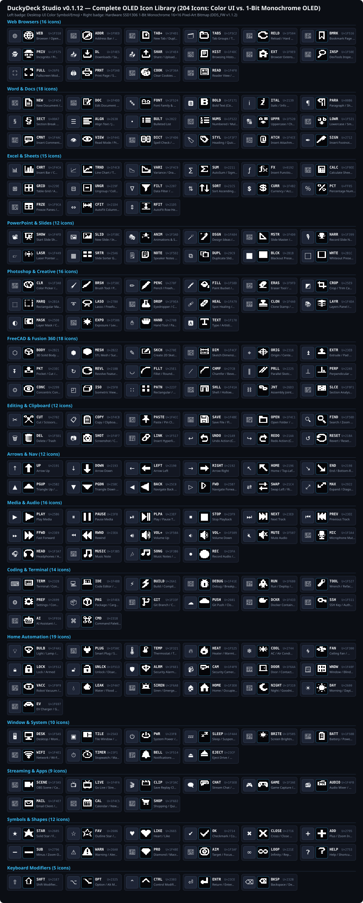
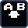
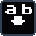
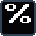

#  DuckyDeck Studio

[](https://github.com/russellmilliner/duckydeck-studio/releases/tag/v0.1.7)
[-0078D4?style=for-the-badge&logo=windows&logoColor=white)](https://github.com/russellmilliner/duckydeck-studio/releases/download/v0.1.7/DuckyDeck-Studio-Setup-v0.1.7-x86_64.exe)
[-0284c7?style=for-the-badge&logo=windows&logoColor=white)](https://github.com/russellmilliner/duckydeck-studio/releases/download/v0.1.7/duckydeck-studio-v0.1.7-windows-x86_64-portable.zip)
[](https://duckydeckstudio.com/releases/duckydeck-studio-v0.1.7-x86_64.flatpak)
[](https://github.com/russellmilliner/duckydeck-studio/releases/tag/v0.1.7)
[](https://duckydeckstudio.com)
[](https://duckydeckstudio.com/architecture.html)
[](https://github.com/russellmilliner/duckydeck-studio)
[](https://ko-fi.com/russellmilliner)
[](https://www.duckypad.com)
[](https://www.tindie.com/stores/dekunukem/)
[](https://www.gnu.org/licenses/gpl-3.0)
[%20%7C%20Windows%2010%2F11-3daee9?logo=kde&logoColor=white&style=for-the-badge)](https://github.com/russellmilliner/duckydeck-studio/releases/tag/v0.1.7)

**DuckyDeck Studio (`v0.1.7`)** is a native **Linux (KDE Plasma 6 / Wayland & X11)** and **Windows 10/11 (x86_64)** desktop configurator, **DSVM v2 bytecode compiler**, **Window-Aware Auto-Switcher**, and **Macro Template Generator (experimental)** for the **duckyPad Pro (`0x0483:0xd11d`)** and **duckyPad 2020 (`0x0483:0xd11c`)**, built with **Rust**, **CXX-Qt 0.7**, **Qt 6**, and **KDE Frameworks 6 (Kirigami + KSyntaxHighlighting)** (with a self-contained Kirigami QML compatibility layer on Windows).

> 🏷️ **Current Version:** **DuckyDeck Studio `v0.1.7`** · **Custom Firmware `v1.1.2` (`DDS_FW_1.1.2_0f85dab1.bin` for duckyPad Pro & `DDS20_FW_1.1.2_3bd4beef.dfu` for duckyPad 2020)** · **KDE Plasma 6 Applet `v1.0.2`**
>
> 🌐 **Official Website & Online Documentation:** **[https://duckydeckstudio.com](https://duckydeckstudio.com)** · **[Architecture Reference (`architecture.html`)](https://duckydeckstudio.com/architecture.html)**
>
> 💻 **GitHub Repository & Releases:** **[https://github.com/russellmilliner/duckydeck-studio](https://github.com/russellmilliner/duckydeck-studio)** · **[Windows 10/11 Setup Installer (`v0.1.7` `.exe`)](https://github.com/russellmilliner/duckydeck-studio/releases/download/v0.1.7/DuckyDeck-Studio-Setup-v0.1.7-x86_64.exe)** · **[Windows Portable ZIP (`v0.1.7` `.zip`)](https://github.com/russellmilliner/duckydeck-studio/releases/download/v0.1.7/duckydeck-studio-v0.1.7-windows-x86_64-portable.zip)** · **[Linux Flatpak Bundle (`v0.1.7`)](https://duckydeckstudio.com/releases/duckydeck-studio-v0.1.7-x86_64.flatpak)** · **[Linux x86_64 Tarball (`v0.1.7`)](https://duckydeckstudio.com/releases/duckydeck-studio-v0.1.7-linux-x86_64.tar.gz)**
>
> ☕ **Enjoying DuckyDeck Studio?** Support development by buying Russell Milliner a coffee on Ko-fi: **[https://ko-fi.com/russellmilliner](https://ko-fi.com/russellmilliner)**
>
> 🙏 **Special Thanks to [dekuNukem](https://github.com/dekuNukem)** for creating the **[duckyPad & duckyPad Pro](https://www.duckypad.com)**! Get official hardware and accessories at **[dekuNukem's Official Tindie Store](https://www.tindie.com/stores/dekunukem/)**.

---

## 🎬 Video Demo & Screenshots

- 🎥 **[Watch the Full 1080p Application Demo Video (`docs/duckydeck-studio-demo.mp4`)](docs/duckydeck-studio-demo.mp4)**

| Dolphin File Manager & DSVM v2 IDE | OBS Studio & Web API Webhook Builder |
| :---: | :---: |
|  |  |
| **Desktop Application Launcher** | **Custom Key Color Picker & Palettes** |
|  |  |
| **KWin Wayland Auto-Switcher Rules** | **Live System Event Log** |
|  |  |

---

## ✨ Key Features

- **🎹 Interactive Hardware Canvas & 128×128 OLED Simulator:**
  - Full visual editor for the **20-key RGB matrix (4×5)**, **Dual Rotary Encoders (Slots 21–26)**, and **32-channel Expansion Modules (Slots 27–58)**.
  - **Header-Footer Split Keycap Layout:** Each keycap features a dedicated top header with its compact key number (`1..20`) next to a pill-shaped RGB LED color bar, a centered 2-line OLED label preview with automatic icon scaling, and a bottom footer strip displaying `APP`/`API` host badges and `↻`/`⏹` execution indicators with zero text overlap up to `115%+` UI zoom.
  - Drag-and-drop keys to **swap** slots, or hold <kbd>Shift</kbd> while dragging to **insert & shift** keys.
  - Live 128×128 monochrome OLED display simulator supporting both the 4×5 key label grid and custom `OLED_LINE` / `OLED_RECT` / `OLED_CIRCLE` / `OLED_PRINT` drawing scripts.
  - Right-click any keycap to **Copy**, **Paste** (across keys and profiles), **Set Key X Color**, or **Clear / Reset**.
- **🎨 Custom Color Picker with Saved & Used Palettes:**
  - Interactive 2D Saturation/Value color square, vertical Hue slider, R/G/B (`0–255`) sliders & spinboxes, `#RRGGBB` hex input, and native OS eyedropper integration.
  - **Saved Colors Palette:** Pin your favorite RGB colors to a persistent palette (`~/.config/duckydeck-studio/kwin_rules.json`).
  - **Used Colors Palette:** Automatically scans and displays every unique color currently used in any profile (`BG_COLOR`) or key (`SWCOLOR`) for 1-click reuse.
- **📜 Built-In duckyScript 3 IDE & DSVM v2 Bytecode Compiler:**
  - Pure-Rust two-pass compiler that compiles `duckyScript 3` (`keyN.txt` & `keyN-release.txt`) directly into **DSVM v2 (`.dsb`)** bytecode binaries.
  - Live syntax verification with byte count & exact error line reporting, KDE `KSyntaxHighlighting`, and a searchable **Command Reference Drawer**.
- **🚀 Launch Application Builder (No-Code Desktop App Launcher):**
  - Search installed desktop applications on **Linux** (`.desktop` entries from system, user, and Flatpak directories) and **Windows 10/11** (Start Menu `.lnk` shortcuts from `%ProgramData%\Microsoft\Windows\Start Menu\Programs` and `%APPDATA%\Microsoft\Windows\Start Menu\Programs` resolved via COM `WScript.Shell`), or configure custom CLI commands, `.exe` paths, arguments, working directories, and terminal execution.
  - Triggers instantaneously over USB HID via Persistent Global Variable `_GV31` (`encode_pgv31_trigger`, no keyboard shortcut conflicts!) or via `F13–F24` global hotkeys (Linux `evdev` or Windows Win32 `RegisterHotKey`).
  - **204 Built-in OLED Key Icons (Color UI + 1-Bit Monochrome Bitmaps) Across 14 Categories:** Includes curated color UI symbols and matching `16×16` / `10×10` 1-bit monochrome pixel-art OLED bitmaps across `Web Browsers`, `Word & Docs`, `Excel & Sheets`, `PowerPoint & Slides`, `Photoshop & Creative`, `FreeCAD & Fusion 360`, `Editing & Clipboard`, `Arrows & Nav`, `Media & Audio`, `Coding & Terminal`, `Home Automation`, `Window & System`, `Streaming & Apps`, and `Symbols & Shapes` (see **[`docs/OLED_ICONS.md`](docs/OLED_ICONS.md)**).
- **🌐 Web API / Webhook Builder & 🏠 Home Assistant Entity Search:**
  - Trigger HTTP `GET`, `POST`, `PUT`, `PATCH`, and `DELETE` requests (Home Assistant, Miniflux, OBS, custom webhooks) with custom headers and JSON bodies directly from any duckyPad key via USB HID (`_GV31`) or `F13–F24`.
  - **Built-in Home Assistant Web API Browser:** Connect to your Home Assistant instance (`base_url` + Long-Lived Access Token) to search devices and entities across domains (`light`, `switch`, `scene`, `script`, `automation`, `button`, `input_boolean`, `media_player`, `cover`, `fan`, `climate`, `lock`) and bind `toggle` / `turn_on` / `turn_off` / `trigger` service calls to any key in one click.
  - **🔔 Profile Change Webhooks:** Automatically fire a per-profile HTTP webhook (configured in **Profile Properties**) and/or a global profile-change webhook (configured in **Settings**) whenever the active profile changes via UI, hardware buttons, Window Auto-Switcher, or the REST API, with template placeholders (`{{profile_number}}`, `{{profile_name}}`, `{{previous_profile_number}}`, `{{previous_profile_name}}`, `{{source}}`, `{{device_serial}}`, `{{timestamp}}`).
- **🔌 Built-In HTTP REST API Server (`/api/v1/*`) for Remote Control & Programming:**
  - Optional embedded HTTP/1.1 REST API server configurable in **Settings → HTTP REST API Server** (defaults to `127.0.0.1:28491`, disabled by default, with 160-bit `ddk_...` Bearer token authentication) for controlling and programming every function of the duckyPad remotely (switching/creating/editing/deleting profiles, programming key labels/colors/icons/scripts, reading/writing `_GV0.._GV31`, setting LEDs/OLED, triggering slots, and syncing to microSD).
- **🪟 Cross-Platform Window Auto-Switcher (KDE Plasma 6 Wayland & Windows 10/11 Win32) & Protected Fallback Profile:**
  - **Linux (`zbus` + KWin Wayland):** Pure-Rust D-Bus listener integrated with KDE Plasma 6 KWin Wayland to automatically switch duckyPad hardware profiles when you focus different applications or browser tabs.
  - **Windows 10/11 (Win32 Foreground Tracker):** Native Win32 listener (`GetForegroundWindow`, `GetWindowTextW`, `GetWindowThreadProcessId`, `QueryFullProcessImageNameW`) that tracks active `.exe` process names and window titles (including regex title matching) with zero CPU overhead.
  - **Automatic Rule & Fallback Synchronization:** New profile groups always create a Default Fallback Profile (`★ FALLBACK`) that is protected from deletion. Reordering profiles automatically updates all Auto-Switcher rule bindings, and deleting a profile automatically reassigns any rules referencing it to the Fallback Profile.
  - Includes a **🎯 Crosshair Window Picker** on both Linux (KWin interactive picker) and Windows (`WindowFromPoint` + `GetAsyncKeyState(VK_LBUTTON)` hover-and-click picker) to bind any open window or web app tab in one click, inline `✕` filter clear buttons, hover tooltips for drag-and-drop reordering, and automatic pausing while the Key Editor is open.
- **💾 Offline Profile Cache, Diff Summary & Validated microSD Sync:**
  - Edits are saved immediately to a local per-device cache (`~/.local/share/duckydeck-studio/profile_cache/` on Linux or `%LOCALAPPDATA%\duckydeck-studio\profile_cache\` on Windows).
  - Inspect a detailed **Unsynced Changes Summary** before syncing, then write, flush, and verify `.dsb` bytecode and `config.txt` files on the duckyPad microSD card (supporting Linux `udisksctl` / `/run/media` and Windows `D:\..Z:\` removable volume detection with `FlushFileBuffers` and safe PowerShell drive eject).
  - **Portable `duckydeck_rules.json` microSD Persistence:** Syncs your window auto-switcher rules directly onto the microSD card root alongside hardware profiles so your window bindings travel with your duckyPad across computers.
  - Export and import individual profiles (`.duckyprofile.json` or folder) or complete **Profile Groups (`.duckygroup.json`)**.
- **🧙‍♂️ First-Run Deck Setup & Legacy dekuNukem Migration:**
  - Automatically detects unconfigured or fresh decks and discovers legacy profiles and auto-switcher rules from existing dekuNukem installations (`~/.local/share/duckypad_config/profile_backups/` on Linux or `%APPDATA%\dekuNukem\duckypad_config\profile_backups\` on Windows).
  - Detects running legacy background daemons (`duckypad_autoprofile.py`, `duckypad_autoswitcher`, `duckypad_configurator`) and provides 1-click graceful termination to prevent USB HID bus contention.
- **🔢 Live PGV Inspector (`_GV0`..`_GV31`) & ✨ Macro Template Generator (experimental):**
  - Read and write all 32 non-volatile 32-bit Persistent Global Variables (`_GV0.._GV31`) over USB HID (`0x18`/`0x19`) in Signed, Unsigned, or Hex format.
  - Generate duckyScript 3 macro templates from your local KDE shortcuts (`~/.config/kglobalshortcutsrc`), converting KDE key sequences directly into duckyScript 3 key combos.
- **📋 System Event Log, Global UI Zoom (`Ctrl++`/`Ctrl+-`), High-Contrast Controls & System Tray:**
  - Built-in **System Event Log** (`DEVICE`, `PROFILE`, `AUTOSWITCH`, `SD_SYNC`, `SCRIPT`, `WEB_API`, `APP_LAUNCH`, `SYSTEM`) with search, category/severity filters, and file export.
  - Global UI text zoom (`75%–160%`, minimum `10pt` base font) with standard <kbd>Ctrl</kbd>+<kbd>+</kbd>, <kbd>Ctrl</kbd>+<kbd>=</kbd>, <kbd>Ctrl</kbd>+<kbd>-</kbd>, and <kbd>Ctrl</kbd>+<kbd>0</kbd> shortcuts persisted across restarts, high-contrast checkboxes and scrollbars in Dark and Light modes, and a dynamic System Tray icon (KDE `StatusNotifierItem` on Linux, Notification Area Tray on Windows) with quick access to **Show / Hide**, **Toggle Desktop OLED Widget**, **Auto-Switcher**, **Autostart** (XDG `.desktop` on Linux, Registry `HKCU\Software\Microsoft\Windows\CurrentVersion\Run` on Windows), and **About DuckyDeck Studio**.
- **🗂️ Reusable Profile Templates:**
  - Create new profiles from built-in templates (*Blank*, *Media & Streaming*, *IDE & Developer*, *Desktop App & Web API Launcher*) or copy any existing profile into a reusable custom template (`~/.config/duckydeck-studio/profile_templates.json` on Linux or `%APPDATA%\duckydeck-studio\profile_templates.json` on Windows).
- **🖥️ Desktop OLED Companion Widget, Multi-Device Simultaneous Support & 4-Way Rotated Key Labels (`0° / 90° / 180° / 270°`):**
  - Floating, multi-monitor-aware desktop replica of the duckyPad OLED screen (using KWin Wayland placement rules on Linux and Win32 `HWND_TOPMOST` on Windows, plus a companion KDE Plasma 6 Applet in `plasmoid/io.github.duckydeck.oled`) with persistent screen/position/transparency settings, optional 24-character extended labels (`wzN`/`wxN`), and independent **Desktop Widget Orientation** (`Follow OLED`, `0°`, `90°`, `180°`, `270°`) configurable per profile in **Profile Properties** that rotates both the key grid positions and the text inside each key immediately without requiring a microSD card sync.
  - **Simultaneous Multi-Device Management (`duckyPad Pro` + `duckyPad 2020`):** Attach multiple duckyPad Pro (`0x0483:0xd11d`) and/or duckyPad 2020 (`0x0483:0xd11c`) units simultaneously with isolated per-device profile caches (`~/.local/share/duckydeck-studio/device_profiles/<SERIAL>/`), independent per-device Auto-Switcher rules, and dedicated per-device floating Desktop OLED Widgets.
  - **High-Resolution Wheel & Ploopy Knob (`v120`) Smooth Scrolling:** Global C++ `QWheelEvent` filter with fractional sub-notch accumulation and 180 ms gesture target lock so high-resolution rotary encoders (such as the Ploopy Knob) and standard mouse wheels scroll every list and pane smoothly without pausing when child controls pass under the cursor.
- **🔧 DuckyDeck Studio Firmware `v1.1.2` (`duckyPad Pro` & `duckyPad 2020`) & Official Firmware Catalog Downloader:**
  - Custom firmware builds for both **`duckyPad Pro` (`DDS_FW_1.1.2_0f85dab1.bin`)** and **`duckyPad 2020` (`DDS20_FW_1.1.2_3bd4beef.dfu`)**, badged with the DuckyDeck Studio icon in the status bar, supporting 204 1-bit monochrome pixel-art OLED icons, 4 customizable OLED layout styles (on Pro), smooth `SWC_FADE_TO` LED transitions, dirty-page display tracking, and zero-SD-wear profile caching (NVS on Pro, RTC backup registers on 2020).
  - **Official Firmware Catalog Downloader:** Fetch the list of official dekuNukem firmwares directly inside the **Firmware Manager** window, download `.bin`/`.dfu` images with IEEE CRC32 verification, and install them in one click.

---

## ⚠️ Hardware Portability vs. Host-Dependent Capabilities

DuckyDeck Studio clearly badges capabilities in the UI as either **✅ Hardware-Portable** (compiled to the microSD card and executed autonomously by the duckyPad on any computer) or **💻 Requires DuckyDeck Studio Running on Host PC (Not Hardware-Portable)**:

| Capability / Feature | Portability | How It Works & What Happens Without DuckyDeck Studio |
| :--- | :--- | :--- |
| **Standard DuckyScript 3 Macros** (`STRING`, `KEYDOWN`, `DELAY`, `MOUSE_MOVE`, `LMOUSE`, loops, `IF`/`WHILE`) | ✅ **Hardware-Portable** | Compiles to `.dsb` bytecode on the microSD card. Works on **any PC/OS** with zero host software installed. |
| **Static Profile & Key RGB Colors** (`BG_COLOR`, `SWCOLOR`, `KEYDOWN_COLOR`, `DIM_UNUSED_KEYS`) | ✅ **Hardware-Portable** | Stored in `config.txt` on the microSD card and rendered directly by duckyPad hardware. |
| **Embedded Key Script RGB Animations** (`SWC_SET`, `SWC_FILL`, `SWC_RESET`) | ✅ **Hardware-Portable** | Compiled directly into `keyN.dsb` bytecode on the microSD card; runs standalone on hardware. |
| **5-Char Physical OLED Key Labels (`zN` / `xN`) & `OLED_*` Script Graphics** | ✅ **Hardware-Portable** | Stored on microSD and rendered by the physical 128×128 OLED display. |
| **Physical OLED Orientation (`0° / 90° / 180° / 270°`) & Monochrome Icons** | ✅ **Hardware-Portable** *(180°/270° & icons require DuckyDeck Studio Firmware v1.1.2)* | Stored in `config.txt` (`IS_LANDSCAPE` / `OLED_ROTATION`) and rendered on the hardware OLED screen. |
| **Manual Profile Switching** (`GOTO_PROFILE`, `NEXT_PROFILE`, `PREV_PROFILE`, `+`/`-` button hold) | ✅ **Hardware-Portable** | Handled natively on the duckyPad hardware. |
| **🚀 Launch Desktop Application (`APP` badge)** | 💻 **Requires DuckyDeck Studio Running** | Triggered over USB HID (`_GV31`) or `F13–F24` (Linux `evdev` / Windows Win32 `RegisterHotKey`) by the DuckyDeck Studio host process. **Will not launch apps if DuckyDeck Studio is closed or on another PC.** |
| **🌐 Web API / HTTP Webhooks & Home Assistant Triggers (`API` badge)** | 💻 **Requires DuckyDeck Studio Running** | Outbound HTTP requests are dispatched by DuckyDeck Studio on the host PC. **The duckyPad hardware has no network stack and cannot fire webhooks standalone.** |
| **🔔 Profile Change Webhooks (Per-Profile & Global)** | 💻 **Requires DuckyDeck Studio Running** | Fired by DuckyDeck Studio when a profile switch is initiated or detected on the host PC. Does not require a microSD card sync. |
| **🔌 HTTP REST API Server (`/api/v1/*`)** | 💻 **Requires DuckyDeck Studio Running** | Hosted by the DuckyDeck Studio process (`127.0.0.1:28491` by default). |
| **🪟 Active-Window Auto-Switcher (KWin Wayland on Linux / Win32 on Windows)** | 💻 **Requires DuckyDeck Studio Running** | Uses KDE Plasma 6 KWin D-Bus tracking on Linux or Win32 `GetForegroundWindow` tracking on Windows to send USB HID profile-switch commands. Without the host app, switch profiles manually on the keypad. |
| **🖥️ Desktop OLED Widget, 24-Char Extended Widget Labels (`wzN`/`wxN`) & Widget Orientation (`DW_ROTATION`)** | 💻 **Requires DuckyDeck Studio Running** | Displayed on your computer monitor by DuckyDeck Studio; orientation changes apply immediately without requiring a microSD card sync. |
| **✨ Live USB HID RGB Animation Streaming** | 💻 **Requires DuckyDeck Studio Running** | Streams RGB frames over USB HID (`0x14`) from DuckyDeck Studio. Use the *"Embed standalone DuckyScript 3 SWC_SET"* option if you want portable on-device key lighting. |

---

## 🔧 DuckyDeck Studio Firmware (`v1.1.2`) vs. Standard Firmware (`3.3.5` / `3.0.4`)

**DuckyDeck Studio Firmware `v1.1.2`** is an optional, 100% backwards-compatible custom firmware suite for both **`duckyPad Pro` (`DDS_FW_1.1.2_0f85dab1.bin`)** and **`duckyPad (2020)` (`DDS20_FW_1.1.2_3bd4beef.dfu`)**. All existing `.dsb` bytecode scripts, profiles, and official features work identically to upstream firmware `3.3.5` (Pro) and `3.0.4` (2020 Evo), while unlocking hardware enhancements tailored to each platform:

- **📦 Download from GitHub Releases:**
  - **duckyPad Pro (`ESP32-S3`):** [`DDS_FW_1.1.2_0f85dab1.bin` (`v1.1.2`)](https://github.com/russellmilliner/duckydeck-studio/releases/tag/v0.1.7) · IEEE CRC32 `0f85dab1` · Size `891,200 bytes` *(automatically staged as `DPP_FW_1.1.2_0f85dab1.bin` onto microSD for universal bootloader compatibility)*
  - **duckyPad 2020 (`STM32F072`):** [`DDS20_FW_1.1.2_3bd4beef.dfu` (`v1.1.2`)](https://github.com/russellmilliner/duckydeck-studio/releases/tag/v0.1.7) · IEEE CRC32 `3bd4beef` · Size `63,057 bytes` (`62,748 bytes` Flash used)
- **🌐 Direct Downloads:** [`https://duckydeckstudio.com/firmware/DDS_FW_1.1.2_0f85dab1.bin`](https://duckydeckstudio.com/firmware/DDS_FW_1.1.2_0f85dab1.bin) · [`https://duckydeckstudio.com/firmware/DDS20_FW_1.1.2_3bd4beef.dfu`](https://duckydeckstudio.com/firmware/DDS20_FW_1.1.2_3bd4beef.dfu)

| Feature / Capability | Standard Firmware (`3.3.5` Pro / `3.0.4` 2020) | DuckyDeck Studio Firmware (`1.1.2` Pro & 2020) |
| :--- | :--- | :--- |
| **Firmware Prefix & Identity** (`shared.c` / `hid_task.c`) | Uses `DPP_FW_*.bin` / `duckypad_v*.dfu`; standard `GET_INFO` (`0x00`) response. | ✅ Distinct **`DDS_FW_*.bin`** (Pro) and **`DDS20_FW_*.dfu`** (2020) builds; reports `'D','D','S'` capability signature at HID bytes `20..22` so DuckyDeck Studio automatically identifies and optimizes for it. |
| **Monochrome OLED Key Icons** (`oled_icons.c` / `ui_task.c`) | ❌ ASCII text only (`0x20..0x7E`); Unicode/emoji symbols are stripped or ignored on hardware. | ✅ **204 Native Pixel-Art Icons** across 14 categories:<br>• **duckyPad Pro**: Full-Cell `16×16`, Top-Line `10×10` + Caption, and Inline `7×10` / `6×8` glyphs.<br>• **duckyPad (2020)**: All 204 inline `6×10` / `7×10` monochrome icons packed into 2.4 KB of STM32F072 Flash. |
| **Customizable OLED Layout Styles (Pro)** (`ui_task.c`) | Single fixed header bar and grid style. | ✅ **4 Selectable OLED Layout Styles** (`OLED_LAYOUT_STYLE 0..3`): Top Bezel Header (`0`), Micro-Page Dots (`1`), Header/Footer Split (`2`), and 3px Recessed Divider Strip (`3`). |
| **OLED Display Refresh Speed** (`ssd1306.c`) | Full framebuffer transmitted over SPI (Pro) or 400 kHz I²C (2020) on every screen refresh. | ✅ **Dirty-Page Bitmask Tracking (`ssd1306_dirty_pages`)**: Only modified 128-byte display pages are transmitted over SPI DMA (Pro) or I²C (2020), cutting `OLED_PRINT` / key-update bus time by up to 8×. |
| **Smooth LED Color Fade** (`ds_vm.c` / `neopixel.c`) | ❌ Stepwise jumps only (`SWC_SET` / `SWCOLOR`); 2020 uses software `double` math in 50 Hz ISR. | ✅ **Hardware `SWC_FADE_TO` Opcode (`89`)**: Smooth color transitions (`SWC_FADE_TO <key> <r> <g> <b> <ms>`), plus Q8 fixed-point integer math on STM32F072 (10× faster ISR, saves 7.3 KB Flash). |
| **Active Profile Switching Speed & SD Longevity** (`profiles.c`) | ⚠️ Rewrites `/dpp_config.txt` on the FAT32 microSD card on every profile change (20–200 ms stall + SD wear). | ✅ **Zero-SD-Wear Profile Cache**: Uses internal Flash NVS (`dpp_cfg`) on **duckyPad Pro** and battery/bus-backed `RTC_BKP_DR2` on **duckyPad (2020)** for instantaneous profile switching. |
| **Software Jump-to-DFU Bootloader (2020)** (`main.c` / `hid_task.c`) | ❌ Requires physically flipping DIP switch #1 on the back of the case to enter DFU mode. | ✅ **Software Jump-to-DFU (`RTC_BKP_DR3` magic)**: Enters the STM32F072 ROM DFU bootloader (`0483:df11`) directly over USB HID (`0x14`, mode `2`) with zero switch flipping. |
| **UTF-8 Key Label Decoding** (`profiles.h` / `profiles.c`) | ❌ `KEYNAME_SIZE = 8` bytes with raw byte truncation (`str[5] = 0`), slicing multi-byte UTF-8 characters. | ✅ **Expanded `KEYNAME_SIZE = 24` bytes** with glyph-aware UTF-8 truncation (`oled_utf8_truncate_glyphs`). Reads `ui_z<N>` / `ui_x<N>` directives for icons while keeping `z<N>` / `x<N>` ASCII fallbacks. |
| **Physical OLED Screen Orientations (Pro)** (`ssd1306.c` / `ui_task.c`) | ⚠️ 2 Orientations: `0°` Portrait and `90°` Clockwise. | ✅ **Full 4-Way Hardware Rotation (`0°`, `90°`, `180°`, `270°`)**: Adds `180°` Inverted Portrait and `270°` Counter-Clockwise Landscape with proper key grid remapping. |

---

## 🖼️ OLED Icon Library (Color UI & 1-Bit Monochrome Hardware Bitmaps)

**DuckyDeck Studio (`v0.1.7`)** and **DuckyDeck Studio Firmware (`DDS_FW v1.1.2` & `DDS20_FW v1.1.2`)** provide **204 unique icons** (199 application & macro icons across 14 categories in the in-app **OLED Button Icon Picker**, plus 5 keyboard modifier glyphs) with **zero duplicate icons**.

Each icon is engineered with **two synchronized visual representations**:
1. **Color Desktop UI Version**: Full-color Unicode/Emoji symbol displayed on the interactive Hardware Canvas, Floating OLED Desktop Widget, and Key Inspector.
2. **1-Bit Monochrome Hardware OLED Version (`16×16` & `10×10`)**: Hand-crafted pixel-art bitmaps compiled into `oled_icons.c` (`firmware/generate_oled_icons.py`) for the physical `128×128` SSD1306 monochrome OLED screen:
   - **`16×16` Full-Cell Bitmap**: Rendered centered inside the key cell when **Line 1** is a single icon and **Line 2** is empty (*Big Icon Only* mode).
   - **`10×10` Top-Line Bitmap**: Rendered at the top of the key cell above a 4-character text label on **Line 2** (*Icon + Short Label* mode), or scaled to `7×10` / `6×8` when mixed inline with text.
   - **Stock Firmware (`DPP_FW` / `duckypad_v3.0.4`) Compatibility**: Writes a 4-character ASCII fallback (`z<N>`/`x<N>`) for stock `dekuNukem` firmware while storing the full UTF-8 icon in `ui_z<N>`/`ui_x<N>` for `DDS_FW v1.1.2` and `DDS20_FW v1.1.2`.

- 📄 **[Complete Standalone OLED Icon Reference (`docs/OLED_ICONS.md`)](docs/OLED_ICONS.md)**



<details>
<summary><strong>📋 Click to Expand Complete 204-Icon Table (Color UI vs. 16×16 &amp; 10×10 Monochrome OLED Bitmaps)</strong></summary>

### Web Browsers (16 Icons)

| Color (UI) | Monochrome 16×16 (OLED) | Monochrome 10×10 (2-Line) | Short Label | Codepoint | Firmware Bitmap ID | Stock ASCII | Function / Menu Action |
| :---: | :---: | :---: | :---: | :---: | :--- | :---: | :--- |
| 🌐 |  |  | **`WEB`** | `U+1F310` | `GLOBE_WEB` | `WEB` | Browser / Open Website / URL |
| 🧭 |  |  | **`ADDR`** | `U+1F9ED` | `COMPASS_ADDR` | `ADDR` | Address Bar / Navigate / Compass |
| 📑 |  |  | **`TAB+`** | `U+1F4D1` | `TAB_PLUS` | `TAB+` | New Tab / Duplicate Tab / Bookmark Tabs |
| 🗂 |  |  | **`TABS`** | `U+1F5C2` | `TAB_GROUPS` | `TABS` | Tab Groups / Tab Overview / Workspaces |
| 🔄 |  |  | **`RELD`** | `U+1F504` | `RELOAD_ARROWS` | `RELD` | Reload / Hard Refresh Page |
| 🔖 |  |  | **`BMRK`** | `U+1F516` | `BOOKMARK` | `BMRK` | Bookmark Page / Favorites |
| 🕵 |  |  | **`PRIV`** | `U+1F575` | `INCOGNITO` | `PRIV` | Incognito / Private Browsing Window |
| 📥 |  |  | **`DL`** | `U+1F4E5` | `DOWNLOAD_TRAY` | `DL` | Downloads / Save Page As |
| 📤 |  |  | **`SHAR`** | `U+1F4E4` | `SHARE_TRAY` | `SHAR` | Share / Upload / Send Link |
| 📜 |  |  | **`HIST`** | `U+1F4DC` | `HISTORY_SCROLL` | `HIST` | Browsing History / Recently Closed |
| 🧩 |  |  | **`EXT`** | `U+1F9E9` | `EXTENSION_PUZZLE` | `EXT` | Browser Extensions / Add-ons / Plugins |
| 🔎 |  |  | **`INSP`** | `U+1F50E` | `INSPECT_MAG` | `INSP` | DevTools Inspect / Find in Page |
| ⛶ |  |  | **`FULL`** | `U+26F6` | `FULLSCREEN` | `FULL` | Fullscreen Mode (F11) |
| 🖨 |  |  | **`PRNT`** | `U+1F5A8` | `PRINTER` | `PRNT` | Print Page / Save as PDF |
| 🍪 |  |  | **`COOK`** | `U+1F36A` | `COOKIE` | `COOK` | Clear Cookies / Site Data |
| 📰 |  |  | **`READ`** | `U+1F4F0` | `READER_NEWS` | `READ` | Reader View / Simplified Article |

### Word & Docs (18 Icons)

| Color (UI) | Monochrome 16×16 (OLED) | Monochrome 10×10 (2-Line) | Short Label | Codepoint | Firmware Bitmap ID | Stock ASCII | Function / Menu Action |
| :---: | :---: | :---: | :---: | :---: | :--- | :---: | :--- |
| 📄 |  |  | **`NEW`** | `U+1F4C4` | `NEW_DOC` | `NEW` | New Document / Blank Page |
| 📝 |  |  | **`DOC`** | `U+1F4DD` | `EDIT_DOC` | `DOC` | Edit Document / Rich Text Note |
| 🔤 |  |  | **`FONT`** | `U+1F524` | `FONT_ABC` | `FONT` | Font Family & Size Formatting |
| 🅱 |  |  | **`BOLD`** | `U+1F171` | `BOLD_B` | `BOLD` | Bold Text (Ctrl+B) |
| ℹ |  |  | **`ITAL`** | `U+2139` | `ITALIC_I` | `ITAL` | Italic / Info Style (Ctrl+I) |
| ¶ |  |  | **`PARA`** | `U+00B6` | `PARAGRAPH_PILCROW` | `PARA` | Paragraph / Show Formatting Marks |
| § |  |  | **`SECT`** | `U+00A7` | `SECTION_SIGN` | `SECT` | Section Break / Page Layout |
| ☰ |  |  | **`ALGN`** | `U+2630` | `ALIGN_LINES` | `ALGN` | Align Text / Justify Paragraph |
| • |  |  | **`BULT`** | `U+2022` | `BULLET_LIST` | `BULT` | Bulleted List |
| 🔢 |  |  | **`NUMS`** | `U+1F522` | `NUMBER_LIST` | `NUMS` | Numbered / Multilevel List |
| 🔠 |  |  | **`UPPR`** | `U+1F520` | `UPPERCASE_AB` | `UPPR` | Uppercase / Change Case |
| 🔡 |  |  | **`LOWR`** | `U+1F521` | `LOWERCASE_AB` | `LOWR` | Lowercase / Small Caps |
| 💬 |  |  | **`CMNT`** | `U+1F4AC` | `CHAT` | `CMNT` | Insert Comment / Review Track Changes |
| 👁 |  |  | **`VIEW`** | `U+1F441` | `VIEW_EYE` | `VIEW` | Read Mode / Print Preview |
| 📖 |  |  | **`DICT`** | `U+1F4D6` | `DICTIONARY_BOOK` | `DICT` | Spell Check / Thesaurus / Word Count |
| 🏷 |  |  | **`STYL`** | `U+1F3F7` | `STYLE_TAG` | `STYL` | Heading / Quick Style Tag |
| 📎 |  |  | **`ATCH`** | `U+1F4CE` | `ATTACHMENT_CLIP` | `ATCH` | Insert Attachment / Embedded Object |
| ✒ |  |  | **`SIGN`** | `U+2712` | `SIGN_NIB` | `SIGN` | Insert Footnote / Signature / Nib |

### Excel & Sheets (15 Icons)

| Color (UI) | Monochrome 16×16 (OLED) | Monochrome 10×10 (2-Line) | Short Label | Codepoint | Firmware Bitmap ID | Stock ASCII | Function / Menu Action |
| :---: | :---: | :---: | :---: | :---: | :--- | :---: | :--- |
| 📊 |  |  | **`CHRT`** | `U+1F4CA` | `CHART_BARS` | `CHRT` | Insert Bar / Column / Pivot Chart |
| 📈 |  |  | **`TRND`** | `U+1F4C8` | `TREND_UP` | `TRND` | Line Chart / Trendline / Sparkline |
| 📉 |  |  | **`VARI`** | `U+1F4C9` | `TREND_DOWN` | `VARI` | Variance / Drawdown Chart |
| ∑ |  |  | **`SUM`** | `U+2211` | `SIGMA_SUM` | `SUM` | AutoSum / Sigma Formula (Alt+=) |
| ƒ |  |  | **`FX`** | `U+0192` | `FUNCTION_FX` | `FX` | Insert Function / Formula Bar (fx) |
| 🧮 |  |  | **`CALC`** | `U+1F9EE` | `CALC` | `CALC` | Calculate Sheet / Pivot Table |
| ⊞ |  |  | **`GRID`** | `U+229E` | `GRID_BORDERS` | `GRID` | Table Grid / All Cell Borders |
| ⊟ |  |  | **`UNGR`** | `U+229F` | `UNGROUP_MINUS` | `UNGR` | Ungroup / Collapse Rows & Columns |
| ∇ |  |  | **`FILT`** | `U+2207` | `FILTER_FUNNEL` | `FILT` | Data Filter / AutoFilter Funnel |
| ⇅ |  |  | **`SORT`** | `U+21C5` | `SWAP_UD` | `SORT` | Sort Ascending / Descending |
| 💲 |  |  | **`CURR`** | `U+1F4B2` | `CURRENCY_DOLLAR` | `CURR` | Currency / Accounting Number Format |
| ％ |  |  | **`PCT`** | `U+FF05` | `PERCENT_FMT` | `PCT` | Percentage Number Format |
| 🧊 |  |  | **`FRZE`** | `U+1F9CA` | `FREEZE_PANES` | `FRZE` | Freeze Panes / Top Row |
| ⇔ |  |  | **`CFIT`** | `U+21D4` | `AUTOFIT_COL` | `CFIT` | AutoFit Column Width / Merge Across |
| ⇕ |  |  | **`RFIT`** | `U+21D5` | `AUTOFIT_ROW` | `RFIT` | AutoFit Row Height / Insert Row |

### PowerPoint & Slides (12 Icons)

| Color (UI) | Monochrome 16×16 (OLED) | Monochrome 10×10 (2-Line) | Short Label | Codepoint | Firmware Bitmap ID | Stock ASCII | Function / Menu Action |
| :---: | :---: | :---: | :---: | :---: | :--- | :---: | :--- |
| 📽 |  |  | **`SHOW`** | `U+1F4FD` | `SLIDESHOW_PROJ` | `SHOW` | Start Slide Show Presentation (F5) |
| 🖼 |  |  | **`SLID`** | `U+1F5BC` | `NEW_SLIDE_PIC` | `SLID` | New Slide / Insert Picture |
| 🎭 |  |  | **`ANIM`** | `U+1F3AD` | `ANIMATION_STARS` | `ANIM` | Animations & Slide Transitions |
| 🪄 |  |  | **`DSGN`** | `U+1FA84` | `DESIGN_WAND` | `DSGN` | Design Ideas / Auto-Layout Magic Wand |
| 📐 |  |  | **`MSTR`** | `U+1F4D0` | `SLIDE_MASTER` | `MSTR` | Slide Master / Guides & Set Square |
| 🎙 |  |  | **`NARR`** | `U+1F399` | `RECORD_NARRATION` | `NARR` | Record Slide Narration / Voiceover |
| 👉 |  |  | **`LASR`** | `U+1F449` | `LASER_POINTER` | `LASR` | Laser Pointer / Presenter Highlight |
| ▦ |  |  | **`SRTR`** | `U+25A6` | `SLIDE_SORTER` | `SRTR` | Slide Sorter Grid View |
| 🗒 |  |  | **`NOTE`** | `U+1F5D2` | `SPEAKER_NOTES` | `NOTE` | Speaker Notes / Presenter View |
| ⧉ |  |  | **`DUPL`** | `U+29C9` | `DUPLICATE_SLIDE` | `DUPL` | Duplicate Slide / Group Objects (Ctrl+D) |
| ⬛ |  |  | **`BLCK`** | `U+2B1B` | `BLACKOUT_SCREEN` | `BLCK` | Blackout Presentation Screen (B) |
| ⬜ |  |  | **`WHTE`** | `U+2B1C` | `WHITEOUT_SCREEN` | `WHTE` | Whiteout Presentation Screen (W) |

### Photoshop & Creative (16 Icons)

| Color (UI) | Monochrome 16×16 (OLED) | Monochrome 10×10 (2-Line) | Short Label | Codepoint | Firmware Bitmap ID | Stock ASCII | Function / Menu Action |
| :---: | :---: | :---: | :---: | :---: | :--- | :---: | :--- |
| 🎨 |  |  | **`CLR`** | `U+1F3A8` | `PALETTE` | `CLR` | Color Picker / Swatches Palette |
| 🖌 |  |  | **`BRSH`** | `U+1F58C` | `BRUSH_TOOL` | `BRSH` | Brush Tool / Paint Stroke (B) |
| ✏ |  |  | **`PENC`** | `U+270F` | `EDIT_PENCIL` | `PENC` | Pencil / Freehand Draw Tool |
| 🖍 |  |  | **`FILL`** | `U+1F58D` | `FILL_BUCKET` | `FILL` | Paint Bucket / Gradient Fill (G) |
| 🧽 |  |  | **`ERAS`** | `U+1F9FD` | `ERASER_TOOL` | `ERAS` | Eraser Tool / Clear Pixels (E) |
| ◩ |  |  | **`CROP`** | `U+25E9` | `CROP_TOOL` | `CROP` | Crop / Trim Canvas Tool (C) |
| ⬚ |  |  | **`MARQ`** | `U+2B1A` | `MARQUEE_SELECT` | `MARQ` | Rectangular Marquee Selection (M) |
| ➰ |  |  | **`LASO`** | `U+27B0` | `LASSO_SELECT` | `LASO` | Lasso / Freeform Selection Tool (L) |
| 🧪 |  |  | **`DROP`** | `U+1F9EA` | `FLASK_TEST` | `DROP` | Eyedropper / Color Sampler (I) |
| 🩹 |  |  | **`HEAL`** | `U+1FA79` | `HEALING_PATCH` | `HEAL` | Spot Healing / Patch Brush (J) |
| 💠 |  |  | **`CLON`** | `U+1F4A0` | `CLONE_STAMP` | `CLON` | Clone Stamp / Pattern Stamp (S) |
| 📚 |  |  | **`LAYR`** | `U+1F4DA` | `LAYERS_STACK` | `LAYR` | Layers Panel / Merge Layers (F7) |
| ◐ |  |  | **`MASK`** | `U+25D0` | `LAYER_MASK` | `MASK` | Layer Mask / Contrast / Invert |
| 🔆 |  |  | **`EXPO`** | `U+1F506` | `EXPOSURE_LEVELS` | `EXPO` | Exposure / Levels / Curves Adjustment |
| ✋ |  |  | **`HAND`** | `U+270B` | `HAND_PAN` | `HAND` | Hand Tool / Pan Canvas (H) |
| 🅰 |  |  | **`TEXT`** | `U+1F170` | `TYPE_TEXT_T` | `TEXT` | Type / Artistic Text Tool (T) |

### FreeCAD & Fusion 360 (18 Icons)

| Color (UI) | Monochrome 16×16 (OLED) | Monochrome 10×10 (2-Line) | Short Label | Codepoint | Firmware Bitmap ID | Stock ASCII | Function / Menu Action |
| :---: | :---: | :---: | :---: | :---: | :--- | :---: | :--- |
| ⬡ |  |  | **`BODY`** | `U+2B21` | `SOLID_BODY_HEX` | `BODY` | 3D Solid Body / Part Design Workbench |
| ⬢ |  |  | **`MESH`** | `U+2B22` | `MESH_BODY` | `MESH` | STL Mesh / Surface Body / Tessellate |
| ✎ |  |  | **`SKCH`** | `U+270E` | `SKETCH_2D` | `SKCH` | Create 2D Sketch / Edit Sketch |
| 📏 |  |  | **`DIM`** | `U+1F4CF` | `DIMENSION_RULER` | `DIM` | Sketch Dimension / Measure Distance (D) |
| ⌖ |  |  | **`ORIG`** | `U+2316` | `ORIGIN_DATUM` | `ORIG` | Origin / Center Point / Datum Crosshair |
| ⏫ |  |  | **`EXTR`** | `U+23EB` | `EXTRUDE_PAD` | `EXTR` | Extrude / Pad Sketch Profile (E) |
| ⏬ |  |  | **`PKT`** | `U+23EC` | `POCKET_CUT` | `PKT` | Pocket / Cut / Hole Feature |
| ↻ |  |  | **`REVL`** | `U+21BB` | `SYNC_CW` | `REVL` | Revolve Feature / Orbit 3D View |
| ◡ |  |  | **`FLLT`** | `U+25E1` | `FILLET_ARC` | `FLLT` | Fillet / Round Edge (F) |
| ⟋ |  |  | **`CHMF`** | `U+27CB` | `CHAMFER_BEVEL` | `/` | Chamfer / Bevel Edge |
| ∥ |  |  | **`PRLL`** | `U+2225` | `PARALLEL_CONST` | `||` | Parallel Sketch Constraint |
| ⊥ |  |  | **`PERP`** | `U+22A5` | `PERPENDICULAR` | `_|_` | Perpendicular / Normal To Sketch Plane |
| ⊙ |  |  | **`CONC`** | `U+2299` | `CONCENTRIC` | `CONC` | Concentric Constraint / Center Circle (C) |
| ◰ |  |  | **`ISO`** | `U+25F0` | `ISOMETRIC_VIEW` | `ISO` | Isometric View / Fit All (F6) |
| ∷ |  |  | **`PATN`** | `U+2237` | `PATTERN_ARRAY` | `::` | Rectangular / Circular Pattern Array |
| 🐚 |  |  | **`SHLL`** | `U+1F41A` | `SHELL_HOLLOW` | `SHLL` | Shell / Hollow Wall Thickness |
| ⛓ |  |  | **`JNT`** | `U+26D3` | `ASSEMBLY_JOINT` | `JNT` | Assembly Joint / Mate Constraint (J) |
| 🧱 |  |  | **`SLCE`** | `U+1F9F1` | `SLICE_LAYERS` | `SLCE` | Section Analysis / Slicer Layer Preview |

### Editing & Clipboard (12 Icons)

| Color (UI) | Monochrome 16×16 (OLED) | Monochrome 10×10 (2-Line) | Short Label | Codepoint | Firmware Bitmap ID | Stock ASCII | Function / Menu Action |
| :---: | :---: | :---: | :---: | :---: | :--- | :---: | :--- |
| ✂ |  |  | **`CUT`** | `U+2702` | `CUT` | `8<` | Cut / Scissors (Ctrl+X) |
| 📋 |  |  | **`COPY`** | `U+1F4CB` | `COPY` | `COPY` | Copy / Clipboard (Ctrl+C) |
| 📌 |  |  | **`PASTE`** | `U+1F4CC` | `PASTE_PIN` | `PAST` | Paste / Pin Clipboard (Ctrl+V) |
| 💾 |  |  | **`SAVE`** | `U+1F4BE` | `SAVE` | `SAVE` | Save File / Floppy (Ctrl+S) |
| 📁 |  |  | **`OPEN`** | `U+1F4C1` | `FOLDER` | `OPEN` | Open Folder / Browse File (Ctrl+O) |
| 🔍 |  |  | **`FIND`** | `U+1F50D` | `SEARCH` | `FIND` | Search / Zoom / Find & Replace (Ctrl+F) |
| 🗑 |  |  | **`DEL`** | `U+1F5D1` | `DELETE_TRASH` | `DEL` | Delete / Trash |
| 📷 |  |  | **`SHOT`** | `U+1F4F7` | `CAMERA` | `SHOT` | Screenshot / Capture Region |
| 🔗 |  |  | **`LINK`** | `U+1F517` | `LINK` | `LINK` | Insert Hyperlink / Copy URL (Ctrl+K) |
| ↩ |  |  | **`UNDO`** | `U+21A9` | `UNDO` | `UNDO` | Undo Action (Ctrl+Z) |
| ↪ |  |  | **`REDO`** | `U+21AA` | `REDO` | `REDO` | Redo Action (Ctrl+Y) |
| ↺ |  |  | **`RESET`** | `U+21BA` | `RESET_CCW` | `RESE` | Revert / Reset Changes |

### Arrows & Nav (12 Icons)

| Color (UI) | Monochrome 16×16 (OLED) | Monochrome 10×10 (2-Line) | Short Label | Codepoint | Firmware Bitmap ID | Stock ASCII | Function / Menu Action |
| :---: | :---: | :---: | :---: | :---: | :--- | :---: | :--- |
| ↑ |  |  | **`UP`** | `U+2191` | `ARROW_UP` | `UP` | Arrow Up |
| ↓ |  |  | **`DOWN`** | `U+2193` | `ARROW_DOWN` | `DOWN` | Arrow Down |
| ← |  |  | **`LEFT`** | `U+2190` | `ARROW_LEFT` | `LEFT` | Arrow Left |
| → |  |  | **`RIGHT`** | `U+2192` | `ARROW_RIGHT` | `RIGH` | Arrow Right |
| ↖ |  |  | **`HOME`** | `U+2196` | `ARROW_NW` | `<^` | Home / Top-Left |
| ↘ |  |  | **`END`** | `U+2198` | `ARROW_SE` | `v>` | End / Bottom-Right |
| ▲ |  |  | **`PGUP`** | `U+25B2` | `TRI_UP` | `PGUP` | Triangle Up / Page Up |
| ▼ |  |  | **`PGDN`** | `U+25BC` | `TRI_DOWN` | `PGDN` | Triangle Down / Page Down |
| ◀ |  |  | **`BACK`** | `U+25C0` | `TRI_LEFT` | `BACK` | Navigate Back / Previous |
| ▷ |  |  | **`FWD`** | `U+25B7` | `STEP_FWD_OUTLINE` | `FWD` | Navigate Forward / Step Next |
| ⇄ |  |  | **`SWAP`** | `U+21C4` | `SWAP_LR` | `SWAP` | Swap Left / Right |
| ⤢ |  |  | **`MAX`** | `U+2922` | `EXPAND_DIAG` | `MAX` | Expand / Diagonal Resize |

### Media & Audio (16 Icons)

| Color (UI) | Monochrome 16×16 (OLED) | Monochrome 10×10 (2-Line) | Short Label | Codepoint | Firmware Bitmap ID | Stock ASCII | Function / Menu Action |
| :---: | :---: | :---: | :---: | :---: | :--- | :---: | :--- |
| ▶ |  |  | **`PLAY`** | `U+25B6` | `PLAY` | `PLAY` | Play Media |
| ⏸ |  |  | **`PAUSE`** | `U+23F8` | `PAUSE` | `||` | Pause Media |
| ⏯ |  |  | **`PLPA`** | `U+23EF` | `PLAY_PAUSE` | `PLPA` | Play / Pause Toggle |
| ⏹ |  |  | **`STOP`** | `U+23F9` | `STOP` | `STOP` | Stop Playback |
| ⏭ |  |  | **`NEXT`** | `U+23ED` | `NEXT_TRACK` | `NEXT` | Next Track |
| ⏮ |  |  | **`PREV`** | `U+23EE` | `PREV_TRACK` | `PREV` | Previous Track |
| ⏩ |  |  | **`FFWD`** | `U+23E9` | `FAST_FORWARD` | `>>` | Fast Forward |
| ⏪ |  |  | **`RWND`** | `U+23EA` | `REWIND` | `<<` | Rewind |
| 🔊 |  |  | **`VOL+`** | `U+1F50A` | `VOL_UP` | `VOL+` | Volume Up |
| 🔉 |  |  | **`VOL-`** | `U+1F509` | `VOL_DOWN` | `VOL-` | Volume Down |
| 🔇 |  |  | **`MUTE`** | `U+1F507` | `MUTE` | `MUTE` | Mute Audio |
| 🎤 |  |  | **`MIC`** | `U+1F3A4` | `MIC` | `MIC` | Microphone Mute / Push-to-Talk |
| 🎧 |  |  | **`HEAD`** | `U+1F3A7` | `HEADPHONES` | `HEAD` | Headphones / Audio Output |
| 🎵 |  |  | **`MUSIC`** | `U+1F3B5` | `MUSIC_NOTE` | `MUSI` | Music Note |
| 🎶 |  |  | **`SONG`** | `U+1F3B6` | `MUSIC_NOTES` | `SONG` | Music Notes / Playlist |
| ⏺ |  |  | **`REC`** | `U+23FA` | `RECORD` | `REC` | Record Audio / Video |

### Coding & Terminal (14 Icons)

| Color (UI) | Monochrome 16×16 (OLED) | Monochrome 10×10 (2-Line) | Short Label | Codepoint | Firmware Bitmap ID | Stock ASCII | Function / Menu Action |
| :---: | :---: | :---: | :---: | :---: | :--- | :---: | :--- |
| ⌨ |  |  | **`TERM`** | `U+2328` | `TERMINAL_KB` | `>_` | Terminal / Console / Shell |
| 💻 |  |  | **`IDE`** | `U+1F4BB` | `LAPTOP_IDE` | `IDE` | Code Editor / VS Code / IDE |
| ⚡ |  |  | **`BUILD`** | `U+26A1` | `BOLT_BUILD` | `BUIL` | Build / Compile / Flash |
| 🐞 |  |  | **`DEBUG`** | `U+1F41E` | `BUG_DEBUG` | `DEBU` | Debug / Breakpoint / Bug |
| 🚀 |  |  | **`RUN`** | `U+1F680` | `ROCKET_RUN` | `RUN` | Run / Deploy / Launch |
| 🔧 |  |  | **`TOOL`** | `U+1F527` | `WRENCH_TOOL` | `TOOL` | Wrench / Refactor / Lint |
| ⚙ |  |  | **`PREF`** | `U+2699` | `GEAR_SETTINGS` | `PREF` | Settings / Configuration Gear |
| 📦 |  |  | **`PKG`** | `U+1F4E6` | `PACKAGE` | `PKG` | Package / Cargo / NPM Build |
| 🌿 |  |  | **`GIT`** | `U+1F33F` | `GIT_BRANCH` | `Y-` | Git Branch / Commit / Merge |
| ☁ |  |  | **`PUSH`** | `U+2601` | `CLOUD` | `PUSH` | Git Push / Cloud Sync |
| 🐳 |  |  | **`DCKR`** | `U+1F433` | `DOCKER_WHALE` | `DCKR` | Docker Container / Compose |
| 🔑 |  |  | **`SSH`** | `U+1F511` | `SSH_KEY` | `SSH` | SSH Key / Auth Token / Secret |
| 🤖 |  |  | **`AI`** | `U+1F916` | `ROBOT_AI` | `AI` | AI Assistant / Copilot / Agent |
| ⌘ |  |  | **`CMD`** | `U+2318` | `COMMAND_KEY` | `CMD` | Command Palette / Super Key |

### Home Automation (19 Icons)

| Color (UI) | Monochrome 16×16 (OLED) | Monochrome 10×10 (2-Line) | Short Label | Codepoint | Firmware Bitmap ID | Stock ASCII | Function / Menu Action |
| :---: | :---: | :---: | :---: | :---: | :--- | :---: | :--- |
| 💡 |  |  | **`BULB`** | `U+1F4A1` | `LIGHT_BULB` | `BULB` | Light / Lamp / Bulb |
| 🔌 |  |  | **`PLUG`** | `U+1F50C` | `SMART_PLUG` | `PLUG` | Smart Plug / Socket |
| 🌡 |  |  | **`TEMP`** | `U+1F321` | `THERMOSTAT` | `TEMP` | Thermostat / Temperature |
| 🔥 |  |  | **`HEAT`** | `U+1F525` | `FIRE` | `HEAT` | Heater / Warmth |
| ❄ |  |  | **`COOL`** | `U+2744` | `SNOWFLAKE_COOL` | `COOL` | AC / Air Conditioner / Cooling |
| 🌀 |  |  | **`FAN`** | `U+1F300` | `CEILING_FAN` | `FAN` | Ceiling Fan / Ventilation |
| 🔒 |  |  | **`LOCK`** | `U+1F512` | `LOCK` | `LOCK` | Lock / Armed |
| 🔓 |  |  | **`UNLCK`** | `U+1F513` | `UNLOCK` | `UNLC` | Unlock / Disarmed |
| 🛡 |  |  | **`ALRM`** | `U+1F6E1` | `SECURITY_SHIELD` | `ALRM` | Security Alarm / Shield |
| 📹 |  |  | **`CAM`** | `U+1F4F9` | `SECURITY_CAM` | `CAM` | Security Camera / CCTV |
| 🚪 |  |  | **`DOOR`** | `U+1F6AA` | `DOOR_SENSOR` | `DOOR` | Door / Contact Sensor |
| 🪟 |  |  | **`WNDW`** | `U+1FA9F` | `WINDOW_TILE` | `WNDW` | Window / Blinds / Shade |
| 🧹 |  |  | **`VACC`** | `U+1F9F9` | `ROBOT_VACUUM` | `VACC` | Robot Vacuum / Cleaner |
| 💧 |  |  | **`LEAK`** | `U+1F4A7` | `WATER_DROP` | `LEAK` | Water / Flood / Leak Sensor |
| 🚨 |  |  | **`SIREN`** | `U+1F6A8` | `SIREN_STROBE` | `SIRE` | Siren / Emergency Strobe |
| 🏠 |  |  | **`HOME`** | `U+1F3E0` | `HOME` | `HOME` | Home / Occupied Scene |
| 🌙 |  |  | **`NIGHT`** | `U+1F319` | `MOON_SLEEP` | `((` | Night / Goodnight Scene |
| ☀ |  |  | **`DAY`** | `U+2600` | `SUN_BRIGHT` | `DAY` | Morning / Daytime Scene |
| 🚗 |  |  | **`EV`** | `U+1F697` | `EV_CAR` | `EV` | EV Charger / Garage Door |

### Window & System (10 Icons)

| Color (UI) | Monochrome 16×16 (OLED) | Monochrome 10×10 (2-Line) | Short Label | Codepoint | Firmware Bitmap ID | Stock ASCII | Function / Menu Action |
| :---: | :---: | :---: | :---: | :---: | :--- | :---: | :--- |
| 🖥 |  |  | **`DESK`** | `U+1F5A5` | `DESKTOP_MON` | `DESK` | Desktop / Monitor Switch |
| ▣ |  |  | **`TILE`** | `U+25A3` | `TILE_WINDOW` | `TILE` | Tile Window / Snap Layout |
| ⏻ |  |  | **`PWR`** | `U+23FB` | `POWER_BUTTON` | `PWR` | System Power / Shutdown / Reboot |
| 💤 |  |  | **`SLEEP`** | `U+1F4A4` | `SLEEP_ZZZ` | `SLEE` | Sleep / Suspend System |
| 🔅 |  |  | **`BRITE`** | `U+1F505` | `BRIGHTNESS_LOW` | `BRIT` | Screen Brightness / Night Light |
| 🔋 |  |  | **`BATT`** | `U+1F50B` | `BATTERY` | `BATT` | Battery / Power Profile |
| 📡 |  |  | **`WIFI`** | `U+1F4E1` | `WIFI_NET` | `WIFI` | Network / Wi-Fi Toggle |
| ⏱ |  |  | **`TIMER`** | `U+23F1` | `STOPWATCH` | `TIME` | Stopwatch / Macro Delay |
| 🔔 |  |  | **`BELL`** | `U+1F514` | `BELL` | `BELL` | Notifications / Do Not Disturb |
| ⏏ |  |  | **`EJECT`** | `U+23CF` | `EJECT_SYMBOL` | `EJEC` | Eject Drive / Safe Unmount |

### Streaming & Apps (9 Icons)

| Color (UI) | Monochrome 16×16 (OLED) | Monochrome 10×10 (2-Line) | Short Label | Codepoint | Firmware Bitmap ID | Stock ASCII | Function / Menu Action |
| :---: | :---: | :---: | :---: | :---: | :--- | :---: | :--- |
| 🎥 |  |  | **`SCENE`** | `U+1F3A5` | `VIDEO_CAM` | `SCEN` | OBS Scene / Camera Switch |
| 📺 |  |  | **`LIVE`** | `U+1F4FA` | `TV_STREAM` | `LIVE` | Go Live / Stream Monitor |
| 🎬 |  |  | **`CLIP`** | `U+1F3AC` | `CLAPPERBOARD` | `CLIP` | Save Replay Clip / Marker |
| 🗨 |  |  | **`CHAT`** | `U+1F5E8` | `CHAT_BUBBLE` | `CHAT` | Stream Chat / Discord Message |
| 🎮 |  |  | **`GAME`** | `U+1F3AE` | `GAMEPAD` | `GAME` | Game Capture / Controller |
| 📻 |  |  | **`AUDIO`** | `U+1F4FB` | `RADIO_MIXER` | `AUDI` | Audio Mixer / Radio Stream |
| 📧 |  |  | **`MAIL`** | `U+1F4E7` | `MAIL` | `MAIL` | Email Client / Compose Mail |
| 📅 |  |  | **`CAL`** | `U+1F4C5` | `CALENDAR` | `CAL` | Calendar / New Meeting |
| 🛒 |  |  | **`SHOP`** | `U+1F6D2` | `SHOPPING_CART` | `SHOP` | Shopping / Quick Order |

### Symbols & Shapes (12 Icons)

| Color (UI) | Monochrome 16×16 (OLED) | Monochrome 10×10 (2-Line) | Short Label | Codepoint | Firmware Bitmap ID | Stock ASCII | Function / Menu Action |
| :---: | :---: | :---: | :---: | :---: | :--- | :---: | :--- |
| ★ |  |  | **`STAR`** | `U+2605` | `STAR_SOLID` | `STAR` | Solid Star / Favorite |
| ☆ |  |  | **`FAV`** | `U+2606` | `STAR_OUTLINE` | `FAV` | Outline Star / Bookmark |
| ♥ |  |  | **`LIKE`** | `U+2665` | `HEART` | `<3` | Heart / Like |
| ✔ |  |  | **`OK`** | `U+2714` | `CHECK` | `OK` | Checkmark / Confirm / Apply |
| ✖ |  |  | **`CLOSE`** | `U+2716` | `CROSS` | `CLOS` | Cross / Close / Cancel |
| ➕ |  |  | **`ADD`** | `U+2795` | `PLUS` | `ADD` | Plus / Zoom In / New Item |
| ➖ |  |  | **`SUB`** | `U+2796` | `MINUS` | `SUB` | Minus / Zoom Out / Remove |
| ⚠ |  |  | **`WARN`** | `U+26A0` | `WARNING` | `WARN` | Warning / Alert |
| 💎 |  |  | **`PRO`** | `U+1F48E` | `DIAMOND` | `<>` | Diamond / Macro Preset |
| 🎯 |  |  | **`AIM`** | `U+1F3AF` | `TARGET` | `AIM` | Target / Focus Mode |
| ∞ |  |  | **`LOOP`** | `U+221E` | `INFINITY` | `oo` | Infinity / Repeat Loop |
| ❓ |  |  | **`HELP`** | `U+2753` | `HELP_QUESTION` | `HELP` | Help / Shortcut Reference (F1) |

### Keyboard Modifiers (5 Icons)

| Color (UI) | Monochrome 16×16 (OLED) | Monochrome 10×10 (2-Line) | Short Label | Codepoint | Firmware Bitmap ID | Stock ASCII | Function / Menu Action |
| :---: | :---: | :---: | :---: | :---: | :--- | :---: | :--- |
| ⇧ |  |  | **`SHFT`** | `U+21E7` | `SHIFT_KEY` | `SHFT` | Shift Modifier Key |
| ⌥ |  |  | **`OPT`** | `U+2325` | `OPTION_KEY` | `ALT` | Option / Alt Modifier Key |
| ⌃ |  |  | **`CTRL`** | `U+2303` | `CTRL_KEY` | `CTRL` | Control Modifier Key |
| ⏎ |  |  | **`ENTR`** | `U+23CE` | `ENTER_KEY` | `ENT` | Return / Enter Key |
| ⌫ |  |  | **`BKSP`** | `U+232B` | `BACKSPACE_KEY` | `BKSP` | Backspace / Delete Key |

</details>

---

## 🔌 HTTP REST API Server & Security Implications

DuckyDeck Studio includes a full-featured **HTTP REST API Server** (configurable in **Settings → HTTP REST API Server**) for remotely controlling and programming all functions of the duckyPad from scripts, Home Assistant, Node-RED, Stream Deck bridges, or custom tools.

- **Default Listen Address & Port:** `127.0.0.1:28491` (Disabled by default; Bearer Token Authentication enabled by default).
- **Authentication Header:** Pass your generated 160-bit token (`ddk_<40 hex chars>`) via `Authorization: Bearer <token>` or `X-API-Token: <token>`.

### ⚠️ Security Implications & Best Practices
1. **Full Hardware & Host Control:** An authenticated REST API client has complete administrative control over the connected duckyPad and host integrations. It can switch/create/modify/delete profiles and key scripts, sync changes to the microSD card, compile and execute DuckyScript keystroke/mouse macros, manipulate LEDs/OLED/PGVs, and invoke host actions (`APP_LAUNCH`, `WEB_API`, `SYS_ACTION`) configured on slots.
2. **Loopback (`127.0.0.1`) vs. Network Binding (`0.0.0.0`):**
   - Keeping the listen address set to **`127.0.0.1` (default)** ensures that only local processes running on your computer can connect to the API.
   - Binding to **`0.0.0.0`** or a LAN IP address exposes the server over **unencrypted HTTP** to every device on your local network.
3. **Token Protection & Transport Security:**
   - Always keep **Require Bearer Token Authentication** enabled, especially when binding to a non-loopback address.
   - Treat your API token (`ddk_...`) as a sensitive secret and rotate it immediately using **Generate Token** in Settings if you suspect it was exposed.
   - Never expose the plain-HTTP port directly to the public internet or untrusted networks; place it behind a TLS/HTTPS reverse proxy (Caddy, Nginx) or use an encrypted tunnel (SSH port forwarding, WireGuard, Tailscale).

### REST API Endpoint Summary (`/api/v1/*`)
Full documentation and request/response schemas are available at **[https://duckydeckstudio.com](https://duckydeckstudio.com)** as well as in **[`docs/REST_API.md`](docs/REST_API.md)**, **[`docs/openapi.yaml`](docs/openapi.yaml)**, and **[`docs/swagger.json`](docs/swagger.json)**.

| Method & Path | Description |
| :--- | :--- |
| `GET /api/v1/health` | Unauthenticated liveness probe (`{"ok":true,"service":"duckydeck-studio","version":"0.1.7","authRequired":true}`). |
| `GET /api/v1/openapi.json` \| `/swagger.json` \| `/openapi.yaml` | Unauthenticated OpenAPI 3.0.3 / Swagger specification in JSON or YAML format. |
| `GET /api/v1/status` *(or `/api/v1`)* | Full device connection, firmware, active profile, SD sync, and auto-switcher state. |
| `GET /api/v1/profiles` | List all profiles and their properties. |
| `POST /api/v1/profiles` | Create a new profile (`{"name":"Streaming"}`) or duplicate an existing profile (`{"name":"Copy","duplicateFrom":1}`). |
| `POST /api/v1/profiles/select` | Select active profile and optionally switch hardware (`{"profile":2,"switchHardware":true}`). |
| `POST /api/v1/profiles/reorder` | Move profile (`{"fromProfile":3,"toProfile":1}`) and automatically sync Auto-Switcher rule bindings. |
| `GET /api/v1/profiles/{num}` | Get full profile details, webhook config, and all 26 slots. |
| `PUT` \| `PATCH /api/v1/profiles/{num}` | Update profile properties (`name`, `bgColor`, `oledRotation`, `widgetRotation`, `webhook`, etc.). |
| `DELETE /api/v1/profiles/{num}` | Delete profile `{num}` (Fallback Profile is protected; deleted profile rules reassign to Fallback). |
| `GET /api/v1/profiles/{num}/slots` | List all 26 slots (`1..20` keys, `21..26` rotary encoders) in profile `{num}`. |
| `GET /api/v1/profiles/{num}/slots/{slot}` | Get configuration and scripts for a specific slot (`1..26`). |
| `PUT` \| `POST` \| `PATCH /api/v1/profiles/{num}/slots/{slot}` | Program a slot (`labelLine1`, `labelLine2`, `widgetLabelLine1`, `widgetLabelLine2`, `colorHex`, `scriptContent`, `allowAbort`, `dontRepeat`, `hostApp`, `applyTemplateId`). |
| `DELETE /api/v1/profiles/{num}/slots/{slot}` | Clear/reset slot `{slot}` in profile `{num}`. |
| `POST /api/v1/profiles/{num}/slots/{slot}/trigger` | Remotely execute the slot's configured host action (`@HOST_APP`, `@HA_ACTION`, `@WEBHOOK`). |
| `POST /api/v1/dsvm/compile` | Validate/compile duckyScript 3 source (`{"script":"STRINGLN Hello"}`) into `.dsb` bytecode + CRC32. |
| `GET /api/v1/templates` | List all built-in and user-saved key templates. |
| `GET /api/v1/pgv` \| `PUT` \| `POST /api/v1/pgv` | Read or write all 32 Persistent Global Variables (`_GV0.._GV31`). |
| `POST /api/v1/leds` | Live-override per-key RGB LEDs (`{"colorHex":"#38bdf8"}` or `{"leds":[{"slot":1,"colorHex":"#ff0055"}]}`) or restore profile LEDs (`{"restore":true}`). |
| `POST /api/v1/sd/sync` \| `/reload` \| `/mount` \| `/unmount` | Sync `.dsb` bytecode & profiles to microSD, reload from SD/cache, mount SD mode, or unmount SD. |
| `GET /api/v1/jobs/{id}` | Poll background job status (`running`, `done`, `error`) for async SD/reboot operations. |
| `POST /api/v1/device/sleep` \| `/wake` \| `/reboot` \| `/sync-rtc` | Put duckyPad to sleep, wake it up, soft-reboot, or synchronize hardware RTC with host clock. |
| `GET /api/v1/logs` | Retrieve recent system, HID, script, and automation event logs. |

---

## 📚 Documentation & Links

- **🌐 [Official Website & User Documentation (`https://duckydeckstudio.com`)](https://duckydeckstudio.com)** — Official online documentation, user manual, release downloads, and firmware downloads (accessible directly inside the app via **☰ → User Documentation** or **About → User Guide**; offline copy at [`docs/user-guide.html`](docs/user-guide.html)).
- **🏗️ [Architecture & Design Developer Documentation (`https://duckydeckstudio.com/architecture.html`)](https://duckydeckstudio.com/architecture.html)** — Interactive HTML architecture reference ([`docs/architecture.html`](docs/architecture.html)) and Markdown documentation ([`docs/ARCHITECTURE.md`](docs/ARCHITECTURE.md)) detailing the CXX-Qt bridge, USB HID/MSC protocol, DSVM v2 bytecode compiler, HTTP REST API server, Flatpak sandbox, and Cross-Platform Auto-Switcher (KWin Wayland & Windows Win32).
- **💻 [GitHub Repository & Issue Tracker (`https://github.com/russellmilliner/duckydeck-studio`)](https://github.com/russellmilliner/duckydeck-studio)** — Source code, issue tracker, and **[GitHub Releases](https://github.com/russellmilliner/duckydeck-studio/releases)**.
- **🔌 [HTTP REST API Reference (`https://duckydeckstudio.com/REST_API.md` / `docs/REST_API.md`)](https://duckydeckstudio.com/REST_API.md)** — Complete endpoint documentation, authentication guide, and `curl` examples, accompanied by **[`docs/REST_API.md`](docs/REST_API.md)**, **[`docs/openapi.yaml`](docs/openapi.yaml)**, and **[`docs/swagger.json`](docs/swagger.json)**.

---

## 📂 Project Layout

```text
duckydeck-studio/
├── Cargo.toml                             # Rust dependencies (cxx-qt, hidapi, zbus, windows-sys, tokio, reqwest, keyring)
├── build.rs                               # CXX-Qt QML module & QObject bridge compiler (Linux Kirigami + Windows compat)
├── io.github.duckydeck.Studio.yml         # Flatpak manifest (org.kde.Platform 6.11 + Rust SDK)
├── packaging/
│   └── windows/
│       ├── DuckyDeckStudio.iss            # Inno Setup 6 installer script for Windows 10/11 (x86_64)
│       └── duckydeck-studio.ico           # Multi-resolution Windows application icon
├── scripts/
│   ├── check.sh                           # Quality gate (rustfmt, clippy, unit tests, architecture checks)
│   ├── build-flatpak.sh                   # Builds & bundles target/release/duckydeck-studio-v0.1.7-x86_64.flatpak
│   ├── build-windows.sh                   # Cross-compiles Windows x86_64 Portable ZIP & Inno Setup .exe installer
│   └── test-flatpak-ui.sh                 # Runs the automated QML UI test suite inside the Flatpak sandbox
├── docs/
│   ├── user-guide.html                    # Interactive Web User Documentation & Manual
│   ├── architecture.html                  # Interactive Web Architecture & Developer Reference
│   ├── REST_API.md                        # HTTP REST API Reference & curl examples
│   ├── openapi.yaml                       # OpenAPI 3.0.3 YAML specification
│   ├── swagger.json                       # OpenAPI 3.0.3 / Swagger JSON specification
│   └── ARCHITECTURE.md                    # Developer Architecture & Design Documentation (Markdown)
├── data/
│   ├── io.github.duckydeck.Studio.desktop      # XDG Desktop entry
│   ├── io.github.duckydeck.Studio.metainfo.xml # AppStream metadata with USB modalias
│   ├── icons/io.github.duckydeck.Studio.svg    # Scalable application icon
│   ├── syntax/duckyscript3.xml                 # KDE KSyntaxHighlighting grammar for duckyScript 3
│   └── udev/
│       ├── 70-duckypad.rules                   # uaccess udev rules for 0x0483:0xd11d & 0xd11c (Linux only)
│       └── install-udev-rules.sh               # Helper script to install & reload udev rules
└── src/
    ├── main.rs                            # Qt 6 entrypoint, D-Bus/NamedPipe IPC & syntax registration
    ├── paths.rs                           # Cross-platform Linux XDG / Flatpak & Windows %APPDATA% path resolver
    ├── api_server.rs                      # Embedded HTTP/1.1 REST API Server (/api/v1/*) with Bearer auth
    ├── actions/                           # Host actions (web_api.rs, app_launch.rs, desktop_apps.rs)
    ├── bridge/                            # #[cxx_qt::bridge] DeviceController & submodules
    ├── cpp/                               # C++ Qt helpers (app_helper.h, syntax_highlighter.h, kirigami_compat.h)
    ├── hardware/                          # USB HID protocol, profile parser, MSC & firmware manager
    ├── vm/compiler.rs                     # Pure-Rust duckyScript 3 -> DSVM v2 (.dsb) bytecode compiler
    ├── kwin/auto_switcher.rs              # Cross-platform active-window listener (KWin Wayland D-Bus & Windows Win32)
    ├── ai/shortcut_scraper.rs             # Local ~/.config/kglobalshortcutsrc parser & DuckyScript converter
    └── qml/                               # Kirigami QML components (Main, HardwareCanvas, Builders, Dialogs)
        ├── kirigami/                      # Self-contained Kirigami QML compatibility layer for Windows builds
        └── AiArchitectModal.qml           # Macro Template Generator (experimental) modal dialog
```

---

## 🛠️ Build & Installation Instructions

### 1. Windows 10 & 11 Installation (`x86_64`)

DuckyDeck Studio runs natively on **Windows 10 and Windows 11 (`x86_64`)** with **zero extra driver installation required**—Windows automatically binds the duckyPad's vendor-defined USB HID interface (`0x0483:0xd11d` and `0x0483:0xd11c`) and Mass Storage microSD drive upon plug-in.

#### Option A: Windows Setup Installer (Recommended)
1. Download **[`DuckyDeck-Studio-Setup-v0.1.7-x86_64.exe`](https://github.com/russellmilliner/duckydeck-studio/releases/download/v0.1.7/DuckyDeck-Studio-Setup-v0.1.7-x86_64.exe)** from **[GitHub Releases](https://github.com/russellmilliner/duckydeck-studio/releases/tag/v0.1.7)** or **[duckydeckstudio.com](https://duckydeckstudio.com/releases/DuckyDeck-Studio-Setup-v0.1.7-x86_64.exe)**.
2. Run the installer (`DuckyDeck-Studio-Setup-v0.1.7-x86_64.exe`) — no Administrator privileges are required (installs per-user to `%LOCALAPPDATA%\Programs\DuckyDeck Studio` by default, creates Start Menu and optional Desktop shortcuts, and optionally enables **Autostart at Windows Login**).
3. Launch **DuckyDeck Studio** from the Start Menu.

#### Option B: Windows Portable ZIP (No Installer Required)
1. Download **[`duckydeck-studio-v0.1.7-windows-x86_64-portable.zip`](https://github.com/russellmilliner/duckydeck-studio/releases/download/v0.1.7/duckydeck-studio-v0.1.7-windows-x86_64-portable.zip)**.
2. Extract the archive to any folder and run `duckydeck-studio.exe`:
   ```powershell
   Invoke-WebRequest -Uri "https://github.com/russellmilliner/duckydeck-studio/releases/download/v0.1.7/duckydeck-studio-v0.1.7-windows-x86_64-portable.zip" -OutFile "duckydeck-studio-portable.zip"
   Expand-Archive -Path "duckydeck-studio-portable.zip" -DestinationPath ".\DuckyDeckStudio"
   .\DuckyDeckStudio\duckydeck-studio.exe
   ```

---

### 2. Quick Install on Linux: Prebuilt Flatpak Bundle (Recommended for Any Linux Distribution)

Download and install the self-contained `io.github.duckydeck.Studio` Flatpak bundle directly from **[duckydeckstudio.com](https://duckydeckstudio.com/releases/duckydeck-studio-v0.1.7-x86_64.flatpak)** or **[GitHub Releases](https://github.com/russellmilliner/duckydeck-studio/releases/tag/v0.1.7)**:

```bash
# 1. Ensure Flathub is configured (for org.kde.Platform//6.11 runtime):
flatpak remote-add --if-not-exists --user flathub https://flathub.org/repo/flathub.flatpakrepo

# 2. Download & install the DuckyDeck Studio v0.1.7 Flatpak bundle:
curl -LO https://duckydeckstudio.com/releases/duckydeck-studio-v0.1.7-x86_64.flatpak
flatpak install --user -y duckydeck-studio-v0.1.7-x86_64.flatpak

# 3. Launch DuckyDeck Studio (or open from your KDE Application Launcher):
flatpak run io.github.duckydeck.Studio

# 4. Run CLI status or automation commands via Flatpak:
flatpak run io.github.duckydeck.Studio --status
```

---

### 3. Download Prebuilt Linux Tarball or Clone from GitHub

#### Option A: Clone with Git
```bash
git clone https://github.com/russellmilliner/duckydeck-studio.git
cd duckydeck-studio
```

#### Option B: Download Prebuilt Linux x86_64 Tarball or Source ZIP
Visit **[https://github.com/russellmilliner/duckydeck-studio/releases](https://github.com/russellmilliner/duckydeck-studio/releases)** or **[https://duckydeckstudio.com](https://duckydeckstudio.com)**, or download via terminal:
```bash
curl -LO https://duckydeckstudio.com/releases/duckydeck-studio-v0.1.7-linux-x86_64.tar.gz
tar -xzf duckydeck-studio-v0.1.7-linux-x86_64.tar.gz
cd duckydeck-studio-v0.1.7-linux-x86_64
./duckydeck-studio
```

---

### 4. Install Linux Build Prerequisites (When Building from Source)

#### Arch Linux / CachyOS / EndeavourOS / Manjaro
```bash
sudo pacman -S --needed base-devel rust clang cmake ninja pkgconf \
    qt6-base qt6-declarative kirigami syntax-highlighting hidapi libusb
```

#### Fedora (40 / 41+)
```bash
sudo dnf install cargo rust clang cmake ninja-build pkgconf-pkg-config \
    qt6-qtbase-devel qt6-qtdeclarative-devel kf6-kirigami-devel \
    kf6-syntax-highlighting-devel hidapi-devel libusb1-devel systemd-devel
```

#### Ubuntu (24.04+) / Debian / KDE Neon
```bash
sudo apt install build-essential cargo rustc clang cmake ninja-build pkg-config \
    qt6-base-dev qt6-declarative-dev libkf6kirigami-dev \
    libkf6syntaxhighlighting-dev libhidapi-dev libusb-1.0-0-dev libudev-dev
```

---

### 5. Configure Linux USB HID Permissions (`udev` Rules)

*(Linux only — not needed on Windows)* To allow non-root access to `/dev/hidraw*` for the duckyPad Pro (`0x0483:0xd11d`) and duckyPad 2020 (`0x0483:0xd11c`), install the included `udev` rules:

```bash
sudo ./data/udev/install-udev-rules.sh
```
*(Alternatively, click the **Install Rules** button inside the app's top Polkit banner on first launch — works in both Native and Flatpak builds.)*

---

### 6. Local Linux Build & User Installation (`~/.local/bin`)

Build the optimized release binary and install the executable, desktop launcher, icon, and `duckyScript 3` syntax highlighting definition for your user account:

```bash
# 1. Compile optimized release binary
cargo build --release

# 2. Install binary to ~/.local/bin
install -Dm755 target/release/duckydeck-studio ~/.local/bin/duckydeck-studio

# 3. Install duckyScript 3 syntax highlighting for KDE KSyntaxHighlighting
install -Dm644 data/syntax/duckyscript3.xml \
    ~/.local/share/org.kde.syntax-highlighting/syntax/duckyscript3.xml

# 4. Install desktop entry, icon, and documentation
install -Dm644 data/io.github.duckydeck.Studio.desktop \
    ~/.local/share/applications/io.github.duckydeck.Studio.desktop
install -Dm644 data/icons/io.github.duckydeck.Studio.svg \
    ~/.local/share/icons/hicolor/scalable/apps/io.github.duckydeck.Studio.svg
install -Dm644 docs/user-guide.html \
    ~/.local/share/duckydeck-studio/docs/user-guide.html
install -Dm644 docs/architecture.html \
    ~/.local/share/duckydeck-studio/docs/architecture.html
```

Run the application:
```bash
~/.local/bin/duckydeck-studio
```

---

### 7. Building & Testing the Linux Flatpak & Windows Installer from Source

#### A. Linux Flatpak Bundle (`scripts/build-flatpak.sh`)
1. Install the KDE Plasma 6.11 Flatpak SDK and Rust/LLVM extensions:
   ```bash
   flatpak install --user flathub org.kde.Platform//6.11 org.kde.Sdk//6.11 \
       org.freedesktop.Sdk.Extension.rust-stable//25.08 \
       org.freedesktop.Sdk.Extension.llvm22//25.08
   ```
2. Build and export the single-file `.flatpak` bundle (`target/release/duckydeck-studio-v0.1.7-x86_64.flatpak`) and install it:
   ```bash
   bash scripts/build-flatpak.sh
   flatpak install --user -y --reinstall target/release/duckydeck-studio-v0.1.7-x86_64.flatpak
   ```
3. Run the automated Flatpak QML UI Overflow, Contrast & Behavioral Test Suite:
   ```bash
   bash scripts/test-flatpak-ui.sh
   ```

#### B. Cross-Compiling the Windows `x86_64` Portable ZIP & Inno Setup Installer (`scripts/build-windows.sh`)
DuckyDeck Studio can be cross-compiled for Windows `x86_64` (`x86_64-pc-windows-gnullvm`) directly from Linux using `llvm-mingw` + Qt 6 MinGW64 + Wine Inno Setup:
```bash
# Cross-compile duckydeck-studio.exe, bundle Qt6 runtime DLLs/QML plugins,
# and generate both the Portable ZIP and Inno Setup .exe installer in target/release/:
bash scripts/build-windows.sh
```
Outputs produced in `target/release/`:
- `target/release/DuckyDeck-Studio-Setup-v0.1.7-x86_64.exe` (Inno Setup installer)
- `target/release/duckydeck-studio-v0.1.7-windows-x86_64-portable.zip` (Self-contained portable archive)

---

## 🙏 Special Thanks & Official duckyPad Links

A special thank you to **[dekuNukem](https://github.com/dekuNukem)** for creating the **duckyPad** and **duckyPad Pro**, designing the **DuckyScript 3 / DSVM v2** architecture, and open-sourcing the hardware, firmware, and USB HID specifications for the community!

- **🦆 Official duckyPad Website:** [https://www.duckypad.com](https://www.duckypad.com)
- **🛒 dekuNukem's Official Tindie Store:** [https://www.tindie.com/stores/dekunukem/](https://www.tindie.com/stores/dekunukem/)
- **📦 duckyPad Pro on Tindie:** [https://www.tindie.com/products/dekunukem/duckypad-pro-macro-scripting-beyond-qmkvia/](https://www.tindie.com/products/dekunukem/duckypad-pro-macro-scripting-beyond-qmkvia/)
- **💻 duckyPad Pro GitHub Repository:** [https://github.com/dekuNukem/duckyPad-Pro](https://github.com/dekuNukem/duckyPad-Pro)

---

## ☕ Support the Project

If **DuckyDeck Studio** makes your duckyPad workflow better on Linux or Windows, consider buying Russell Milliner a coffee!

- **Website & User Manual:** [https://duckydeckstudio.com](https://duckydeckstudio.com)
- **GitHub:** [https://github.com/russellmilliner/duckydeck-studio](https://github.com/russellmilliner/duckydeck-studio)
- **Ko-fi:** [https://ko-fi.com/russellmilliner](https://ko-fi.com/russellmilliner)

