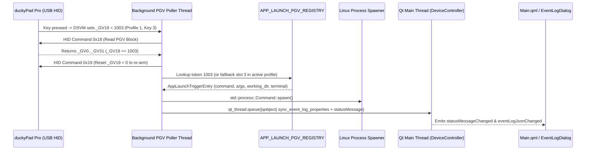
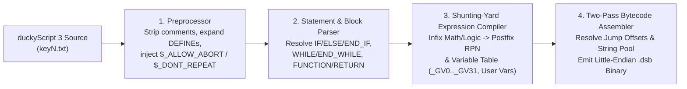
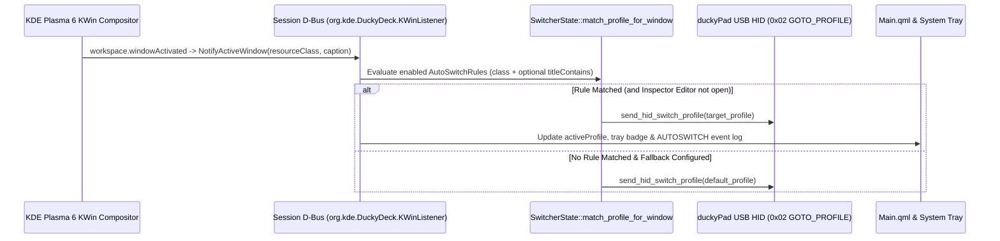

#  DuckyDeck Studio — Architecture & Design Developer Documentation

**Author:** Russell Milliner  
**Website & Documentation:** [https://duckydeckstudio.com](https://duckydeckstudio.com)  
**Repository:** [https://github.com/russellmilliner/duckydeck-studio](https://github.com/russellmilliner/duckydeck-studio)  
**Support:** [☕ Buy Me a Coffee on Ko-fi (https://ko-fi.com/russellmilliner)](https://ko-fi.com/russellmilliner)  
**License:** GPL-3.0-or-later  

---

## 1. System Overview & Design Philosophy

**DuckyDeck Studio** is a native Linux desktop configurator, **DSVM v2 bytecode compiler**, **KDE Plasma 6 Wayland Auto-Switcher**, and **host automation daemon** for the **duckyPad Pro (`0x0483:0xd11d`)** and **duckyPad 2020 (`0x0483:0xd11c`)**.

### Core Design Goals
1. **Zero-Runtime-Wrapper Native Stack:** Built directly in **Rust (2021 edition)** bridged to **Qt 6 / KDE Frameworks 6 (Kirigami + KSyntaxHighlighting)** via **CXX-Qt 0.7**, avoiding Electron/Python packaging overhead while delivering native KDE Breeze theming and Wayland integration.
2. **Offline-First & Deterministic SD Sync:** All profile edits, key scripts, RGB LED overrides, and rule bindings are immediately persisted to a per-device local cache (`~/.local/share/duckydeck-studio/profiles_cache/<serial>/`) and compared against the hardware microSD state using deterministic content diffing before writing and validating `.dsb` bytecode on the microSD card.
3. **Full DSVM v2 Compiler in Pure Rust:** Compiles `duckyScript 3` (`keyN.txt` / `keyN-release.txt`) directly into duckyPad virtual machine bytecode (`.dsb`) with live syntax diagnostics, RPN expression evaluation, control flow (`IF`/`ELSE`/`WHILE`), functions, OLED primitives, and PGV (`_GV0.._GV31`) access.
4. **Bidirectional Hardware-Host Automation:** Combines KWin Wayland window focus events (`zbus` D-Bus listener) for automatic profile switching (`Host → duckyPad`) with USB HID PGV polling (`_GV18` / `_GV19`) and `evdev` F13–F24 listeners for Web API webhooks and Desktop Application Launching (`duckyPad → Host`).

---

## 2. High-Level System Architecture

```mermaid
flowchart TB
    subgraph UI["Qt 6 / KDE Kirigami QML Frontend (src/qml/)"]
        MainQML["Main.qml\n(3-Column Shell, Color Picker,\nWeb API & App Launch Builders,\nEvent Log, SD Sync & Settings)"]
        CanvasQML["HardwareCanvas.qml\n(4x5 RGB Matrix, Dual Encoders,\n128x128 OLED Simulator, 32ch Exp)"]
        AutoSwitchQML["AutoSwitchDrawer.qml\n(KWin Rules & Window Picker UI)"]
        PgvQML["PgvInspectorDrawer.qml\n(_GV0.._GV31 Live Inspector)"]
        AiQML["AiArchitectModal.qml\n(AI Macro Architect)"]
        UdevQML["UdevBanner.qml\n(Polkit udev Installer Banner)"]
    end

    subgraph Bridge["CXX-Qt 0.7 QObject Bridge (src/bridge/)"]
        DC["DeviceController\n(src/bridge/device_controller.rs)\nQProperties + QInvokables + Qt Thread Queue"]
        Tray["StatusNotifierItem System Tray\n(src/tray.rs)\nDynamic ARGB32 Pixmap + DBus Menu"]
    end

    subgraph Core["Rust Core Subsystems"]
        HW["Hardware & Storage Engine\n(src/hardware/storage.rs)\nUSB HID 0x0483:0xd11d / 0xd11c\nmicroSD config.txt & keyN.txt I/O"]
        DSVM["DSVM v2 Bytecode Compiler\n(src/hardware/dsvm.rs)\nduckyScript 3 -> .dsb Binary"]
        Perms["Permissions & Polkit\n(src/hardware/permissions.rs)\n/sys/class/hidraw + pkexec"]
        KWin["KWin Wayland Auto-Switcher\n(src/kwin/auto_switcher.rs)\nzbus DBus Service + Window Picker"]
        AI["KDE Shortcut Scraper\n(src/ai/shortcut_scraper.rs)\n~/.config/kglobalshortcutsrc"]
    end

    subgraph Daemons["Background Worker Threads"]
        Hotplug["USB Hotplug & PGV Poller Thread\n(_GV18 Web API / _GV19 App Launch)"]
        Evdev["evdev Global Hotkey Listener\n(F13..F24 Triggers)"]
        KWinTask["Tokio zbus KWin Listener\n(org.kde.DuckyDeck.KWinListener)"]
    end

    MainQML <--> DC
    CanvasQML <--> DC
    AutoSwitchQML <--> DC
    PgvQML <--> DC
    AiQML <--> DC
    UdevQML <--> DC

    DC <--> Tray
    DC <--> HW
    DC <--> DSVM
    DC <--> Perms
    DC <--> KWin
    DC <--> AI

    Hotplug --> DC
    Evdev --> DC
    KWinTask --> DC
```



---

## 3. Repository & Module Structure

| Path | Responsibility |
| :--- | :--- |
| [`Cargo.toml`](file:///home/millinr/Builds/Ducky/duckydeck-studio/Cargo.toml) | Crate manifest (`cxx-qt 0.7`, `hidapi`, `zbus`, `tokio`, `ksni`, `evdev`, `serde`, `ureq`). |
| [`build.rs`](file:///home/millinr/Builds/Ducky/duckydeck-studio/build.rs) | `CxxQtBuilder` configuration registering QML module `io.github.duckydeck` and compiling [`device_controller.rs`](file:///home/millinr/Builds/Ducky/duckydeck-studio/src/bridge/device_controller.rs). |
| [`src/main.rs`](file:///home/millinr/Builds/Ducky/duckydeck-studio/src/main.rs) | Application entrypoint: configures `QGuiApplication`, registers `KSyntaxHighlighting` QML types and custom `duckyscript3.xml` syntax definition, and loads `Main.qml`. |
| [`src/bridge/device_controller.rs`](file:///home/millinr/Builds/Ducky/duckydeck-studio/src/bridge/device_controller.rs) | Central `#[cxx_qt::bridge]` `DeviceController` QObject, background thread orchestration, Web API & App Launch execution, event logging, and QML JSON serialization. |
| [`src/hardware/storage.rs`](file:///home/millinr/Builds/Ducky/duckydeck-studio/src/hardware/storage.rs) | USB HID transport (`hidapi`), device discovery, RTC sync, PGV burst read/write (`0x18`/`0x19`), Mass Storage (`0x1B`) mounting via `udisksctl`, and `DuckyProfile` / `DuckySlotConfig` SD parser/writer. |
| [`src/hardware/dsvm.rs`](file:///home/millinr/Builds/Ducky/duckydeck-studio/src/hardware/dsvm.rs) | Pure-Rust duckyScript 3 → DSVM v2 (`.dsb`) bytecode compiler and syntax verifier. |
| [`src/hardware/permissions.rs`](file:///home/millinr/Builds/Ducky/duckydeck-studio/src/hardware/permissions.rs) | Inspects `/sys/class/hidraw` device nodes for `PermissionDenied` and invokes `pkexec` to install `70-duckypad.rules`. |
| [`src/kwin/auto_switcher.rs`](file:///home/millinr/Builds/Ducky/duckydeck-studio/src/kwin/auto_switcher.rs) | KWin Wayland script injector, `zbus` D-Bus service (`org.kde.DuckyDeck.KWinListener`), interactive KWin `queryWindowInfo` window picker, and persisted configuration (`kwin_rules.json`). |
| [`src/tray.rs`](file:///home/millinr/Builds/Ducky/duckydeck-studio/src/tray.rs) | FreeDesktop `StatusNotifierItem` (`ksni`) system tray service with dynamic 64×64 ARGB32 profile badge rendering. |
| [`src/ai/shortcut_scraper.rs`](file:///home/millinr/Builds/Ducky/duckydeck-studio/src/ai/shortcut_scraper.rs) | Parses `~/.config/kglobalshortcutsrc` to ground AI macro generation with real user shortcuts. |
| [`src/qml/Main.qml`](file:///home/millinr/Builds/Ducky/duckydeck-studio/src/qml/Main.qml) | Primary application window, sidebar profile manager, script editor, color picker window (`duckyColorPickerWindow`), Web API & App Launch builders, SD sync dialog, Event Log window, and Settings. |
| [`src/qml/HardwareCanvas.qml`](file:///home/millinr/Builds/Ducky/duckydeck-studio/src/qml/HardwareCanvas.qml) | Interactive 4×5 RGB key matrix, dual rotary encoders, 128×128 OLED simulator (`Canvas`), and 32-channel expansion module view. |

---

## 4. CXX-Qt Bridge & Concurrency Model

Because Qt GUI objects (`QObject`) have strict single-thread affinity (the Qt main event loop thread), [`DeviceController`](file:///home/millinr/Builds/Ducky/duckydeck-studio/src/bridge/device_controller.rs) separates state into:
1. **Qt-Thread Owned State (`DeviceControllerRust`):**
   - `profiles: Vec<DuckyProfile>` — In-memory representation of up to 64 profiles.
   - `sd_root_path: Option<PathBuf>` — Mounted microSD path when available.
   - `copied_slot: Option<DuckySlotConfig>` — Clipboard buffer for copy/paste across keys and profiles.
2. **Thread-Safe Shared State (`Arc<Mutex<...>>` / Static Atomics):**
   - `switcher_state: Arc<Mutex<SwitcherState>>` — Shared between the Qt thread and the Tokio KWin D-Bus listener task.
   - `WEB_API_REGISTRY: OnceLock<Mutex<HashMap<String, WebApiTriggerEntry>>>` and `WEB_API_PGV_REGISTRY: OnceLock<Mutex<HashMap<i32, WebApiTriggerEntry>>>` — Shared registries for F13–F24 and `_GV18` Web API triggers.
   - `APP_LAUNCH_FKEY_REGISTRY` and `APP_LAUNCH_PGV_REGISTRY` — Shared registries for F13–F24 and `_GV19` Application Launch triggers.
   - `SYSTEM_EVENT_LOG: OnceLock<Mutex<Vec<SystemEventEntry>>>` — Ring buffer (up to 1,000 entries) mirrored to `~/.local/share/duckydeck-studio/logs/system_events.log`.
3. **Cross-Thread UI Updates (`CxxQtThread`):**
   - Background threads (KWin D-Bus listener, USB hotplug & PGV poller, async SD sync worker, HTTP webhook worker, firmware checker) never mutate `QProperty` values directly. Instead, they capture `let qt_thread = self.qt_thread();` and dispatch closures via `qt_thread.queue(move |mut qobject| { ... })`.



---

## 5. Hardware Communication & Storage Layer

### 5.1 USB HID Protocol (`src/hardware/storage.rs`)
The duckyPad Pro (`0x0483:0xd11d`) and duckyPad 2020 (`0x0483:0xd11c`) communicate over a 64-byte vendor-defined USB HID interface (`HID_REPORT_ID_OUT = 0x05`).

| Command Byte (`tx[2]`) | Name | Description |
| :--- | :--- | :--- |
| `0x01` | `HID_CMD_GET_INFO` | Returns firmware version, hardware model, serial number, active profile, and MSC disk label. |
| `0x02` | `HID_CMD_GOTO_PROFILE` | Switches the active hardware profile (`1..=64`). |
| `0x14` | `HID_CMD_SWCOLOR` | Sets a single key's RGB LED override (`key_index 0..19`, `R`, `G`, `B`) in real time. |
| `0x15` / `0x16` | `SLEEP` / `WAKE` | Puts the duckyPad into sleep mode or wakes it up. |
| `0x18` | `HID_CMD_READ_PGV` | Reads all 32 32-bit Persistent Global Variables (`_GV0.._GV31`, 128 bytes) across 3 burst packets (`chunk_index 0..2`). |
| `0x19` | `HID_CMD_WRITE_PGV` | Writes a 32-bit little-endian integer to `_GV[idx]` (`0..31`) in non-volatile memory. |
| `0x1A` | `HID_CMD_SYNC_RTC` | Synchronizes the hardware Real-Time Clock with the Linux host's Unix timestamp and UTC offset. |
| `0x1B` | `HID_CMD_MOUNT_USB_MSC` | Reboots the duckyPad Pro into USB Mass Storage mode so the host can mount the microSD card via `udisksctl`. |

### 5.2 microSD File Layout & `config.txt` Format
Each profile resides in a folder named `profile_<Name>` (or `profile<N>_<Name>`) on the FAT32 microSD card, indexed by `profile_info.txt`:
- `config.txt`:
  - `z<N> <line1>` — First OLED label line for slot `N` (`1..58`, max 7 chars).
  - `x<N> <line2>` — Second OLED label line for slot `N` (`1..58`, max 7 chars).
  - `BG_COLOR <R> <G> <B>` — Default background RGB LED color for the profile.
  - `SWCOLOR_<N> <R> <G> <B>` — Custom per-key RGB LED override for key `N` (`1..20`).
  - `ab <N>` — Allow any key press to abort script execution on slot `N`.
  - `dr <N>` — Disable auto-repeat while key `N` is held down.
- `key<N>.txt` & `key<N>.dsb`: On-press duckyScript 3 source and compiled DSVM v2 bytecode binary.
- `key<N>-release.txt` & `key<N>-release.dsb`: On-release duckyScript 3 source and compiled DSVM v2 bytecode binary.

---

## 6. DSVM v2 Bytecode Compiler (`src/hardware/dsvm.rs`)

The duckyPad Pro executes compiled **DSVM v2 (`.dsb`)** stack-machine bytecode files rather than interpreting raw text on-device. [`src/hardware/dsvm.rs`](file:///home/millinr/Builds/Ducky/duckydeck-studio/src/hardware/dsvm.rs) implements a complete two-pass compiler:



### Key Compiler Capabilities
- **Preprocessor & Metadata Directives:** Preserves structured comment directives (`// @DUCKYDECK_WEBAPI {...}` and `// @DUCKYDECK_APPLAUNCH {...}`) so visual builder configurations round-trip losslessly inside standard `keyN.txt` files.
- **Expression Engine:** Converts infix arithmetic, bitwise, and boolean expressions into stack-based RPN instructions (`OP_PUSH_CONST`, `OP_PUSH_VAR`, `OP_ADD`, `OP_EQ`, `OP_BITWISE_AND`, etc.).
- **Built-In Hardware Commands:** Compiles keyboard/mouse HID injection (`STRING`, `STRINGLN`, `KEYDOWN`, `KEYUP`, `MMOVE`, `LCLICK`), LED commands (`SWCC`, `SWCF`, `SWCR`), OLED graphics (`OLED_CLEAR`, `OLED_CURSOR`, `OLED_PRINT`, `OLED_LINE`, `OLED_RECT`, `OLED_CIRCLE`, `OLED_UPDATE`), and profile control (`GOTO_PROFILE`, `NEXT_PROFILE`, `PREV_PROFILE`, `DP_SLEEP`).

---

## 7. Wayland Auto-Switcher Architecture (`src/kwin/auto_switcher.rs`)

Wayland compositors isolate window focus metadata for security. On KDE Plasma 6, DuckyDeck Studio bridges KWin window focus changes to the duckyPad using a lightweight runtime KWin Script paired with a `zbus` D-Bus service:



### Editor Pause Safeguard
When a user selects a key in the UI to edit its script (`root.hasSelectedSlot == true`), `deviceController.setScriptEditorOpen(true)` sets `sw.paused_for_editing = true`. While paused:
- Incoming KWin window activation events still update `activeWindowClass` / `activeWindowTitle` diagnostics.
- Automatic profile switching is suppressed so the user can freely focus a browser or terminal to copy URLs, headers, or CLI commands without losing their active editing context.

---

## 8. Color Picker & Palette Persistence

The custom Color Picker window (`duckyColorPickerWindow` in [`src/qml/Main.qml`](file:///home/millinr/Builds/Ducky/duckydeck-studio/src/qml/Main.qml)) provides two synchronized palettes:
1. **Saved Colors (`saved_colors_json`):**
   - Stored in `SwitcherState::saved_colors` (`Vec<String>` of normalized `#rrggbb` strings) and persisted in `~/.config/duckydeck-studio/kwin_rules.json`.
   - Exposed to QML via `deviceController.savedColorsJson`, `savePaletteColor(hex)`, and `removePaletteColor(hex)`.
2. **Used Colors (`used_colors_json`):**
   - Computed dynamically by [`DeviceControllerRust::collect_used_colors_json`](file:///home/millinr/Builds/Ducky/duckydeck-studio/src/bridge/device_controller.rs#L1002-L1022) across all loaded profiles (`prof.bg_color` and every slot's `custom_rgb`).
   - Automatically refreshes whenever a profile or key color is modified.

---

## 9. Persistence & File Locations

| Path | Format | Contents |
| :--- | :--- | :--- |
| [`~/.config/duckydeck-studio/kwin_rules.json`](file:///home/millinr/.config/duckydeck-studio/kwin_rules.json) | JSON | Auto-Switcher rules, fallback profile, UI area text scales, tray preferences, **HTTP REST API Server config (`rest_api_*`)**, **Global Profile Change Webhook (`profile_webhook_*`)**, and **Saved Colors** palette. |
| `~/.config/duckydeck-studio/home_assistant.json` | JSON | Home Assistant Web API connection (`base_url` and Long-Lived Access Token `access_token`) used for device/entity search. |
| `~/.config/duckydeck-studio/oled_widget_geometry.json` | JSON | Multi-monitor screen name (`screen_name`), position (`x`, `y`), size (`width`, `height`), `transparency_percent`, `always_on_top`, `frameless_mode`, and `show_rgb_dots` for the Desktop OLED Widget. |
| `~/.config/duckydeck-studio/profile_templates.json` | JSON | User-created reusable profile templates saved from existing profiles (merged with built-in templates). |
| `~/.local/share/duckydeck-studio/firmware_cache/official/` | Directory | Downloaded official dekuNukem `.bin` firmware binaries and `official_catalog.json` metadata cache verified by IEEE CRC32. |
| `~/.local/share/duckydeck-studio/profiles_cache/<serial>/` | Directory | Offline mirror of all hardware profiles (`profile_info.txt`, `profile_*/config.txt`, `key*.txt`, `key*.dsb`) and `.sd_baseline/` snapshot for diffing. |
| `~/.local/share/duckydeck-studio/logs/system_events.log` | Plaintext Log | Timestamped diagnostic event log (`DEVICE`, `PROFILE`, `AUTOSWITCH`, `SD_SYNC`, `SCRIPT`, `WEB_API`, `APP_LAUNCH`, `SYSTEM`). |
| `~/.local/share/org.kde.syntax-highlighting/syntax/duckyscript3.xml` | Kate XML | KDE `KSyntaxHighlighting` grammar definition for duckyScript 3. |

---

## 9.5 Hardware Portability vs. Host-Dependent Execution Model

DuckyDeck Studio distinguishes between **Standalone Hardware-Portable Capabilities** (stored on the FAT32 microSD card and executed directly by the STM32 / DSVM v2 firmware on any host OS) and **Host-Dependent Capabilities** (which require the `duckydeck-studio` process running on the Linux host PC):

1. **Hardware-Portable (Autonomous on microSD):**
   - Compiled `.dsb` bytecode (`STRING`, `KEYDOWN`, `DELAY`, `MOUSE_MOVE`, `SWC_SET`, `OLED_PRINT`, `GOTO_PROFILE`, etc.).
   - `config.txt` hardware directives: `BG_COLOR`, `KEYDOWN_COLOR`, `SWCOLOR_<N>`, `DIM_UNUSED_KEYS`, `IS_UPPER_HS`, `IS_LANDSCAPE`, `OLED_ROTATION` (`0°/90°/180°/270°`), and 5-character `z<N>`/`x<N>` OLED labels.
2. **Host-Dependent (`💻 Requires DuckyDeck Studio Running`):**
   - **Application Launcher (`// @DUCKYDECK_APPLAUNCH`)** and **Web API / Home Assistant Webhooks (`// @DUCKYDECK_WEBAPI`)**: The key script writes a trigger token to `_GV19` / `_GV18` (or emits `F13..F24`), which is polled over USB HID by `duckydeck-studio` and executed on the host PC.
   - **Profile Change Webhooks (`PROFILE_WEBHOOK` per-profile & Global Webhook)**: Fired asynchronously by `duckydeck-studio` whenever the active profile changes via UI, hardware buttons, Auto-Switcher, or REST API. Excluded from microSD sync diffs.
   - **KWin Wayland Active-Window Auto-Switcher**: Driven by the KWin D-Bus script and `zbus` listener inside `duckydeck-studio`.
   - **Desktop OLED Companion Widget (`OledDesktopWidget.qml`), 24-Char Extended Labels (`wz<N>`/`wx<N>`), and Independent Widget Rotation (`DW_ROTATION`)**: Rendered on the host desktop by `duckydeck-studio`. Changing `DW_ROTATION` updates the local profile cache and live widget immediately without marking the microSD card out of sync (`compute_profiles_fingerprint` and `compute_unsynced_changes_json` exclude `DW_ROTATION` and `PROFILE_WEBHOOK`, and `merge_host_only_profile_settings` preserves them across SD reloads).
   - **Live USB HID RGB Streaming**: Pushes real-time LED frames via HID command `0x14` from `duckydeck-studio`.

---

## 9.6 Firmware Versioning (`v1.0.0`) & Official Firmware Catalog Downloader

- **DuckyDeck Studio Firmware (`v1.0.0`)**: Built from `firmware/duckyPad-Pro/firmware/` (`DPP_FW_1.0.0_<crc32>.bin`) and identified over USB HID `GET_INFO` (`0x00`) via the `'D', 'D', 'S'` signature at bytes `20..22`. Adds `0°/90°/180°/270°` hardware OLED orientation and `0x80..0x9F` 1-bit monochrome key icons.
- **Official dekuNukem Firmware Catalog Downloader**: `fetch_official_firmwares_from_site()` queries the official `dekuNukem/duckyPad-Pro` GitHub repository (`firmware/` directory and Releases API) to list available `DPP_FW_<ver>_<crc32>.bin` releases inside the Firmware Manager window. Clicking **Download .bin** or **Download & Install** invokes `download_official_firmware_binary()`, which downloads the `.bin` into `~/.local/share/duckydeck-studio/firmware_cache/official/` and verifies its IEEE CRC32 checksum against the filename before staging or flashing.

---

## 9.7 Embedded HTTP REST API Server (`src/api_server.rs`) & Security Model

DuckyDeck Studio embeds a stoppable/restartable HTTP/1.1 REST API server (`src/api_server.rs`) that dispatches `/api/v1/*` requests onto the Qt main thread via `CxxQtThread<qobject::DeviceController>::queue(...)` and awaits the JSON response over a bounded channel.

- **Default Configuration**: Disabled by default (`rest_api_enabled = false`), bound to loopback `127.0.0.1:28491`, with Bearer Token authentication enabled (`rest_api_require_auth = true`) and a 160-bit CSPRNG/hash-derived token (`ddk_<40 hex chars>`).
- **Constant-Time Token Verification**: All endpoints (except `/api/v1/health` and `OPTIONS` preflight) verify `Authorization: Bearer <token>` or `X-API-Token: <token>` in constant time (`constant_time_eq`) when `require_auth` is enabled.
- **Security Implications**:
  - Because the REST API can program arbitrary DuckyScript keystroke/mouse macros, sync to the microSD card, switch profiles, and invoke host actions (`APP_LAUNCH`, `WEB_API`, `SYS_ACTION`), binding to `0.0.0.0` exposes full device and host control over plain HTTP to the local network.
  - Both the Settings UI and user documentation prominently warn users to keep `127.0.0.1` unless LAN access is explicitly needed, keep Bearer Token authentication enabled, and use an HTTPS reverse proxy or SSH/WireGuard tunnel for remote access.

---

## 10. Building, Testing & Extending

### Running Unit & Compiler Tests
```bash
cargo test
```

### Building the Release Binary
```bash
cargo build --release
install -Dm755 target/release/duckydeck-studio ~/.local/bin/duckydeck-studio
```

### Adding a New QObject Property or Invokable
1. Declare the `#[qproperty(...)]` or `#[qinvokable]` signature inside `mod ffi` in [`src/bridge/device_controller.rs`](file:///home/millinr/Builds/Ducky/duckydeck-studio/src/bridge/device_controller.rs).
2. Add the backing field to `pub struct DeviceControllerRust` (with an initial value in `Default::default()`).
3. Implement any `#[qinvokable]` method on `impl qobject::DeviceController`.
4. Note that CXX-Qt automatically converts `snake_case` Rust identifiers to `camelCase` in QML (e.g. `save_palette_color` becomes `deviceController.savePaletteColor(...)`).

