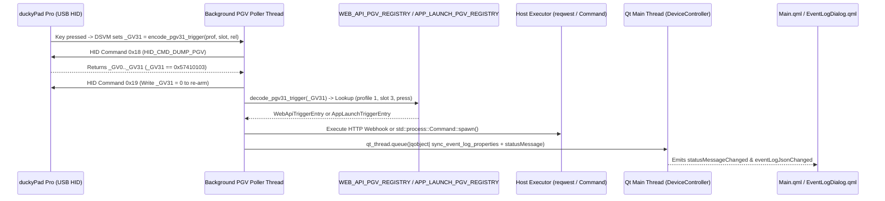
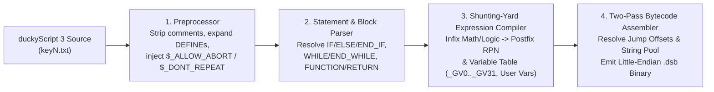
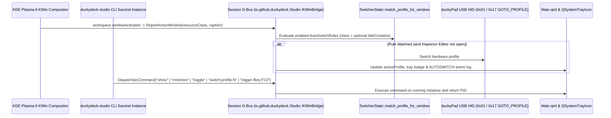

#  DuckyDeck Studio — Architecture & Design Developer Documentation

[](https://duckydeckstudio.com/releases/duckydeck-studio-v0.1.3-linux-x86_64.tar.gz)
[](https://duckydeckstudio.com/releases/duckydeck-studio-v0.1.3-x86_64.flatpak)
[](https://github.com/russellmilliner/duckydeck-studio/releases/tag/fw-v1.0.0)
[](https://duckydeckstudio.com)
[](https://github.com/russellmilliner/duckydeck-studio)

**Application Version:** `v0.1.3` (Custom Firmware `v1.0.0`, KDE Plasma 6 Applet `v1.0.2`)  
**Author:** Russell Milliner  
**Official Website & User Guide:** [https://duckydeckstudio.com](https://duckydeckstudio.com)  
**HTML Architecture Reference:** [`docs/architecture.html`](architecture.html) ([https://duckydeckstudio.com/architecture.html](https://duckydeckstudio.com/architecture.html))  
**GitHub Repository & Releases:** [https://github.com/russellmilliner/duckydeck-studio](https://github.com/russellmilliner/duckydeck-studio)  
**Flatpak Release Bundle:** [`duckydeck-studio-v0.1.3-x86_64.flatpak`](https://duckydeckstudio.com/releases/duckydeck-studio-v0.1.3-x86_64.flatpak)  
**REST API Reference:** [`docs/REST_API.md`](REST_API.md) ([https://duckydeckstudio.com/REST_API.md](https://duckydeckstudio.com/REST_API.md))  
**Support:** [☕ Buy Me a Coffee on Ko-fi (https://ko-fi.com/russellmilliner)](https://ko-fi.com/russellmilliner)  
**License:** GPL-3.0-or-later  

---

## 1. System Overview & Design Philosophy

**DuckyDeck Studio** (`v0.1.3`) is a native Linux desktop configurator, **DSVM v2 bytecode compiler**, **KDE Plasma 6 Wayland Auto-Switcher**, and **host automation daemon** for the **duckyPad Pro (`0x0483:0xd11d`)** and **duckyPad 2020 (`0x0483:0xd11c`)**.

### Core Design Goals
1. **Zero-Runtime-Wrapper Native Stack:** Built directly in **Rust (2021 edition)** bridged to **Qt 6 / KDE Frameworks 6 (Kirigami + KSyntaxHighlighting)** via **CXX-Qt 0.7**, avoiding Electron/Python packaging overhead while delivering native KDE Breeze theming and Wayland integration.
2. **Offline-First & Deterministic SD Sync:** All profile edits, key scripts, RGB LED overrides, and rule bindings are immediately persisted to a per-device local cache (`~/.local/share/duckydeck-studio/profiles_cache/<serial>/`) and compared against the hardware microSD state using deterministic content diffing before writing and validating `.dsb` bytecode on the microSD card.
3. **Full DSVM v2 Compiler in Pure Rust:** Compiles `duckyScript 3` (`keyN.txt` / `keyN-release.txt`) directly into duckyPad virtual machine bytecode (`.dsb`) with live syntax diagnostics, RPN expression evaluation, control flow (`IF`/`ELSE`/`WHILE`), functions, OLED primitives, and PGV (`_GV0.._GV31`) access.
4. **Bidirectional Hardware-Host Automation:** Combines KWin Wayland window focus events (`zbus` D-Bus listener) for automatic profile switching (`Host → duckyPad`) with USB HID PGV polling (`_GV31` encoded via `encode_pgv31_trigger`) and global `F13–F24` shortcut triggers for Web API webhooks and Desktop Application Launching (`duckyPad → Host`).

---

## 2. High-Level System Architecture

```mermaid
flowchart TB
    subgraph UI["Qt 6 / KDE Kirigami QML Frontend"]
        MainQML["src/qml/Main.qml\n(ApplicationWindow Shell, Sidebar & Script Editor)"]
        CanvasQML["src/qml/HardwareCanvas.qml\n(4x5 RGB Matrix, Option C Header-Footer Keycaps,\nDual Encoders, 128x128 OLED Simulator, 32ch Exp)"]
        BuildersQML["src/qml/WebApiBuilder.qml &\nsrc/qml/AppLaunchBuilder.qml"]
        DialogsQML["src/qml/ColorPickerWindow.qml,\nsrc/qml/SettingsPage.qml,\nsrc/qml/SdSyncDialog.qml,\nsrc/qml/EventLogDialog.qml"]
        AutoSwitchQML["src/qml/AutoSwitchDrawer.qml\n(KWin Rules & Window Picker UI)"]
        PgvQML["src/qml/PgvInspectorDrawer.qml\n(_GV0.._GV31 Live Inspector)"]
        AiQML["src/qml/AiArchitectModal.qml\n(Macro Template Generator)"]
        WidgetQML["src/qml/OledDesktopWidget.qml\n(Floating 4-Way Rotated Desktop OLED Widget)"]
        UdevQML["src/qml/UdevBanner.qml\n(Polkit udev Installer Banner)"]
    end

    subgraph Bridge["CXX-Qt 0.7 QObject Bridge & Native Helpers"]
        DC["DeviceController\n(src/bridge/device_controller.rs)\nQProperties + QInvokables + Qt Thread Queue"]
        Tray["QSystemTrayIcon & KF6 Helper\n(src/cpp/app_helper.h)\nDynamic Tray Badge + About Action + Palette Bridge"]
    end

    subgraph Core["Rust Core Subsystems"]
        HW["Hardware & Storage Engine\n(src/hardware/storage.rs,\nsrc/hardware/profile.rs,\nsrc/hardware/msc.rs,\nsrc/hardware/firmware.rs)"]
        Actions["Host Action Subsystems\n(src/actions/web_api.rs,\nsrc/actions/app_launch.rs,\nsrc/actions/desktop_apps.rs)"]
        DSVM["DSVM v2 Bytecode Compiler\n(src/vm/compiler.rs)\nduckyScript 3 -> .dsb Binary"]
        Perms["Permissions & Polkit\n(src/hardware/permissions.rs)\n/sys/class/hidraw + pkexec"]
        KWin["KWin Wayland Auto-Switcher\n(src/kwin/auto_switcher.rs)\nzbus D-Bus Service + Rule Remapper"]
        AI["KDE Shortcut Scraper\n(src/ai/shortcut_scraper.rs)\n~/.config/kglobalshortcutsrc"]
        API["Embedded REST API Server\n(src/api_server.rs)\n/api/v1/* + Async Job Worker"]
    end

    subgraph Daemons["Background Worker Threads"]
        Hotplug["USB Hotplug & _GV31 Trigger Poller\n(encode_pgv31_trigger / decode_pgv31_trigger)"]
        KWinTask["Tokio zbus D-Bus Service\n(io.github.duckydeck.Studio /KWinBridge)"]
    end

    MainQML <--> DC
    CanvasQML <--> DC
    BuildersQML <--> DC
    DialogsQML <--> DC
    AutoSwitchQML <--> DC
    PgvQML <--> DC
    AiQML <--> DC
    WidgetQML <--> DC
    UdevQML <--> DC

    DC <--> Tray
    DC <--> HW
    DC <--> Actions
    DC <--> DSVM
    DC <--> Perms
    DC <--> KWin
    DC <--> AI
    API <--> DC

    Hotplug --> DC
    KWinTask --> DC
```



---

## 3. Repository & Module Structure

| Path | Responsibility |
| :--- | :--- |
| [`Cargo.toml`](../Cargo.toml) | Crate manifest (`version = "0.1.3"`, `cxx-qt 0.7`, `hidapi`, `zbus`, `tokio`, `reqwest`, `keyring`, `serde`, `serde_json`, `sha2`). |
| [`build.rs`](../build.rs) | `CxxQtBuilder` configuration registering QML module `io.github.duckydeck` and compiling [`src/bridge/device_controller.rs`](../src/bridge/device_controller.rs). |
| [`src/main.rs`](../src/main.rs) | Application entrypoint: CLI & D-Bus single-instance IPC client, `QApplication` initialization, `KSyntaxHighlighting` registration, and QML engine startup. |
| [`src/paths.rs`](../src/paths.rs) | XDG directory helpers (`XDG_CONFIG_HOME`, `XDG_DATA_HOME`, `XDG_RUNTIME_DIR`) and environment sanitization. |
| [`src/api_server.rs`](../src/api_server.rs) | Embedded HTTP/1.1 REST API Server (`/api/v1/*`) with Bearer auth, connection cap, payload size guard, and async job worker. |
| [`src/bridge/device_controller.rs`](../src/bridge/device_controller.rs) | Central `#[cxx_qt::bridge]` `DeviceController` QObject, profile fallback & Auto-Switcher synchronization invariants, background thread orchestration, and QInvokable wrappers. |
| [`src/bridge/event_log.rs`](../src/bridge/event_log.rs) | Thread-safe ring buffer (`SYSTEM_EVENT_LOG`), log file appender, and JSON serializer for system diagnostics. |
| [`src/bridge/rest_routes.rs`](../src/bridge/rest_routes.rs) | REST API route table and request handlers executed via the `DeviceController` bridge. |
| [`src/bridge/serialize.rs`](../src/bridge/serialize.rs) | JSON serializers for profiles, slots, unsynced diffs, and templates exposed to QML and the REST API. |
| [`src/bridge/showcase.rs`](../src/bridge/showcase.rs) | Built-in profile templates, SVG icon helpers (`known_site_svg`), and optional `--features demo` showcase generator. |
| [`src/hardware/storage.rs`](../src/hardware/storage.rs) | USB HID transport (`hidapi`), device discovery, RTC sync, PGV burst read/write (`0x18`/`0x19`), and submodule re-exports. |
| [`src/hardware/profile.rs`](../src/hardware/profile.rs) | `DuckyProfile` and `DuckySlotConfig` parser/writer (`config.txt`, `profile_info.txt`), diffing, and local cache management. |
| [`src/hardware/msc.rs`](../src/hardware/msc.rs) | USB Mass Storage (`0x1B`) mounting/unmounting via `udisksctl` and microSD card capacity inspection. |
| [`src/hardware/firmware.rs`](../src/hardware/firmware.rs) | Firmware release catalog, GitHub release downloader, and IEEE CRC32 integrity verification. |
| [`src/hardware/permissions.rs`](../src/hardware/permissions.rs) | Inspects `/sys/class/hidraw` device nodes for `PermissionDenied` and invokes `pkexec` to install `70-duckypad.rules`. |
| [`src/actions/web_api.rs`](../src/actions/web_api.rs) | Web API / Webhook & Home Assistant client, OS keyring secret storage, and `_GV31` trigger encoding (`encode_pgv31_trigger`). |
| [`src/actions/app_launch.rs`](../src/actions/app_launch.rs) | Desktop Application Launcher metadata parser/generator (`// @DUCKYDECK_APPLAUNCH`), process spawner, and `_GV31` / `F13–F24` registries. |
| [`src/actions/desktop_apps.rs`](../src/actions/desktop_apps.rs) | XDG `.desktop` entry scanner across system, user, and Flatpak directories. |
| [`src/vm/compiler.rs`](../src/vm/compiler.rs) | Pure-Rust duckyScript 3 → DSVM v2 (`.dsb`) two-pass bytecode compiler and syntax verifier. |
| [`src/kwin/auto_switcher.rs`](../src/kwin/auto_switcher.rs) | KWin Wayland script injector, `zbus` D-Bus service (`io.github.duckydeck.Studio` at `/KWinBridge`), window picker, profile reorder/deletion rule remapper, and persisted rules (`kwin_rules.json`). |
| [`src/ai/shortcut_scraper.rs`](../src/ai/shortcut_scraper.rs) | Parses `~/.config/kglobalshortcutsrc` and converts KDE shortcuts into duckyScript 3 syntax (`kde_shortcut_to_duckyscript`). |
| [`src/cpp/app_helper.h`](../src/cpp/app_helper.h) | C++ helper bridging `QSystemTrayIcon` (dynamic profile badge, SD status, Auto-Switcher/Autostart toggles, and `"About DuckyDeck Studio"` dialog trigger), `KColorScheme`, `KIconLoader`, and `KSyntaxHighlighting` into the QML engine. |
| [`src/qml/Main.qml`](../src/qml/Main.qml) | Primary `Kirigami.ApplicationWindow` shell, profile sidebar (with inline `✕` filter clear button, hover tooltips, and `HighContrastCheckBox`/`HighContrastScrollBar`), and duckyScript 3 code editor. |
| [`src/qml/HardwareCanvas.qml`](../src/qml/HardwareCanvas.qml) | Interactive 4×5 RGB key matrix using the **Option C Header-Footer Split** keycap layout, dual rotary encoders, 128×128 OLED simulator (`Canvas`), and 32-channel expansion module view. |
| [`src/qml/ColorPickerWindow.qml`](../src/qml/ColorPickerWindow.qml) | Custom HSV/RGB color picker window, saved/used color palettes, and RGB lighting animation builder. |
| [`src/qml/WebApiBuilder.qml`](../src/qml/WebApiBuilder.qml) | Visual Web API / Webhook key builder and saved destinations manager. |
| [`src/qml/AppLaunchBuilder.qml`](../src/qml/AppLaunchBuilder.qml) | Visual Desktop Application Launcher builder, installed app picker, macro recorder, and OLED icon picker. |
| [`src/qml/SettingsPage.qml`](../src/qml/SettingsPage.qml) | Application Settings window, Profile Properties, Key Properties, Profile Templates, and standalone `About DuckyDeck Studio` dialog (`openAboutWindow()`). |
| [`src/qml/RestApiSettings.qml`](../src/qml/RestApiSettings.qml) | HTTP REST API Server and Global Profile Change Webhook configuration section inside Settings. |
| [`src/qml/SdSyncDialog.qml`](../src/qml/SdSyncDialog.qml) | microSD sync progress dialog, unsynced changes diff viewer, and Firmware Manager dialog. |
| [`src/qml/EventLogDialog.qml`](../src/qml/EventLogDialog.qml) | System Event Log viewer, filter/export controls, and automated scene-graph UI test suite runner (`--ui-test-suite` across Dark/Light themes at `100%` and `115%` zoom levels). |
| [`src/qml/AutoSwitchDrawer.qml`](../src/qml/AutoSwitchDrawer.qml) | KWin Wayland Auto-Switcher rules (with inline `✕` filter clear button & hover reorder tooltips) & interactive window picker dialog. |
| [`src/qml/PgvInspectorDrawer.qml`](../src/qml/PgvInspectorDrawer.qml) | Live Signed/Unsigned/Hex editor for `_GV0.._GV31`. |
| [`src/qml/AiArchitectModal.qml`](../src/qml/AiArchitectModal.qml) | Macro Template Generator (experimental) modal dialog with KDE shortcut selector. |
| [`src/qml/OledDesktopWidget.qml`](../src/qml/OledDesktopWidget.qml) | Floating desktop OLED companion widget window supporting 4-way orientation (`0°/90°/180°/270°`) with both key-grid remapping and in-key label rotation. |
| [`src/qml/UdevBanner.qml`](../src/qml/UdevBanner.qml) | Inline Polkit 1-click udev setup warning banner. |

---

## 4. CXX-Qt Bridge, Concurrency Model & `_GV31` Trigger Encoding

Because Qt GUI objects (`QObject`) have strict single-thread affinity (the Qt main event loop thread), [`src/bridge/device_controller.rs`](../src/bridge/device_controller.rs) separates state into:
1. **Qt-Thread Owned State (`DeviceControllerRust`):**
   - `profiles: Vec<DuckyProfile>` — In-memory representation of up to 64 profiles.
   - `sd_root_path: Option<PathBuf>` — Mounted microSD path when available.
   - `copied_slot: Option<DuckySlotConfig>` — Clipboard buffer for copy/paste across keys and profiles.
2. **Thread-Safe Shared State (`Arc<Mutex<...>>` / Static Atomics):**
   - `switcher_state: Arc<Mutex<SwitcherState>>` — Shared between the Qt thread and the Tokio D-Bus listener task.
   - `WEB_API_REGISTRY` and `WEB_API_PGV_REGISTRY` — Shared registries for `F13–F24` and `_GV31` Web API triggers.
   - `APP_LAUNCH_FKEY_REGISTRY` and `APP_LAUNCH_PGV_REGISTRY` — Shared registries for `F13–F24` and `_GV31` Application Launch triggers.
   - `SYSTEM_EVENT_LOG` — Ring buffer (up to 1,000 entries) mirrored to `~/.local/share/duckydeck-studio/logs/system_events.log`.
3. **Unified `_GV31` Trigger Encoding (`encode_pgv31_trigger` / `decode_pgv31_trigger`):**
   - Both Web API (`// @DUCKYDECK_WEBAPI`) and Desktop Application Launch (`// @DUCKYDECK_APPLAUNCH`) scripts in `pgv` trigger mode write a 32-bit magic word into Persistent Global Variable **`_GV31`** (`PGV_TRIGGER_INDEX = 31`).
   - [`encode_pgv31_trigger(profile_num, slot_num, is_release)`](../src/actions/web_api.rs) packs the magic prefix `WEB_API_PGV_MAGIC = 0x5741_0000` (`"WA\0\0"`) in the upper 16 bits, bit 15 (`0x8000`) for `is_release`, bits `8..14` (`0x7F00`) for `profile_num`, and bits `0..7` (`0x00FF`) for `slot_num` (`1..=58`).
   - When the background USB HID poller reads `_GV0.._GV31` via command `0x18` (`HID_CMD_DUMP_PGV`) and detects a non-zero `_GV31` matching `decode_pgv31_trigger`, it immediately clears `_GV31 = 0` via command `0x19` (`HID_CMD_WRITE_PGV`) to re-arm the trigger and dispatches the matching `WEB_API_PGV_REGISTRY` or `APP_LAUNCH_PGV_REGISTRY` action on the host.
4. **Cross-Thread UI Updates (`CxxQtThread`):**
   - Background threads never mutate `QProperty` values directly; they capture `let qt_thread = self.qt_thread();` and dispatch closures via `qt_thread.queue(move |mut qobject| { ... })`.



---

## 5. Hardware Communication & Storage Layer

### 5.1 USB HID Protocol (`src/hardware/storage.rs`)
The duckyPad Pro (`0x0483:0xd11d`) and duckyPad 2020 (`0x0483:0xd11c`) communicate over a 64-byte vendor-defined USB HID interface (`HID_REPORT_ID_OUT = 0x05`).

| Command Byte (`tx[2]`) | Name | Description |
| :--- | :--- | :--- |
| `0x00` | `HID_CMD_QUERY_INFO` | Returns firmware version, hardware model, serial number, active profile, and capability signature. |
| `0x01` | `HID_CMD_GOTO_PROFILE_BY_NUM` | Switches the active hardware profile by number (`1..=64`). |
| `0x04` | `HID_CMD_SET_LED_SINGLE` | Sets a single key's RGB LED override in real time. |
| `0x14` | `HID_CMD_SOFTWARE_RESET` | Reboots the duckyPad firmware (optionally into USB MSC mode). |
| `0x17` | `HID_CMD_GOTO_PROFILE_BY_NAME` | Switches the active hardware profile by folder name. |
| `0x18` | `HID_CMD_DUMP_PGV` | Reads all 32 32-bit Persistent Global Variables (`_GV0.._GV31`, 128 bytes) across 3 burst packets (`start_idx = 0, 15, 30`). |
| `0x19` | `HID_CMD_WRITE_PGV` | Writes up to 12 `(pgv_index | 0x80, i32_le)` entries per packet into `_GV0.._GV31`. |

### 5.2 microSD File Layout & `config.txt` Format (`src/hardware/profile.rs`)
Each profile resides in a folder named `profile<N>_<Name>` on the FAT32 microSD card:
- `config.txt`:
  - `z<N> <line1>` / `x<N> <line2>` — First and second OLED label lines for slot `N` (`1..58`).
  - `ui_z<N> <line1>` / `ui_x<N> <line2>` — UTF-8 icon-capable label lines for DuckyDeck Studio Firmware `v1.0.0`.
  - `wz<N> <line1>` / `wx<N> <line2>` — Extended 24-character desktop OLED widget labels.
  - `BG_COLOR <R> <G> <B>` — Default background RGB LED color for the profile.
  - `SWCOLOR_<N> <R> <G> <B>` — Custom per-key RGB LED override for key `N` (`1..20`).
  - `ab <N>` / `dr <N>` — Allow abort (`$_ALLOW_ABORT`) or disable auto-repeat (`$_DONT_REPEAT`) on slot `N`.
- `key<N>.txt` & `key<N>.dsb`: On-press duckyScript 3 source and compiled DSVM v2 bytecode binary.
- `key<N>-release.txt` & `key<N>-release.dsb`: On-release duckyScript 3 source and compiled DSVM v2 bytecode binary.
- `duckydeck_rules.json` (microSD root): Portable KWin Wayland auto-switcher rules bundle (`SdPersistedRulesBundle`), synchronized automatically between local config (`~/.config/duckydeck-studio/kwin_rules.json`) and the deck microSD card upon save/sync (`save_rules_bundle_to_dir`). Stores window resource class filters, window title patterns, default fallback profile, and associated profile names for cross-machine rule portability.

---

## 6. DSVM v2 Bytecode Compiler (`src/vm/compiler.rs`)

The duckyPad Pro executes compiled **DSVM v2 (`.dsb`)** stack-machine bytecode files rather than interpreting raw text on-device. [`src/vm/compiler.rs`](../src/vm/compiler.rs) implements a complete two-pass compiler:



### Key Compiler Capabilities
- **Preprocessor & Metadata Directives:** Preserves structured comment directives (`// @DUCKYDECK_WEBAPI {...}` and `// @DUCKYDECK_APPLAUNCH {...}`) so visual builder configurations round-trip losslessly inside standard `keyN.txt` files.
- **Expression Engine:** Converts infix arithmetic, bitwise, and boolean expressions into stack-based RPN instructions (`OP_PUSH_CONST`, `OP_PUSH_VAR`, `OP_ADD`, `OP_EQ`, `OP_BITWISE_AND`, etc.).
- **Built-In Hardware Commands:** Compiles keyboard/mouse HID injection (`STRING`, `STRINGLN`, `KEYDOWN`, `KEYUP`, `MMOVE`, `LCLICK`), LED commands (`SWC_SET`, `SWC_FILL`, `SWC_RESET`), OLED graphics (`OLED_CLEAR`, `OLED_CURSOR`, `OLED_PRINT`, `OLED_LINE`, `OLED_RECT`, `OLED_CIRCLE`, `OLED_UPDATE`), and profile control (`GOTO_PROFILE`, `NEXT_PROFILE`, `PREV_PROFILE`, `DP_SLEEP`).

---

## 7. Wayland Auto-Switcher & Session D-Bus IPC (`src/kwin/auto_switcher.rs` & `src/main.rs`)

Wayland compositors isolate window focus metadata for security. On KDE Plasma 6, DuckyDeck Studio registers the session D-Bus service **`io.github.duckydeck.Studio`** at object path **`/KWinBridge`** (interface **`io.github.duckydeck.KWinBridge`**) via `zbus`, serving both KWin Wayland callbacks and single-instance CLI IPC:



### D-Bus Interface Methods (`io.github.duckydeck.KWinBridge`)
1. `ReportActiveWindow(window_class: &str, window_title: &str)`: Invoked by the injected KWin script whenever the active Wayland window changes; evaluates `AutoSwitchRule` entries and switches the duckyPad profile unless paused because the script editor is open (`paused_for_editing`).
2. `ReportPickedWindow(window_class: &str, window_title: &str)`: Invoked when the user picks a window with the interactive KWin crosshair picker.
3. `DispatchIpcCommand(command: &str) -> u32`: Used by [`src/main.rs`](../src/main.rs) (`send_ipc_command_to_running_instance`) and [`src/cpp/app_helper.h`](../src/cpp/app_helper.h) for single-instance activation, system tray actions, and CLI remote commands (`show`, `show-about`, `minimize`, `toggle`, `quit`, `toggle-oled-widget`, `switch-profile:<n>`, `trigger-fkey:<F13..F24>`).

### Profile Fallback & Auto-Switcher Rule Synchronization Invariants
- **Default Fallback Profile Guarantee**: Whenever a new profile group is initialized or loaded (`load_profiles_from_root` / `reset_to_factory_defaults` in [`src/bridge/device_controller.rs`](../src/bridge/device_controller.rs)), if no profiles exist, Profile `#1` (`"Default"`) is automatically created and `fallback_profile` is clamped to a valid `1..=profiles.len()` index (defaulting to `#1`).
- **Non-Deletable Fallback Profile**: [`delete_profile`](../src/bridge/device_controller.rs) rejects deletion of the currently configured `fallback_profile` so that unmatched windows and deleted-profile rules always have a valid fallback target.
- **Automatic Rule & Fallback Remapping**:
  - **On Profile Reorder (`remap_rules_on_profile_reorder`)**: Moving a profile from `from_num` to `to_num` atomically updates `fallback_profile`, every `AutoSwitchRule::profile_number`, and `profile_name` in `~/.config/duckydeck-studio/kwin_rules.json`.
  - **On Profile Deletion (`remap_rules_on_profile_delete`)**: Deleting a profile shifts higher-numbered `fallback_profile` and rule indices down by `1`, and automatically reassigns any `AutoSwitchRule` that referenced the deleted profile to the updated `fallback_profile`.

### 7.1 First-Run Deck Setup, Legacy Migration & Conflict Resolution
When launching DuckyDeck Studio on a fresh install or a system with legacy dekuNukem duckyPad software:
1. **Conflicting Process Detection**: Detects running legacy background processes (`duckypad_autoprofile.py`, `duckypad_autoswitcher`, `duckypad_configurator`) via `/proc` inspection and host inspection (`flatpak-spawn --host pgrep/ps`). Offers one-click graceful shutdown (`stop_conflicting_software`) to prevent USB HID bus contention.
2. **Profile & Rule Discovery**: Discovers profiles from the connected deck microSD card, local DuckyDeck cache, and legacy dekuNukem profile backups in `~/.local/share/duckypad_config/profile_backups/` ([`src/hardware/profile.rs`](../src/hardware/profile.rs)). Discovers rules from microSD `duckydeck_rules.json`, local DuckyDeck rules, and legacy dekuNukem auto-switcher configurations (`~/.local/share/duckypad_autoswitcher/rules.txt`) ([`src/kwin/auto_switcher.rs`](../src/kwin/auto_switcher.rs)).
3. **One-Click Migration**: The user can import profiles and auto-switcher rules simultaneously, automatically remapping profile numbers and names into DuckyDeck Studio's synchronized cache.
4. **Onboarding State Tracking**: Marks onboarding completion in `~/.config/duckydeck-studio/first_run_onboarding_state.json` (and host config if running inside Flatpak), preventing redundant prompts on subsequent launches while remaining accessible via SD Sync.

---

## 8. Keycap Layout, Desktop OLED Widget, Color Picker & UI Verification

### 8.1 Option C Header-Footer Split Keycap Layout (`src/qml/HardwareCanvas.qml`)
Each mechanical keycap cell in the 4×5 hardware matrix uses a non-overlapping 3-zone vertical structure:
1. **Top Header Strip (`15px`)**: Displays the compact key slot number (`1..20`) on the left alongside a pill-shaped per-key RGB LED color bar (`keyLedBar`) on the right.
2. **Center OLED Preview Area**: Renders the two-line key label (`labelLine1` / `labelLine2`, with automatic 1-bit icon badge scaling) centered cleanly with zero overlap against key numbers or action badges.
3. **Bottom Footer Strip (`15px`)**: Displays host-action badges (`APP` or `API` pill) on the left and repeat/abort execution flags (`↻` / `⏹`) on the right.

### 8.2 Desktop OLED Companion Widget & KDE Plasma Applet Orientation (`src/qml/OledDesktopWidget.qml`)
- Supports per-profile orientation (`DW_ROTATION`: `-1` Match Hardware OLED, `0°`, `90°`, `180°`, `270°`), synced immediately via `activeProfileWidgetRotation` whenever edited in Profile Properties or via the REST API.
- Applies both **grid coordinate remapping** (`remapGridCoords(r, c, rot)`) across the 4×5 matrix and **in-key text label rotation** (`cellLabelColumn.rotation: root.effectiveRotation`) with swapped width/height constraints at `90°` and `270°` so text inside each key rotates to match physical orientation.

### 8.3 Color Picker, High-Contrast Controls & Automated Scene-Graph UI Test Suite
- **Color Picker (`src/qml/ColorPickerWindow.qml`)**: Provides synchronized **Saved Colors** (`saved_colors_json` persisted in `kwin_rules.json`) and dynamically computed **Used Colors** (`collect_used_colors_json` across all loaded profiles and slots).
- **High-Contrast Controls (`HighContrastCheckBox` & `HighContrastScrollBar`)**: Custom QML control components with explicit dark/light mode border luminance (`#94a3b8` unchecked border in Dark Mode, `#475569` in Light Mode) and hover feedback across all windows.
- **Automated Scene-Graph UI Test Suite (`--ui-test-suite` in `src/qml/EventLogDialog.qml`)**: Walks every window, drawer, and dialog in both **Dark Mode** and **Light Mode** across **`100%` (`1.0x`)** and **`115%` (`1.15x`)** UI zoom levels, verifying zero text truncation, zero overlapping siblings (`KEYCAP_HEADER_OVERLAP` / `KEYCAP_FOOTER_OVERLAP`), and WCAG contrast ratios.

---

## 9. Persistence, Credentials & File Locations

| Path | Format | Contents |
| :--- | :--- | :--- |
| `~/.config/duckydeck-studio/kwin_rules.json` | JSON | Auto-Switcher rules, fallback profile, UI text scale, tray preferences, **HTTP REST API Server config (`rest_api_*`)**, **Global Profile Change Webhook (`profile_webhook_*`)**, and **Saved Colors** palette. Sensitive tokens are stored in the OS keyring (`keyring` crate) with `"__keyring__"` sentinel markers on disk. |
| `~/.config/duckydeck-studio/first_run_onboarding_state.json` | JSON | First-run setup completion state and version tracking for seamless onboarding and migration. |
| `<microSD>/duckydeck_rules.json` | JSON | Portable KWin Wayland auto-switcher rules bundle (`SdPersistedRulesBundle`) stored on the deck microSD card for cross-machine rule synchronization. |
| `~/.config/duckydeck-studio/home_assistant.json` | JSON | Home Assistant Web API connection (`base_url`; Long-Lived Access Token stored in OS keyring). |
| `~/.config/duckydeck-studio/oled_widget_geometry.json` | JSON | Multi-monitor screen name (`screen_name`), position (`x`, `y`), size (`width`, `height`), `transparency_percent`, `always_on_top`, `frameless_mode`, and `show_rgb_dots` for the Desktop OLED Widget. |
| `~/.config/duckydeck-studio/profile_templates.json` | JSON | User-created reusable profile templates saved from existing profiles (merged with built-in templates). |
| `~/.local/share/duckydeck-studio/firmware_cache/official/` | Directory | Downloaded official dekuNukem `.bin` firmware binaries and `official_catalog.json` metadata cache verified by IEEE CRC32. |
| `~/.local/share/duckydeck-studio/profiles_cache/<serial>/` | Directory | Offline mirror of all hardware profiles (`profile_info.txt`, `profile_*/config.txt`, `key*.txt`, `key*.dsb`) and `.sd_baseline/` snapshot for diffing. |
| `~/.local/share/duckydeck-studio/logs/system_events.log` | Plaintext Log | Timestamped diagnostic event log (`DEVICE`, `PROFILE`, `AUTOSWITCH`, `SD_SYNC`, `SCRIPT`, `WEB_API`, `APP_LAUNCH`, `SYSTEM`). |
| `~/.local/share/org.kde.syntax-highlighting/syntax/duckyscript3.xml` | Kate XML | KDE `KSyntaxHighlighting` grammar definition for duckyScript 3. |

---

## 9.5 Hardware Portability vs. Host-Dependent Execution Model

DuckyDeck Studio distinguishes between **Standalone Hardware-Portable Capabilities** (stored on the FAT32 microSD card and executed directly by the STM32 / DSVM v2 firmware on any host OS) and **Host-Dependent Capabilities** (which require the `duckydeck-studio` process running on the Linux host PC):

1. **Hardware-Portable (Autonomous on microSD):**
   - Compiled `.dsb` bytecode (`STRING`, `KEYDOWN`, `DELAY`, `MOUSE_MOVE`, `SWC_SET`, `OLED_PRINT`, `GOTO_PROFILE`, etc.).
   - `config.txt` hardware directives: `BG_COLOR`, `KEYDOWN_COLOR`, `SWCOLOR_<N>`, `DIM_UNUSED_KEYS`, `IS_UPPER_HS`, `IS_LANDSCAPE`, `OLED_ROTATION` (`0°/90°/180°/270°`), and 5-character `z<N>`/`x<N>` OLED labels.
2. **Host-Dependent (`💻 Requires DuckyDeck Studio Running`):**
   - **Application Launcher (`// @DUCKYDECK_APPLAUNCH`)** and **Web API / Home Assistant Webhooks (`// @DUCKYDECK_WEBAPI`)**: The key script writes an encoded trigger word to `_GV31` via `encode_pgv31_trigger` (or emits `CONTROL ALT SHIFT F13..F24`), which is polled over USB HID by `duckydeck-studio` and executed on the host PC.
   - **Profile Change Webhooks (`PROFILE_WEBHOOK` per-profile & Global Webhook)**: Fired asynchronously by `duckydeck-studio` whenever the active profile changes via UI, hardware buttons, Auto-Switcher, or REST API. Excluded from microSD sync diffs.
   - **KWin Wayland Active-Window Auto-Switcher**: Driven by the KWin D-Bus script and `zbus` listener inside `duckydeck-studio`.
   - **Desktop OLED Companion Widget (`src/qml/OledDesktopWidget.qml`), 24-Char Extended Labels (`wz<N>`/`wx<N>`), and Independent Widget Rotation (`DW_ROTATION`)**: Rendered on the host desktop by `duckydeck-studio`.

---

## 9.6 Firmware Versioning (`v1.0.0`) & Official Firmware Catalog Downloader (`src/hardware/firmware.rs`)

- **DuckyDeck Studio Firmware (`v1.0.0`)**: Built from `firmware/duckyPad-Pro/firmware/` (`DPP_FW_1.0.0_ad2acc81.bin`, downloadable from the [GitHub Releases page](https://github.com/russellmilliner/duckydeck-studio/releases/tag/fw-v1.0.0)) and identified over USB HID `GET_INFO` (`0x00`) via the `'D', 'D', 'S'` signature at bytes `20..22`. Adds `0°/90°/180°/270°` hardware OLED orientation and `0x80..0x9F` 1-bit monochrome key icons.
- **Official dekuNukem Firmware Catalog Downloader**: `fetch_official_firmwares_from_site()` in [`src/hardware/firmware.rs`](../src/hardware/firmware.rs) queries the official `dekuNukem/duckyPad-Pro` GitHub repository to list available `DPP_FW_<ver>_<crc32>.bin` releases inside the Firmware Manager window and verifies IEEE CRC32 checksums before staging.

---

## 9.7 Embedded HTTP REST API Server (`src/api_server.rs`) & Security Model

DuckyDeck Studio embeds a bounded, stoppable/restartable HTTP/1.1 REST API server ([`src/api_server.rs`](../src/api_server.rs) and [`src/bridge/rest_routes.rs`](../src/bridge/rest_routes.rs)):

- **Default Configuration**: Disabled by default (`rest_api_enabled = false`), bound to loopback `127.0.0.1:28491`, with Bearer Token authentication enabled (`rest_api_require_auth = true`) and a 160-bit CSPRNG token (`ddk_<40 hex chars>`) persisted in the OS keyring.
- **Resource & Concurrency Bounds**:
  - **Connection Cap (`MAX_CONCURRENT_CONNECTIONS = 8`)**: Guarded by an `AtomicUsize` `ConnectionSlotGuard`; excess connections immediately receive `503 Service Unavailable` and close.
  - **Request Size Limits**: Header block capped at `64 KB`; request body capped at `2 MB` (`MAX_BODY_BYTES`), returning `413 Payload Too Large` when `Content-Length` or body bytes exceed `2 MB`.
  - **Qt Thread Timeout & Async Worker Jobs (`202 Accepted`)**: Synchronous routes wait at most `10 s` (`CONTROLLER_WAIT_TIMEOUT`) on the Qt main thread. Long-running operations (`POST /api/v1/sd/sync`, `POST /api/v1/sd/mount`, `POST /api/v1/sd/unmount`, `POST /api/v1/device/reboot`) immediately return `202 Accepted` with a job ID (`job_1`, `job_2`, ...) and execute on a background worker thread pollable via `GET /api/v1/jobs/{id}`.
- **Constant-Time Token Verification**: All endpoints (except `/api/v1/health`, `/api/v1/openapi.json`, `/api/v1/swagger.json`, `/api/v1/openapi.yaml`, and `OPTIONS` preflight) verify `Authorization: Bearer <token>` or `X-API-Token: <token>` in constant time (`constant_time_eq`) when `require_auth` is enabled.

---

## 10. Flatpak Sandbox Architecture, Building & Testing

### Flatpak Sandbox & Host Command Bridging (`io.github.duckydeck.Studio.yml` & `scripts/build-flatpak.sh`)
- Built against `org.kde.Platform//6.8` and `org.kde.Sdk//6.8` with `rust-stable` and `llvm18` SDK extensions.
- **USB HID & Block Device Discovery:** Uses `--device=all` and `--filesystem=/run/udev:ro` for direct `/dev/hidraw*` and `/dev/disk/by-label` / `/dev/disk/by-id` enumeration.
- **USB Mass Storage (`udisksctl`) Host Bridging:** Inside Flatpak (`/.flatpak-info` present), [`src/hardware/msc.rs`](../src/hardware/msc.rs) invokes `udisksctl`, `umount`, `sync`, and host `/proc/mounts` checks via `flatpak-spawn --host` (`--talk-name=org.freedesktop.Flatpak` and `--system-talk-name=org.freedesktop.UDisks2`) while reading/writing mounted volumes via `--filesystem=/run/media:rw` and `--filesystem=/media:rw`.
- **Bundled Custom Firmware Discovery:** [`src/hardware/firmware.rs`](../src/hardware/firmware.rs) scans `/app/share/duckydeck-studio/firmware`, `/app/share/duckydeck-studio/firmware/releases`, and embeds `DPP_FW_1.0.0_ad2acc81.bin` as a compile-time fallback so the DuckyDeck Studio `v1.0.0` firmware is always available in the Firmware Manager.

### Running Unit, Compiler, Native UI & Flatpak UI Checks
```bash
# 1. Run formatting, clippy (-D warnings), unit tests, and architecture path verification:
bash scripts/check.sh

# 2. Run the Native QML UI Overflow, Contrast & Behavioral Test Suite:
cargo test ui_test_suite::test_full_qml_ui_overflow_and_contrast_suite -- --ignored --nocapture

# 3. Build & install the Flatpak bundle:
bash scripts/build-flatpak.sh
flatpak install --user -y --reinstall target/release/duckydeck-studio-v0.1.3-x86_64.flatpak

# 4. Run the Flatpak QML UI Overflow, Contrast & Behavioral Test Suite:
bash scripts/test-flatpak-ui.sh
```

### Building the Native Release Binary
```bash
cargo build --release
install -Dm755 target/release/duckydeck-studio ~/.local/bin/duckydeck-studio
```

### Adding a New QObject Property or Invokable
1. Declare the `#[qproperty(...)]` or `#[qinvokable]` signature inside `mod ffi` in [`src/bridge/device_controller.rs`](../src/bridge/device_controller.rs).
2. Add the backing field to `pub struct DeviceControllerRust` (with an initial value in `Default::default()`).
3. Implement any `#[qinvokable]` method on `impl qobject::DeviceController` (delegating non-Qt logic to [`src/bridge/serialize.rs`](../src/bridge/serialize.rs), [`src/bridge/rest_routes.rs`](../src/bridge/rest_routes.rs), [`src/bridge/event_log.rs`](../src/bridge/event_log.rs), or [`src/bridge/showcase.rs`](../src/bridge/showcase.rs)).
4. Note that CXX-Qt automatically converts `snake_case` Rust identifiers to `camelCase` in QML (e.g. `save_palette_color` becomes `deviceController.savePaletteColor(...)`).
