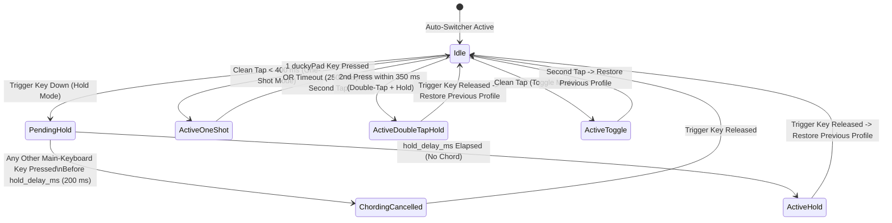

# ⌨️ Main-Keyboard Modifier Layer Shift — Guide & Technical Reference

> **Summary:** **Main-Keyboard Modifier Layer Shift** lets you hold, tap, double-tap, or toggle a modifier or dedicated key on your main PC keyboard (such as `Right Ctrl`, `Menu / App`, `Right Alt / AltGr`, `Caps Lock`, `Scroll Lock`, `Pause`, or `F13–F24`) to temporarily shift your duckyPad (`duckyPad Pro` or `duckyPad 2020`) to a global desktop/utility profile and automatically restore the active window's profile upon release or completion.

---

## 1. Overview & Why Use Modifier Layer Shift?

When using the **Window Auto-Switcher**, your duckyPad automatically switches to the profile matching your focused application (e.g., *VS Code*, *Zen Browser*, *FreeCAD*, *Blender*, or *OBS Studio*). However, you often want instant access to a global **Default**, **Desktop Controls**, **Media**, or **Home Assistant** profile without leaving your current window or manually pressing the physical `+` / `-` buttons on the keypad.

With **Main-Keyboard Modifier Layer Shift**:
- Hold **`Right Ctrl`** (or **`Menu / App`**) on your main keyboard → your duckyPad shifts to your **Default / Desktop Controls** profile.
- Press any key on your duckyPad → release **`Right Ctrl`** → your duckyPad automatically returns to your focused application's profile.
- Normal keyboard shortcuts (like `Ctrl+C` or `Ctrl+V`) never flicker the duckyPad thanks to the built-in **200 ms Chord Guard**.

---

## 2. Activation Modes (`Hold` / `One-Shot` / `Double-Tap + Hold` / `Toggle`)

Each Modifier Layer Shift rule supports four distinct activation modes configurable in **Auto-Switcher → Rules → ⌨️ Main-Keyboard Modifier Layer Shift**:

| Mode | JSON ID | Behavior | Best Trigger Keys |
| :--- | :--- | :--- | :--- |
| **Hold (Momentary Layer)** | `hold` | Shifts to the target profile after holding the key for `hold_delay_ms` (default `200 ms`) with no other keyboard key pressed; automatically restores the previous profile as soon as the key is released. | `Right Ctrl`, `Right Alt`, `Menu / App`, `Right Shift` |
| **One-Shot (Sticky 1 Key)** | `one_shot` | Tap and release the trigger key cleanly (under `400 ms`, no chord pressed) to shift to the target profile for **one duckyPad key press** or until `oneshot_timeout_ms` (default `2500 ms`) expires, or tap the trigger key a second time to cancel early. | `Menu / App`, `Scroll Lock`, `Pause`, `F13–F24` |
| **Double-Tap + Hold** | `double_tap_hold` | Tap the trigger key once and press-and-hold it a second time within `350 ms` to shift to the target profile; restores the previous profile when released. Completely eliminates accidental activation on heavily used modifiers. | `Left Ctrl`, `Left Shift`, `Left Alt`, `Super / Win` |
| **Toggle (Press to Lock / Unlock)** | `toggle` | Tap the trigger key once to lock the duckyPad onto the target profile; tap the same key again to unlock and return to the active window's profile. | `Pause`, `Scroll Lock`, `Caps Lock`, `F13–F24` |



---

## 3. Supported Trigger Keys & Combinations

| Trigger Key / Combo | Key Identifier (`trigger_key`) | Linux `evdev` / USB HID Mapping | Windows Win32 Virtual-Key | Notes |
| :--- | :--- | :--- | :--- | :--- |
| **Menu / Application Key** | `Menu` | `KEY_COMPOSE` (`127`) / HID `0x65` | `VK_APPS` (`0x5D`) | **Recommended**: Dedicated key rarely used in chords |
| **Right Ctrl** | `RightCtrl` | `KEY_RIGHTCTRL` (`97`) / HID Mod Bit `4` (`0xE4`) | `VK_RCONTROL` (`0xA3`) | **Recommended**: Ideal right-hand momentary layer key |
| **Right Alt (AltGr)** | `RightAlt` | `KEY_RIGHTALT` (`100`) / HID Mod Bit `6` (`0xE6`) | `VK_RMENU` (`0xA5`) | Convenient thumb modifier |
| **Right Shift** | `RightShift` | `KEY_RIGHTSHIFT` (`54`) / HID Mod Bit `5` (`0xE5`) | `VK_RSHIFT` (`0xA1`) | Pair with `200 ms` Chord Guard |
| **Left Ctrl** | `LeftCtrl` | `KEY_LEFTCTRL` (`29`) / HID Mod Bit `0` (`0xE0`) | `VK_LCONTROL` (`0xA2`) | Best with `Double-Tap + Hold` or `200 ms` Chord Guard |
| **Left Alt** | `LeftAlt` | `KEY_LEFTALT` (`56`) / HID Mod Bit `2` (`0xE2`) | `VK_LMENU` (`0xA4`) | Best with `Double-Tap + Hold` or `200 ms` Chord Guard |
| **Left Shift** | `LeftShift` | `KEY_LEFTSHIFT` (`42`) / HID Mod Bit `1` (`0xE1`) | `VK_LSHIFT` (`0xA0`) | Best with `Double-Tap + Hold` or `200 ms` Chord Guard |
| **Super / Windows / Meta** | `Super` | `KEY_LEFTMETA` (`125`), `KEY_RIGHTMETA` (`126`) | `VK_LWIN` (`0x5B`), `VK_RWIN` (`0x5C`) | Left or Right Super/Windows key |
| **Ctrl + Alt (Chord)** | `CtrlAlt` | `(Left/Right Ctrl) + (Left/Right Alt)` | `VK_CONTROL + VK_MENU` | Dual-modifier chord |
| **Ctrl + Super (Chord)** | `CtrlSuper` | `(Left/Right Ctrl) + (Left/Right Meta)` | `VK_CONTROL + (VK_LWIN\|VK_RWIN)` | Dual-modifier chord |
| **Caps Lock** | `CapsLock` | `KEY_CAPSLOCK` (`58`) / HID `0x39` | `VK_CAPITAL` (`0x14`) | Lock key |
| **Scroll Lock** | `ScrollLock` | `KEY_SCROLLLOCK` (`70`) / HID `0x47` | `VK_SCROLL` (`0x91`) | Dedicated lock key |
| **Pause / Break** | `Pause` | `KEY_PAUSE` (`119`) / HID `0x48` | `VK_PAUSE` (`0x13`) | Dedicated top-row key |
| **Fn / WakeUp Key** | `Fn` | `KEY_FN` (`0x1D0` / `464`), `KEY_WAKEUP` (`143`) | `0xFF` OEM Fn | Requires hardware/kernel keycode emission (see note below) |
| **F13 – F24** | `F13` .. `F24` | `KEY_F13` (`183`) .. `KEY_F24` (`194`) / HID `0x68..0x73` | `VK_F13` (`0x7C`) .. `VK_F24` (`0x87`) | Macro / QMK / VIA / programmable keyboard keys |

> **⚠️ Hardware Note on Keyboard `Fn` Keys:**
> On most external USB/wireless mechanical keyboards (QMK/VIA, Keychron, Logitech, Razer, Corsair, etc.), the physical **`Fn`** key is evaluated **internally inside the keyboard's own microcontroller** to switch onboard layers (`Fn + F1..F12` → media keys) and **never transmits a USB HID packet to the host PC** when pressed by itself. Only laptops with ACPI/EC `KEY_FN` reporting or Apple keyboards emit an OS-visible `Fn` keycode. For external USB keyboards, use **`Right Ctrl`**, **`Menu / App`**, **`Right Alt`**, or remap your keyboard's `Fn` key in VIA/QMK to **`F13`–`F24`** or **`Menu`**.

---

## 4. Intelligent Chord Guard & Anti-Loop Filtering

### 4.1 200 ms Chord Guard (`hold_delay_ms`)
If you bind a common modifier such as `Right Ctrl` or `Left Ctrl` in **Hold** mode, pressing `Ctrl+C` or `Ctrl+Tab` should never cause your duckyPad to flicker Profiles:
1. When the trigger key is pressed down, DuckyDeck Studio enters `PendingHold` and waits for `hold_delay_ms` (default **`200 ms`**, configurable from `0 ms` to `1000 ms`).
2. If **any other key** on your main keyboard is pressed before `hold_delay_ms` elapses, the state machine immediately transitions to `ChordingCancelled` and does **not** switch profiles for the remainder of that key hold.
3. Once `hold_delay_ms` elapses with no other key pressed, the duckyPad switches to your target layer profile.

### 4.2 Non-duckyPad Input Device Filtering
To prevent macro feedback loops (where a duckyPad macro holding or typing `Ctrl`, `Alt`, `Shift`, or `F13–F24` would accidentally trigger or cancel a Modifier Layer Shift), DuckyDeck Studio's input listener automatically excludes all duckyPad USB Vendor/Product IDs (`0483:D11D` duckyPad Pro and `0483:D11C` duckyPad 2020) when scanning `/dev/hidraw*` and `/dev/input/event*`.

---

## 5. Cross-Platform Zero-Config Input Architecture

Wayland compositors isolate raw keyboard events from background windows for security, and `/dev/input/event*` (`evdev`) on many Linux distributions is restricted to `root:input` (`0660`) unless the user is manually added to the `input` group.

DuckyDeck Studio solves this with a **dual-path zero-config input architecture**:

| Platform | Primary Listener | Secondary / Fallback Listener | Permissions Required |
| :--- | :--- | :--- | :--- |
| **Linux (KDE Plasma 6 Wayland / X11)** | **USB HID `/dev/hidraw*` Parser** (`src/actions/app_launch.rs`): Automatically discovers all attached non-duckyPad USB keyboards containing a Standard Keyboard Collection (`Usage Page 0x01`, `Usage 0x06`) in `/sys/class/hidraw/*/device/report_descriptor` and parses both standard 8-byte Boot Keyboard reports (`[mods, reserved, k0..k5]`), Report-ID-prefixed reports, and NKRO bitfield reports at `15 ms` intervals. | **Linux `evdev` `/dev/input/event*` Reader**: Reads raw `input_event` structs (`EV_KEY`, `24 bytes`) whenever `/dev/input/event*` nodes are readable (e.g., when the user is in the `input` group). | **Zero setup required** on modern systemd/udev Linux desktops (`systemd-logind` automatically grants the active local desktop session `uaccess` ACL read access to keyboard `/dev/hidraw*` nodes). |
| **Windows 10 & 11 (`x86_64`)** | **Win32 `GetAsyncKeyState` Poller** (`src/actions/app_launch.rs`): Polls `GetAsyncKeyState` across all modifier and extended virtual-key codes (`VK_APPS`, `VK_RCONTROL`, `VK_RMENU`, `VK_RSHIFT`, `VK_LCONTROL`, `VK_LMENU`, `VK_LSHIFT`, `VK_LWIN`, `VK_RWIN`, `VK_CAPITAL`, `VK_SCROLL`, `VK_PAUSE`, `VK_F13..VK_F24`) every `20 ms`. | — | **Zero setup required** (standard user session). |

---

## 6. Desktop OLED Widget & UI Integration

- **Desktop OLED Widget Violet Layer Banner**: While a Modifier Layer Shift is active (`Hold`, `One-Shot`, `Double-Tap + Hold`, or `Toggle`), the floating Desktop OLED Widget highlights its border and status bar in violet and displays the active layer status (e.g., `⌨️ LAYER [HOLD Right Ctrl] → P1: Default`).
- **One-Shot Key Press Auto-Return**: When a `One-Shot` layer is active and you press a key on the physical duckyPad (or click a key on the Desktop OLED Widget), DuckyDeck Studio detects the key execution (`notify_duckypad_key_activity`) and automatically returns to your previous application profile after `180 ms`.
- **Single-Scrollbar Auto-Switcher Rules Window**: In **Auto-Switcher → Rules**, both the **Configured Window Rules** section and the **Main-Keyboard Modifier Layer Shift** section expand cleanly inside a single outer scrollable view, and double-clicking any rule automatically scrolls to and focuses the Edit Rule editor.

---

## 7. Configuration Schema (`kwin_rules.json` / `duckydeck_rules.json`)

Modifier Layer Shift rules are persisted alongside your Window Auto-Switcher rules in `~/.config/duckydeck-studio/kwin_rules.json` (Linux), `%APPDATA%\duckydeck-studio\kwin_rules.json` (Windows), and synced portably to `duckydeck_rules.json` on the duckyPad microSD card:

```json
{
  "enabled": true,
  "fallback_profile": 1,
  "modifier_layer_rules": [
    {
      "id": "mod_rule_1",
      "enabled": true,
      "trigger_key": "RightCtrl",
      "mode": "hold",
      "target_profile": 1,
      "hold_delay_ms": 200,
      "oneshot_timeout_ms": 2500
    }
  ]
}
```
